```{css, echo=FALSE} 
@media print { # print out incremental slides; see https://stackoverflow.com/questions/56373198/get-xaringan-incremental-animations-to-print-to-pdf/56374619#56374619
  .has-continuation {
    display: block !important;
  }
}
```

```{r setup, include=FALSE}
# figures formatting setup
options(htmltools.dir.version = FALSE)
library(knitr)
opts_chunk$set(
  prompt = T,
  fig.align="center", #fig.width=6, fig.height=4.5, 
  # out.width="748px", #out.length="520.75px",
  dpi=300, #fig.path='Figs/',
  cache=T, #echo=F, warning=F, message=F
  engine.opts = list(bash = "-l")
  )

## Next hook based on this SO answer: https://stackoverflow.com/a/39025054
knit_hooks$set(
  prompt = function(before, options, envir) {
    options(
      prompt = if (options$engine %in% c('sh','bash')) '$ ' else 'R> ',
      continue = if (options$engine %in% c('sh','bash')) '$ ' else '+ '
      )
})

library(tidyverse)
library(hrbrthemes)
library(fontawesome)
```


# Überblick

</br></br>

1. [Willkommen!](#welcome)

2. [Was ist Data Science?](#whatisdatascience)

3. [Was kann Data Science in der Verwaltung – und was nicht?](#science)

4. [Ziele für dieses Modul](#goals)


---
class: inverse, center, middle
name: welcome

# Herzlich Willkommen!
<html><div style='float:left'></div><hr color='#EB811B' size=1px style="width:1000px; margin:auto;"/></html>


---
# Vorstellungsrunde


.pull-left-vwide[
### Über mich

`r fa('address-book')` Ich bin [Simon Munzert](https://simonmunzert.github.io/) [si’mən munsɜrt], oder Simon [saɪmən].

`r fa('envelope')` [munzert@hertie-school.org](mailto:munzert@hertie-school.org)

`r fa('graduation-cap')` Professor für Data Science und Public Policy | Director, Data Science Lab
]

.pull-right-vsmall[
<div align="center">
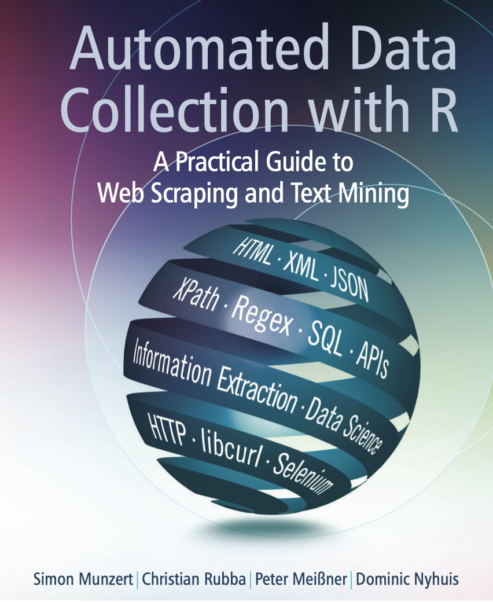
</div>
]

<br><br><br><br><br><br><br><br><br>

<div align="center">

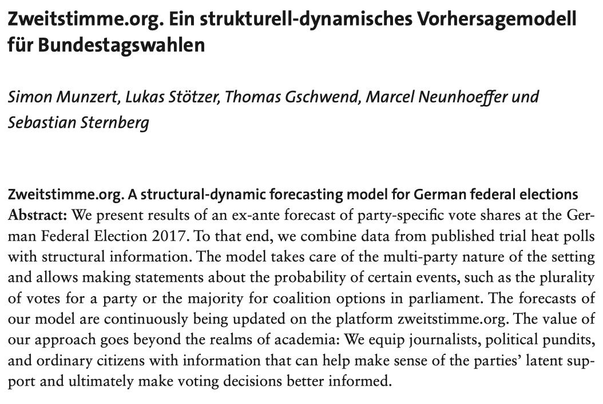
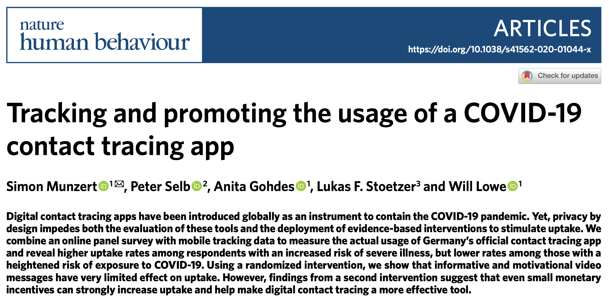
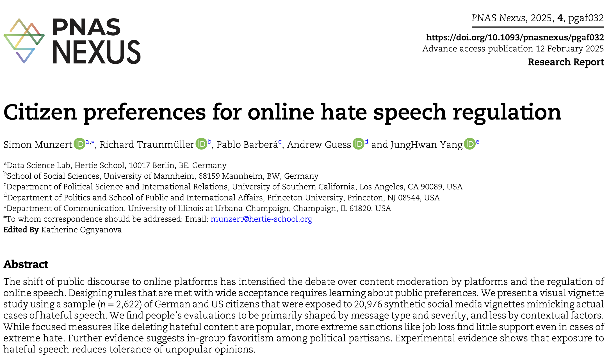
</div>


---
# Vorstellungsrunde


.pull-left[
### Über Euch

`r fa('address-book')` Euer Name

`r fa('envelope')` Eure Behörde und Rolle - maximal 3 Sätze!
]

.pull-right[
<br><br>
<div align="center">
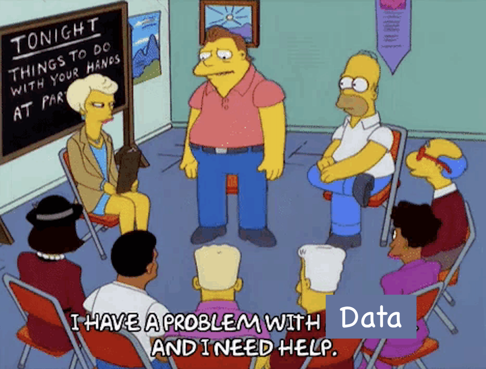
</div>
]


---
# Onboarding-Befragung

<div align="center">
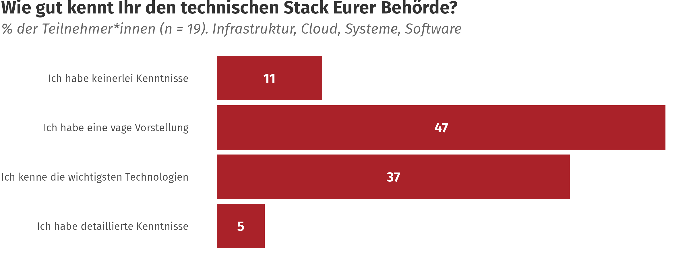
</div>

---
# Onboarding-Befragung

<div align="center">
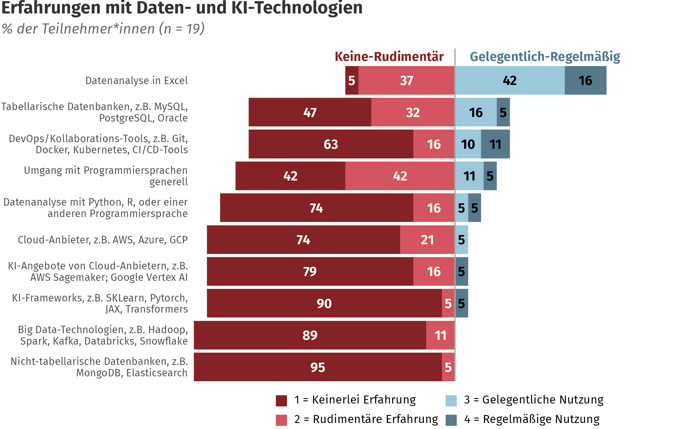
</div>

---
# Onboarding-Befragung

<div align="center">
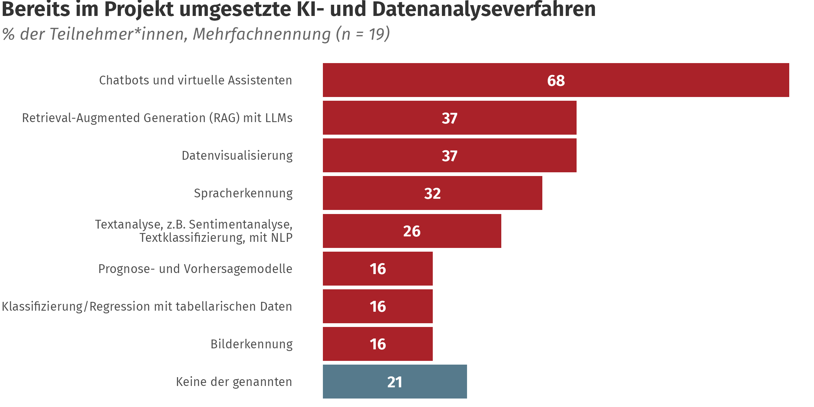
</div>

---
# Onboarding-Befragung

<div align="center">
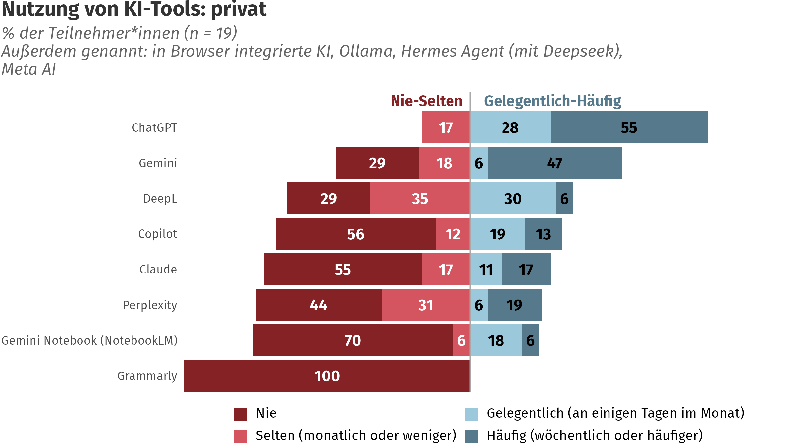
</div>

---
# Onboarding-Befragung

<div align="center">
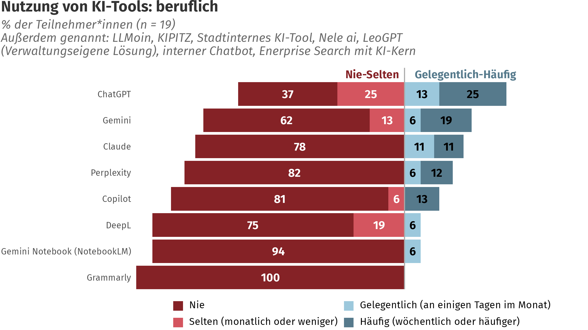
</div>

---
# Onboarding-Befragung

<div align="center">
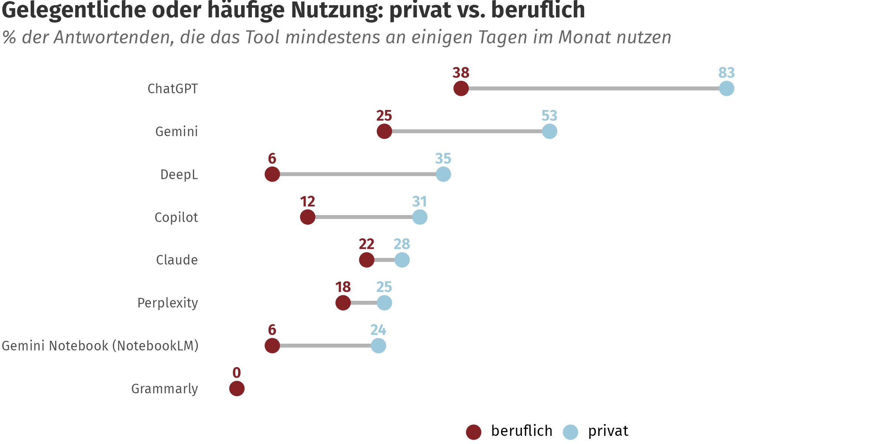
</div>

---
# Onboarding-Befragung

<div align="center">
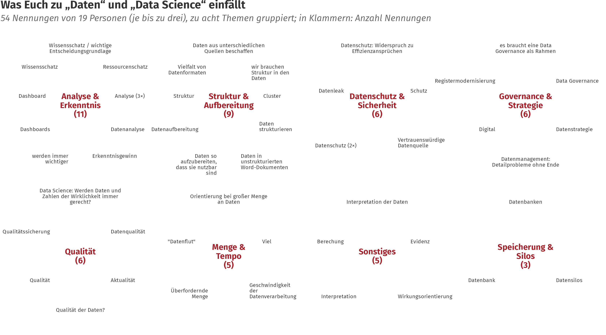
</div>


---
# Onboarding-Befragung

<div align="center">
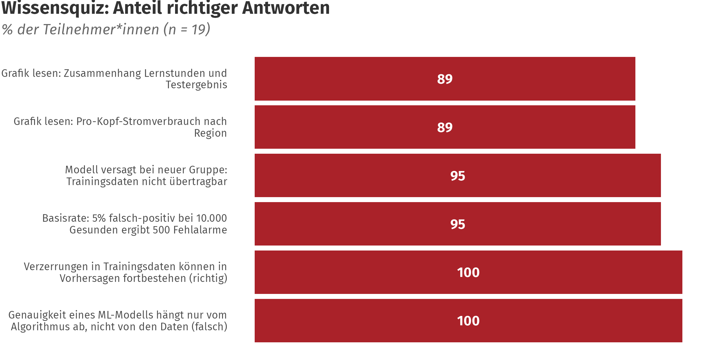
</div>


---
# Workshop-Etikette

.pull-left-wide[
<br>

- Wir haben viele Themen vor uns. Ich habe Material vorbereitet, aber entscheidend ist: **Signalisiert Eure Interessen und Bedarfe** – ich vertiefe gerne, schwenke um oder greife andere Beispiele auf, soweit möglich.  

- Ich bin kein Experte für Eure Behörde oder Eure spezifischen Themen. **Bringt Euer Fachwissen und Eure Erfahrung ein.** Sie bilden die Grundlage für eine fundierte, evidenzbasierte Diskussion über Data Science im öffentlichen Sektor.  

- Bitte nutzt die Gelegenheit, **jederzeit Fragen zu stellen**. Es gibt keine schlechten Fragen – jede trägt zur gemeinsamen Diskussion bei.  

]

.pull-right-small-center[
<div align="center">
<br><br>
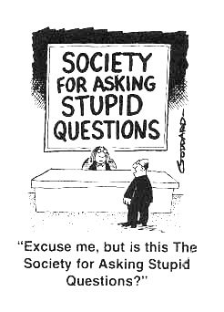
</div>
]


---
# Kursmaterialien

.pull-left[
Alle Materialien dieses Moduls stehen offen im Netz, unabhängig von Moodle:

## [simonmunzert.com/zertifikat-daten](https://simonmunzert.com/zertifikat-daten/)

- **Folien** aller Sessions, als HTML und PDF
- **Code, Daten und Fallstudien** der beiden Praxis-Sessions
- **Literatur, Podcasts und Links** zu jeder Session

Die Seite bleibt bestehen. Ihr könnt also auch dann noch darauf zugreifen, wenn Ihr nach dem Zertifikat keinen Moodle-Zugang mehr habt.
]

.pull-right[
<div align="center">
<br><br>
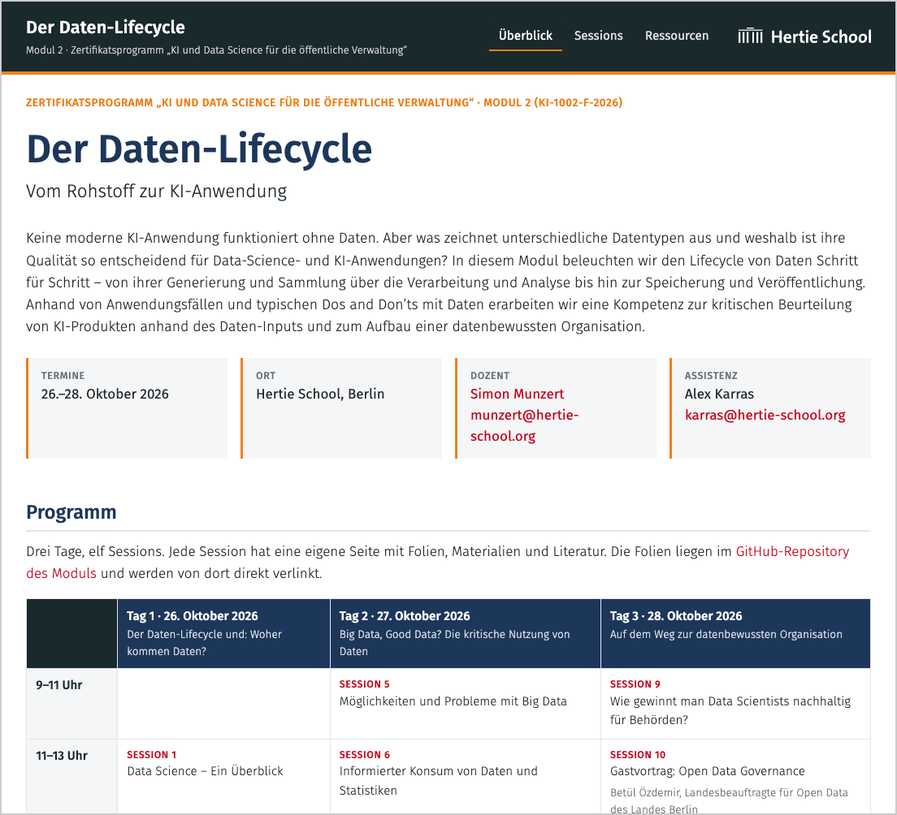
</div>
]

---
class: exercise, center, middle

# Diskussion

.content-box-white[
**Was möchtet Ihr über Daten und Data Science lernen?**

**Was sind Eure Erwartungen an dieses Modul?**

**Excalidraw - **[excalidraw.com](https://excalidraw.com/)
]


---
class: inverse, center, middle
name: whatisdatascience

# Was ist Data Science?
<html><div style='float:left'></div><hr color='#EB811B' size=1px style="width:1000px; margin:auto;"/></html>

---
# Was ist Data Science?

.pull-left-wide2[
## Was ist Data Science?

> "Der interdisziplinäre Forschungszweig Data Science befasst sich mit dem Management und der Analyse von Daten." - [Daniel Keim, Kai-Uwe Sattler](https://www.plattform-lernende-systeme.de/files/Downloads/Publikationen/AG1_Whitepaper_Von_Daten_zu_KI.pdf)

> "Data Science ist ein interdisziplinäres Wissenschaftsfeld, welches wissenschaftlich fundierte Methoden, Prozesse, Algorithmen und Systeme zur Extraktion von Erkenntnissen, Mustern und Schlüssen sowohl aus strukturierten als auch unstrukturierten Daten ermöglicht." - [Wikipedia](https://de.wikipedia.org/wiki/Data_Science)

> "Data Science ist ein Konzept, das Statistik, Datenanalyse, Informatik und die damit verbundenen Methoden vereint, um aktuelle Phänomene anhand von Daten zu verstehen und zu analysieren." - [Chikio Hayashi](https://www.springer.com/book/9784431702085)

️✎ **Zwischen Disziplinen** angesiedelt, anwendungsorientiert
]


.pull-right-small2[
## Eine visuelle Definition

<div align="center"><br>
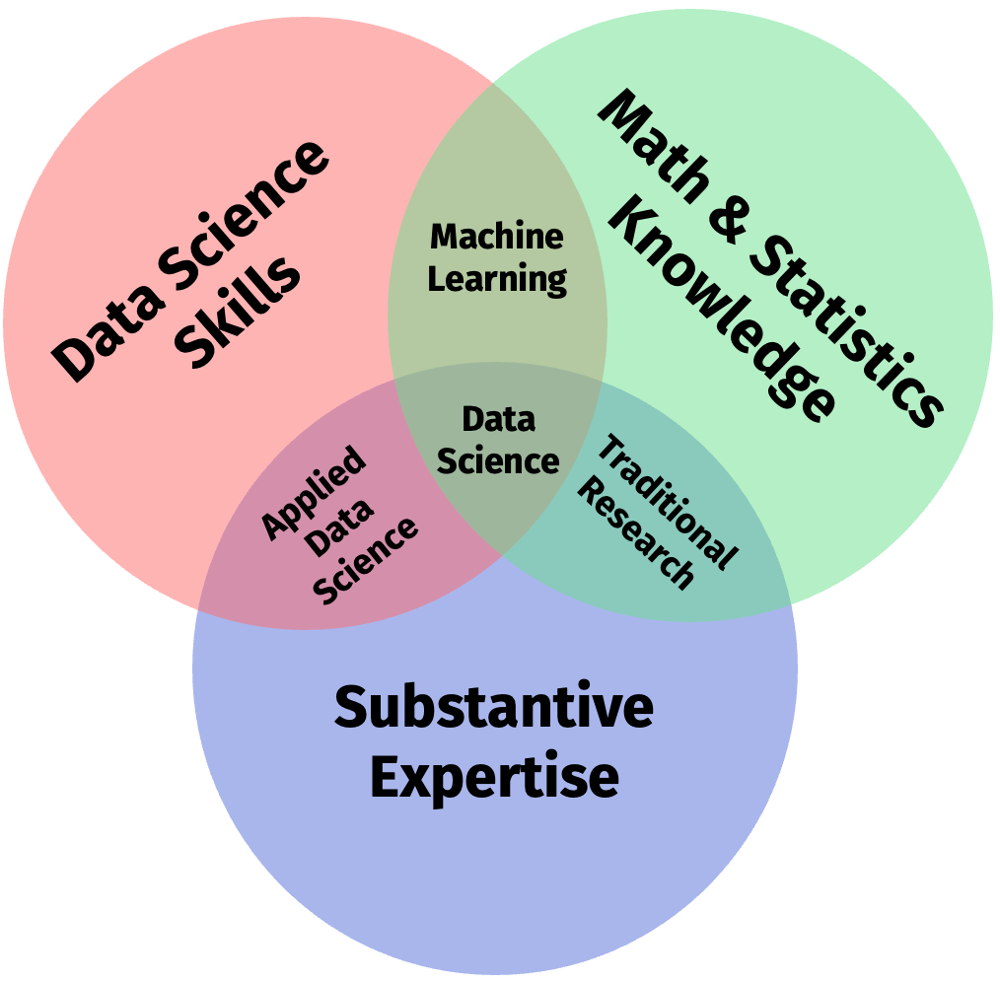
</div>

`Quelle` [Drew Conway, 2010](https://drewconway.com/zia/2013/3/26/the-data-science-venn-diagram) (angepasst)
]


---
# Die Data-Science-Pipeline

.pull-left[

**Vorbereitung**

- **Problemstellung** Vorhersage, Inferenz, Beschreibung
- **Design** Konzept erstellen, Datenerfassung aufsetzen
- **Datenerhebung** rekrutieren, sammeln, überwachen
]

---
# Die Data-Science-Pipeline

.pull-left[
**Vorbereitung**

- **Problemstellung** Vorhersage, Inferenz, Beschreibung
- **Design** Konzept erstellen, Datenerfassung aufsetzen
- **Datenerhebung** rekrutieren, sammeln, überwachen

**Datenverarbeitung**
]

.pull-right-center[
<br><br><br>
<div align="center">

</div>

`Quelle` [H. Wickham, M. Çetinkaya-Rundel, G. Gronemund: R for Data Science](https://r4ds.hadley.nz/)
]

---
# Die Data-Science-Pipeline

.pull-left[
**Vorbereitung**

- **Problemstellung** Vorhersage, Inferenz, Beschreibung
- **Design** Konzept erstellen, Datenerfassung aufsetzen
- **Datenerhebung** rekrutieren, sammeln, überwachen

**Datenverarbeitung**

   - **Aufbereiten**: importieren, bereinigen, anreichern
]

.pull-right-center[
<br><br><br>
<div align="center">

</div>

`Quelle` [H. Wickham, M. Çetinkaya-Rundel, G. Gronemund: R for Data Science](https://r4ds.hadley.nz/)
]


---
# Die Data-Science-Pipeline

.pull-left[
**Vorbereitung**

- **Problemstellung** Vorhersage, Inferenz, Beschreibung
- **Design** Konzept erstellen, Datenerfassung aufsetzen
- **Datenerhebung** rekrutieren, sammeln, überwachen

**Datenverarbeitung**

   - **Aufbereiten**: importieren, bereinigen, anreichern
   - **Explorieren**: visualisieren, beschreiben, entdecken
]

.pull-right-center[
<br><br><br>
<div align="center">
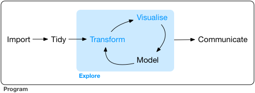
</div>

`Quelle` [H. Wickham, M. Çetinkaya-Rundel, G. Gronemund: R for Data Science](https://r4ds.hadley.nz/)
]


---
# Die Data-Science-Pipeline

.pull-left[
**Vorbereitung**

- **Problemstellung** Vorhersage, Inferenz, Beschreibung
- **Design** Konzept erstellen, Datenerfassung aufsetzen
- **Datenerhebung** rekrutieren, sammeln, überwachen

**Datenverarbeitung**

   - **Aufbereiten**: importieren, bereinigen, anreichern
   - **Explorieren**: visualisieren, beschreiben, entdecken
   - **Modellieren**: testen, inferieren, vorhersagen
]

.pull-right-center[
<br><br><br>
<div align="center">
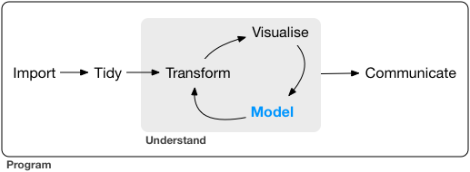
</div>

`Quelle` [H. Wickham, M. Çetinkaya-Rundel, G. Gronemund: R for Data Science](https://r4ds.hadley.nz/)
]


---
# Die Data-Science-Pipeline

.pull-left[
**Vorbereitung**

- **Problemstellung** Vorhersage, Inferenz, Beschreibung
- **Design** Konzept erstellen, Datenerfassung aufsetzen
- **Datenerhebung** rekrutieren, sammeln, überwachen

**Datenverarbeitung**

   - **Aufbereiten**: importieren, bereinigen, anreichern
   - **Explorieren**: visualisieren, beschreiben, entdecken
   - **Modellieren**: testen, inferieren, vorhersagen

**Verbreitung**

  - **Kommunikation**: Öffentlichkeit, Entscheidungsträger
  - **Veröffentlichen**: Zeitschriften, Software, Berichte
  - **Produktivieren**: nutzbar, robust, skalierbar machen
]

.pull-right-center[
<br><br><br>
<div align="center">

</div>

`Quelle` [H. Wickham, M. Çetinkaya-Rundel, G. Gronemund: R for Data Science](https://r4ds.hadley.nz/)
]


---
# Die Data-Science-Pipeline

.pull-left[
**Vorbereitung**

- **Problemstellung** Vorhersage, Inferenz, Beschreibung
- **Design** Konzept erstellen, Datenerfassung aufsetzen
- **Datenerhebung** rekrutieren, sammeln, überwachen

**Datenverarbeitung**

   - **Aufbereiten**: importieren, bereinigen, anreichern
   - **Explorieren**: visualisieren, beschreiben, entdecken
   - **Modellieren**: testen, inferieren, vorhersagen

**Verbreitung**

  - **Kommunikation**: Öffentlichkeit, Entscheidungsträger
  - **Veröffentlichen**: Zeitschriften, Software, Berichte
  - **Produktivieren**: nutzbar, robust, skalierbar machen

**Meta-Fähigkeit: Programmierung**
]

.pull-right-center[
<br><br><br>
<div align="center">
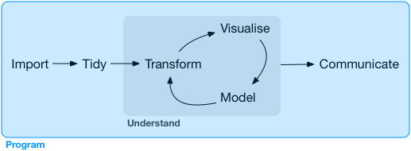
</div>

`Quelle` [H. Wickham, M. Çetinkaya-Rundel, G. Gronemund: R for Data Science](https://r4ds.hadley.nz/)
]


---
# Was Data Science mit KI zu tun hat

<br>

<div align="center">
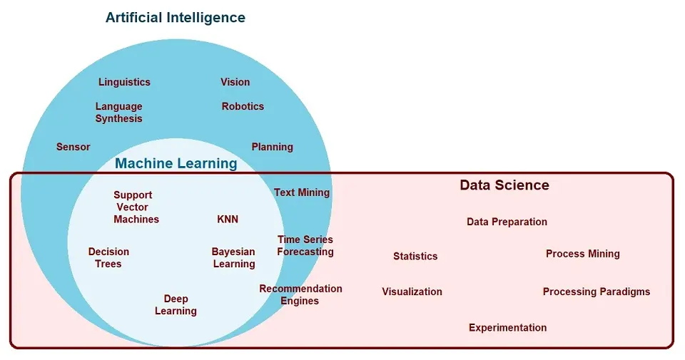
<a href="https://www.ejable.com/tech-corner/ai-machine-learning-and-deep-learning/data-science-artificial-intelligence-and-machine-learning/">Ekta Shah, EJable</a>
</div>


---
# Keine KI ohne Daten

.pull-left[
## Der Engpass sind die Daten, nicht die Modelle

- Modelle gibt es inzwischen von der Stange: Sprachmodelle, Klassifikatoren, Prognoseverfahren.
- Was es nicht von der Stange gibt: **die Daten Eures Hauses**. Ob eine Anwendung funktioniert, entscheidet sich an Verfügbarkeit, Qualität und Rechtsgrundlage der Daten.
- **80/20-Faustregel aus der Praxis**: Der Großteil der Arbeit in Data-Science-Projekten entfällt auf Beschaffen, Bereinigen und Strukturieren von Daten, nicht das Modellieren.
]

.pull-right[
## Die Verwaltung sitzt auf einem Datenschatz

- Register, Fachverfahren, Akten, Statistiken: Daten entstehen überall, meist als **Nebenprodukt** von Verwaltungshandeln.
- Häufig fragmentiert, nicht maschinenlesbar, ohne Metadaten, in Silos. Die [Datenstrategie der Bundesregierung (2023)](https://www.bundesregierung.de/breg-de/themen/digitalisierung/datenstrategie-2023-2222572) nennt das als zentrale Hürde.
]


---
# Was das für Euch bedeutet

.pull-left-wide2[
## Typische Entscheidungen, die Datenkompetenz brauchen

- **Beschaffung**: Ein Anbieter verspricht 95% Genauigkeit. Mit welchen Daten wurde das gemessen – und mit welchen wird es bei uns laufen?
- **Vorlagen und Berichte**: Ist die Statistik auf Seite 3 belastbar? Was sagt das Dashboard wirklich?
- **Prüfung und Aufsicht**: Woran erkennt man ein problematisches Datenprodukt, bevor es Schaden anrichtet?
- **Freigabe und Austausch**: Welche Daten dürfen und sollten wir wie öffnen, teilen, verknüpfen, speichern?
- **Organisation**: Was braucht eine Daten-Einheit, damit sie nach dem Pilot nicht einschläft?

️✎ Datenkompetenz ist Führungskompetenz! Wer die Datenbasis beurteilen kann, kann KI-Systeme besser verantworten.
]

.pull-right-small2[
<br>
<div align="center">

</div>
]


---
class: inverse, center, middle
name: science

# Was kann Data Science in der Verwaltung – und was nicht?

<html><div style='float:left'></div><hr color='#EB811B' size=1px style="width:1000px; margin:auto;"/></html>


---
# Data Science in der Forschung - mehr als KI

.pull-left-small2[
## 1. Beschreibung
- Wie ist der Zustand der Welt?
- Wie entwickeln sich Trends?
- Wie gestalten sich Gruppenunterschiede?

## Der Wert für die Politikgestaltung
- Im Zentrum des **Monitorings**
- „Wie viele Menschen konsumieren Fehlinformationen im Internet?“
- „Wie entwickelt sich die Arbeitslosigkeit in Bezirken?“
- „Wie viele Radunfälle gab es pro Straßenabschnitt?“
]

--

.pull-left-small2[
## 2. Erklärung
- Welche Wirkung hat eine Maßnahme?
- Ist sie über Gruppen heterogen?
- Was sind Wirkungsmechanismen?

## Der Wert für die Politikgestaltung
- Im Mittelpunkt der **Evaluation**
- „Hat die Digitalisierungsmaßnahme zu Zeitersparnis geführt?“
- „Bei wem wirkte die Anti-Fake-News-Kampagne?“
- „Warum hat die Intervention nicht zu den erwarteten Ergebnissen geführt?“
]

--

.pull-left-small2[
## 3. Vorhersage
- Wie wird Person X sich verhalten?
- (Wann) wird Ereignis X eintreten?
- Zu welchem Typ gehört eine Beobachtung?


## Der Wert für die Politikgestaltung
- Steht im Mittelpunkt der **Vorhersage**, aber auch der **Zielsetzung** und **Messung**.
- „Wird die Person rückfällig werden?“
- „Enthält dieser Post Hate Speech?“
- „Wie stark wird die Wasserverschmutzung an einem bestimmten Tag sein?“
]


---
# Fall 1: Preisstatistik per Web Scraping

.pull-left[
<div align="center">
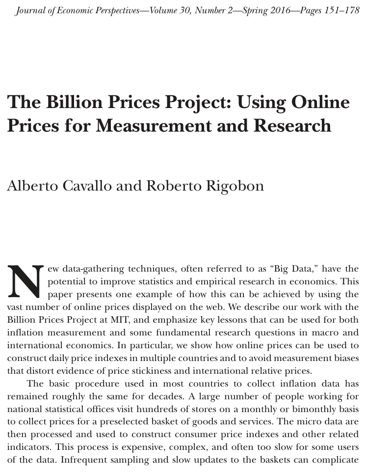
</div>
]

.pull-right[
<div align="center">
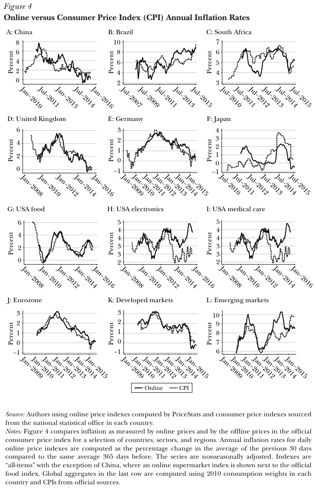
</div>
]

<br>
**Das Billion-Prices-Projekt (MIT):** [https://thebillionpricesproject.com/](https://thebillionpricesproject.com/) 


---
# Fall 1: Preisstatistik per Web Scraping

.pull-left[
.font90[
## Der Fall

- Den **Verbraucherpreisindex** erstellt das [Statistische Bundesamt (Destatis)](https://www.destatis.de/DE/Themen/Wirtschaft/Preise/Verbraucherpreisindex/_inhalt.html) mit den Statistischen Landesämtern: Preiserheber notieren monatlich mehrere hunderttausend Preise in Geschäften.
- Grundlage sind [Preisstatistikgesetz](https://www.gesetze-im-internet.de/preisstatg/) und EU-HVPI-Verordnung. Destatis gehört zum Geschäftsbereich des Innenministeriums, ist fachlich aber unabhängig ([§ 1 BStatG](https://www.gesetze-im-internet.de/bstatg_1987/__1.html)).
- Online-Anteil im Warenkorb: 5% (Basisjahr 2005), über 10% (Basisjahr 2015); seit der Basis 2020 nicht mehr separat ausgewiesen. Rund **10.000 Produkte** wurden monatlich im Internet erhoben – lange von Hand.
- Seit 2018 automatisiert Destatis das mit einem **generischen Web-Scraping-Programm**, u.a. für Mietwagen, Medikamente, Fernbus- und Bahnreisen. Stand 2026: Web Scraping ergänzt „zunehmend die manuelle Erhebung“, dazu Transaktionsdaten für Pauschalreisen und Flüge ([Qualitätsbericht VPI, April 2026](https://www.destatis.de/DE/Methoden/Qualitaet/Qualitaetsberichte/Preise/verbraucherpreis.pdf?__blob=publicationFile)).
]
]
.pull-right[
<div align="center">
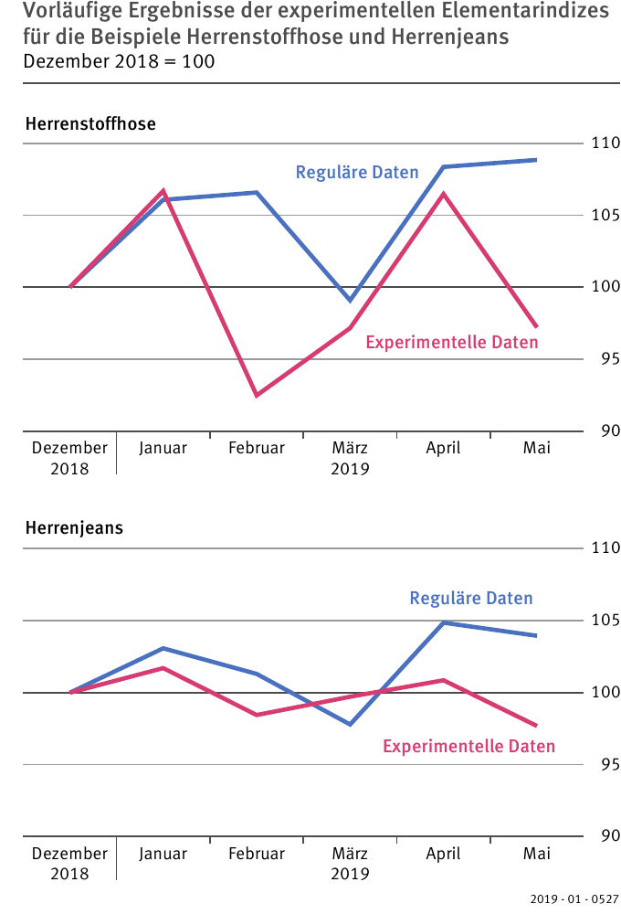
</div>
.font90[`Quelle` [Blaudow/Seeger (2019), WISTA 4/2019, Grafik 6](https://www.destatis.de/DE/Methoden/WISTA-Wirtschaft-und-Statistik/2019/04/fortschritte-einsatz-web-scraping-042019.pdf). Blau: reguläre Erhebung (ein Preis pro Monat), rot: stündliches Web Scraping.]
]


---
# Fall 1: Preisstatistik per Web Scraping

.pull-left[
.font90[
## Vorteile

- **Viel mehr Preise, viel häufiger**: statt einem Preis pro Produkt und Monat beliebig viele; Sonderangebote und Preisschwankungen werden sichtbar (siehe Grafik).
- Günstiger und schneller als Preiserheber im Laden; Krisenmonitoring wird möglich.

## Grenzen

- Online-Preise sind nicht immer gezahlte Preise. **Wer kauft wann wo?** Ohne Gewichtung ist der Index verzerrt.
- **Produktabgrenzung** bleibt Handarbeit: Ist die Hose von heute noch die von gestern?
- Websites ändern sich. **Wartung und Validierung** sind Dauerkosten.

️✎ **Wiederkehrende Fragen:** Woher kommen Daten (Sessions 2-3)? Wen repräsentieren sie (Session 5)?
]
]

.pull-right[
<div align="center">

</div>
.font90[`Quelle` [Blaudow/Seeger (2019), WISTA 4/2019, Grafik 6](https://www.destatis.de/DE/Methoden/WISTA-Wirtschaft-und-Statistik/2019/04/fortschritte-einsatz-web-scraping-042019.pdf). Blau: reguläre Erhebung (ein Preis pro Monat), rot: stündliches Web Scraping.]
]


---
# Fall 2: Flächenmonitoring in der EU-Agrarförderung

.pull-left[
.font90[
## Der Fall

- Agrarsubventionen sind an die **Nutzung von Flächen** gebunden. Jahrzehntelang wurde das per **Vor-Ort-Kontrolle** einer Stichprobe von rund 5% der Betriebe geprüft.
- Seit 2018 erprobt die EU **„Checks by Monitoring“**: Satellitenbilder der Copernicus-Satelliten Sentinel-1 (Radar, wetterunabhängig) und Sentinel-2 (optisch) liefern für **jede Parzelle** eine Zeitreihe über die Saison.
- Algorithmen erkennen darin **Marker** wie Mahd, Pflügen oder Bewuchs und gleichen sie mit den Angaben der Landwirte ab.
- Mit der GAP-Reform 2023–27 ist ein solches **Flächenmonitoringsystem** für alle Mitgliedstaaten verpflichtend ([DVO (EU) 2022/1173](https://eur-lex.europa.eu/eli/reg_impl/2022/1173/oj)).
]

.font90[`Literatur` [JRC: Checks by Monitoring](https://jrc-cbm.readthedocs.io/en/latest/dias4cbm_intro.html); [EU-Kommission: IACS und GAP 2023–27](https://agriculture.ec.europa.eu/common-agricultural-policy/financing-cap/assurance-and-audit/managing-payments_en)]
]

.pull-right[
<div align="center">
<br><br>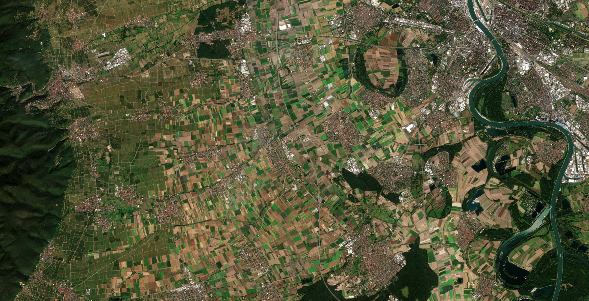
</div>
.font90[Sentinel-2-Aufnahme des BASF-Agrarversuchsgeländes bei Limburgerhof, 22.09.2016. `Quelle` [ESA](https://www.esa.int/ESA_Multimedia/Images/2017/02/BASF_agriculture_test_site), contains modified Copernicus Sentinel data (2016), CC BY-SA 3.0 IGO]
]


---
# Fall 2: Flächenmonitoring in der EU-Agrarförderung

.pull-left-wide2[
.font90[
## Vorteile

- **Vollerhebung statt Stichprobe**, kontinuierlich, ohne Betriebsbesuch.
- **Ampel statt Sanktion**: grün bestätigt, gelb unklar, rot widersprüchlich. Landwirte können nachbessern, bevor Strafen fällig werden.

## Grenzen

- Wolken, kleine Parzellen, ähnliche Kulturen: Der Klassifikator **irrt systematisch** in bestimmten Lagen.
- Ohne verlässliche **Ground Truth** (Vor-Ort-Daten zum Trainieren und Validieren) kein verlässliches Modell.
- Akzeptanz: Bei gelb oder rot gibt es einen **Fotoauftrag**: Landwirte müssen per Geofoto-App nachweisen, was das Modell nicht erkennt. Fast jedes Bundesland hat eine eigene App, die Mitwirkung ist meist Pflicht.

️✎ **Wiederkehrende Fragen:** Was ist eine Messung, und wann ist sie valide (Session 5)? Wie validiert man ein Modell (Session 7)?
]
.font80[`Quellen` [Merkblatt LEA-Foto-App (RLP)](https://www.dlr.rlp.de/Internet/global/themen.nsf/71d722c50f66ecc3c12581210042df58/e5498441f2addd6ac1258cff001b2c49/$FILE/Merkblatt_LEA-Foto-App_v03.pdf); Apps: [LaFIS-GEOFOTO (ST)](https://apps.apple.com/de/app/lafis-geofoto-sachsen-anhalt/id1609577830), [HeLawi (HE)](https://apps.apple.com/de/app/helawi/id6479610318), [MonaNRW](https://apps.apple.com/de/app/monanrw/id6469783699), [LEA-Foto (RLP)](https://apps.apple.com/de/app/lea-foto/id6450749607), [LaFIS-GEOFOTO (MV)](https://apps.apple.com/de/app/lafis-geofoto-m-v/id6503684258)]
]
]

.pull-right-small2[
<div align="center">
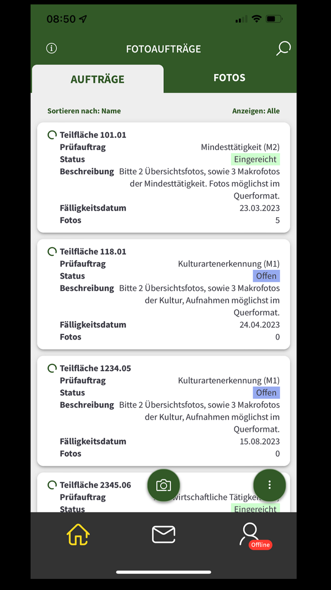
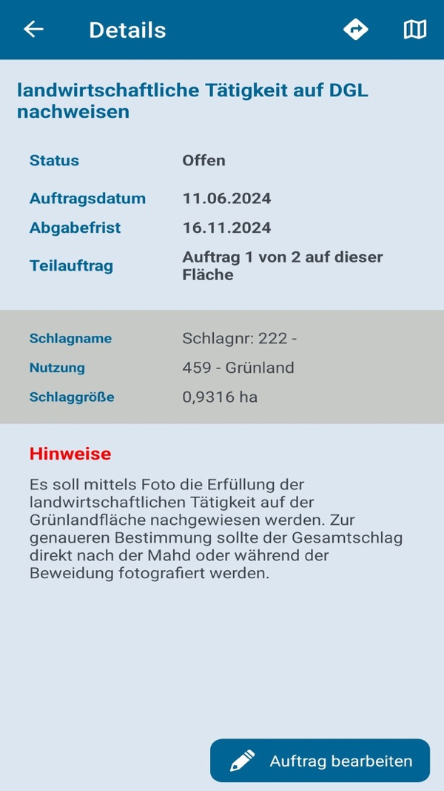
<br><br>


</div>
.font80[Fotoaufträge in LaFIS-GEOFOTO (Sachsen-Anhalt) und HeLawi (Hessen); darunter die Geofoto-Apps von ST, HE, NRW, RLP und MV. `Quelle` App Store]
]


---
# Fall 3: Risikoscoring

.pull-left-wide2[
.font90[
## Die Fälle

**Deutschland: Steuerverwaltung**

- Seit 2017 erlaubt **§ 88 Abs. 5 AO** den Finanzämtern **Risikomanagementsysteme**: Ein Algorithmus wählt aus, welche Steuererklärungen ein Mensch prüft; der Rest wird vollautomatisch veranlagt. Die Kriterien sind per Gesetz geheim.
- Bislang **regelbasiert** (ca. 3.000–4.000 Parameter, drei Risikoklassen); NRW testet seit 2025 KI-Unterstützung.

**Niederlande: Toeslagenaffaire**

- Die Steuerbehörde nutzte ein Risikomodell zur **Betrugsaufdeckung beim Kinderbetreuungszuschlag**. Ein Risikoindikator: **(doppelte) Staatsangehörigkeit**.
- 2013–2019 wurden rund **26.000 Eltern** als Betrüger eingestuft und mussten fünfstellige Beträge zurückzahlen – überwiegend zu Unrecht.
- Folgen: Rücktritt des Kabinetts Rutte III (Januar 2021), Bußgelder der Datenschutzbehörde (2,75 und 3,7 Mio. €), Entschädigungsprogramm. Schon 2020 hatte ein Gericht das verwandte System **SyRI** gestoppt.
]
]

.pull-right-small2[
<div align="center">
<br>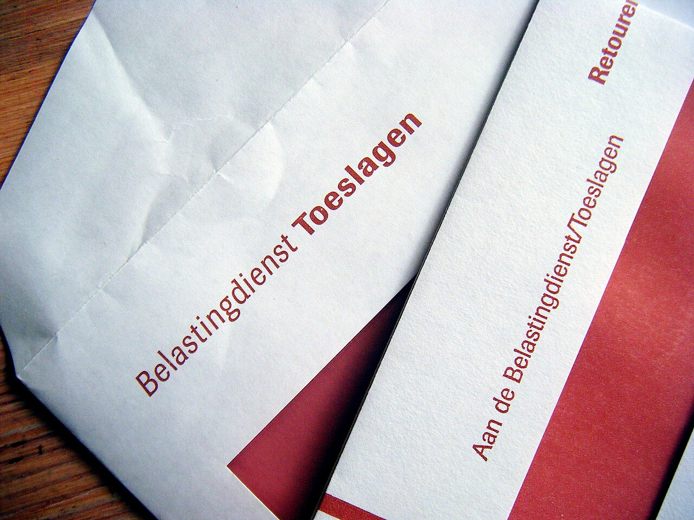
</div>
.font90[Briefe der Abteilung „Toeslagen“ der niederländischen Steuerbehörde. `Quelle` [mystic_mabel, Flickr via Wikimedia Commons](https://commons.wikimedia.org/wiki/File:Belastingdienst_Toeslagen_enveloppen.jpg), CC BY-SA 2.0]

.font90[`Zum deutschen Fall` [§ 88 AO](https://www.gesetze-im-internet.de/ao_1977/__88.html); [Steuertipps (2025)](https://www.steuertipps.de/finanzamt-formalitaeten/risikomanagement-und-ki-die-zukunft-der-steuerverwaltung); [Bundesrechnungshof (2025)](https://bundesrechnungshof.de/berichte/einsatz-von-risikomanagementsystemen-in-der-steuerverwaltung); [Berliner Senat (2024)](https://pardok.parlament-berlin.de/starweb/adis/citat/VT/19/SchrAnfr/S19-19967.pdf)]
]


---
# Fall 3: Risikoscoring

.pull-left-wide2[
.font90[
## Vorteile

- **Routine skalieren**: Millionen Fälle sortieren, Prüfkapazität auf auffällige Fälle lenken.
- Eingebaute Kontrolle: § 88 Abs. 5 AO verlangt eine **Zufallsauswahl** von Fällen für die vollständige Prüfung – so bleibt das System überprüfbar.

## Probleme

- **Verzerrte Merkmale neutralisieren**: Staatsangehörigkeit als Risikofaktor macht Diskriminierung zum Systemmerkmal.
- **Fehlerkosten abwägen**: Eine zusätzliche Prüfung kostet wenig, eine Rückforderung kann Existenzen ruinieren. 

️✎ **Wiederkehrende Fragen:** Falsch positiv, falsch negativ, Basisraten (Session 6). Datenstrategie und Governance (Session 9–10).
]

.font90[`Literatur` [§ 88 AO](https://www.gesetze-im-internet.de/ao_1977/__88.html); [Autoriteit Persoonsgegevens: Bußgeld gegen Belastingdienst (2021)](https://www.taxlive.nl/nl/documenten/nieuws/2-75-miljoen-euro-boete-voor-belastingdienst-om-toeslagenaffaire/)]
]

.pull-right-small2[
<div align="center">
<br><br>
</div>
.font90[Briefe der Abteilung „Toeslagen“ der niederländischen Steuerbehörde. `Quelle` [mystic_mabel, Flickr via Wikimedia Commons](https://commons.wikimedia.org/wiki/File:Belastingdienst_Toeslagen_enveloppen.jpg), CC BY-SA 2.0]

]


---
# Weitere nennenswerte Fälle

.pull-left[
.font90[
- **Predictive Policing**: PRECOBS in Bayern und Baden-Württemberg sagt Einbruchsrisiken für Gebiete vorher; die [Evaluation des Max-Planck-Instituts](https://doi.org/10.1007/s41125-018-0033-0) fand allenfalls moderate Effekte. Die automatisierte Datenanalyse mit Palantir-Software in Hessen und Hamburg erklärte das [Bundesverfassungsgericht](https://www.bundesverfassungsgericht.de/SharedDocs/Entscheidungen/DE/2023/02/rs20230216_1bvr154719.html) 2023 in Teilen für verfassungswidrig.

- **A-Level-Noten in England (2020)**: Weil Prüfungen pandemiebedingt ausfielen, vergab ein Algorithmus Noten, auch auf Basis der historischen Ergebnisse der jeweiligen Schule. Fast 40% der Lehrerprognosen wurden herabgestuft; nach Protesten binnen Tagen zurückgenommen ([Überblick](https://en.wikipedia.org/wiki/2020_United_Kingdom_school_exam_grading_controversy), [HEPI](https://www.hepi.ac.uk/2020/08/16/a-levels-2020-a-system-without-much-appeal/)).

- **Sprachbiometrie beim BAMF**: Software schätzt aus zweiminütigen Sprachproben die Herkunftsregion von Asylsuchenden, als „Indiz“, nicht als Beweis. Fehlerquote nach BAMF-Angaben 15–20%, eine unabhängige Evaluation fehlt ([BT-Drs. 20/3238](https://dserver.bundestag.de/btd/20/032/2003238.pdf), [netzpolitik.org](https://netzpolitik.org/2020/automatisiertes-misstrauen/)).
]
]

.pull-right[
.font90[
- **AMS-Algorithmus (Österreich)**: Ein Modell sollte Arbeitslose nach Integrationschancen in drei Gruppen einteilen; Frauen, Ältere und gesundheitlich Beeinträchtigte bekamen Abzüge, weil sie früher schlechter vermittelt wurden. Nach fünf Jahren Rechtsstreit 2025 für zulässig erklärt, wird aber nicht eingeführt ([Allhutter et al. 2020](https://doi.org/10.3389/fdata.2020.00005), [AMS-Presseaussendung 2025](https://www.ots.at/presseaussendung/OTS_20250904_OTS0060/datenschutz-und-innovation-vereinbar-gericht-gibt-ams-nach-jahrelangem-rechtsstreit-um-ams-algorithmus-recht)).

- **Corona-Warn-App (2020–2023)**: Datensparsames Design, Open Source, rund 48,7 Mio. Downloads und 9 Mio. Warnungen bei 214 Mio. Euro Kosten. Beispiel dafür, dass Datenschutz und Nutzen kein Widerspruch sein müssen, aber auch dafür, wie schwer Wirkung messbar ist, wenn man kaum Daten erhebt ([BT-Drs. 20/7845](https://dserver.bundestag.de/btd/20/078/2007845.pdf), [Quellcode](https://github.com/corona-warn-app)).

<br>
️✎ Auffällig: Die **spektakulären Fehlschläge** betreffen häufig **Vorhersagen über einzelne Menschen**. Die sind aber notorisch schwierig ([Salganik et al. 2020](https://www.pnas.org/doi/abs/10.1073/pnas.1915006117), [Cantrell et al. 2026](https://arxiv.org/abs/2610.17115)).
]
]


---
class: exercise, center, middle

# Übung

.content-box-white[
**Was kann Data Science und KI, was nicht?**

Whiteboard | AI-Anwendungen | Performanz | Schädlichkeit
]


---
# Was kann Data Science und KI tun, was nicht?

<div align="center">
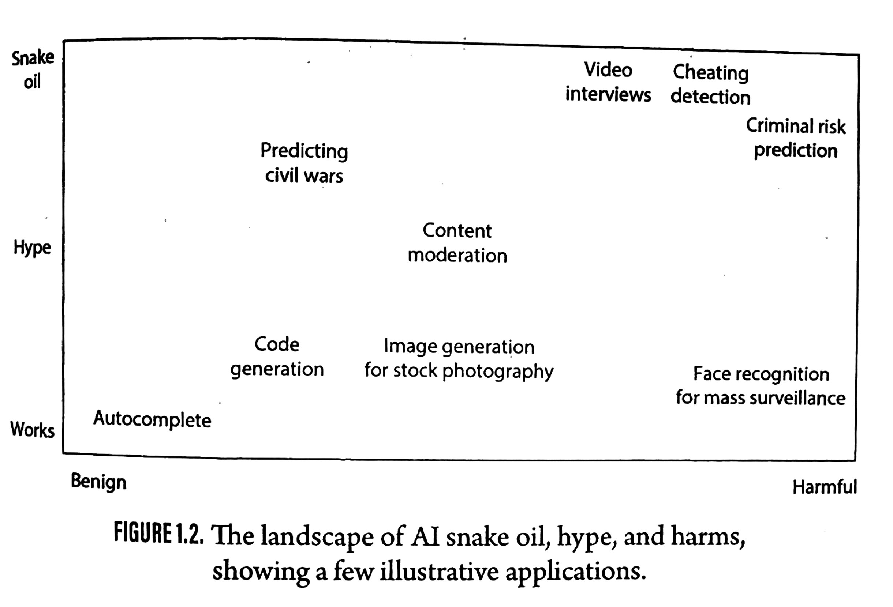
</div>

`Quelle` [Narayanan/Kapoor, AI Snake Oil, S.29](https://press.princeton.edu/books/hardcover/9780691249131/ai-snake-oil)


---
class: inverse, center, middle
name: goals

# Ziele für dieses Modul
<html><div style='float:left'></div><hr color='#EB811B' size=1px style="width:1000px; margin:auto;"/></html>


---
# Lernziele

.pull-left-wide[
## Nach diesem Modul könnt Ihr ...

1. **Datentypen und Datenquellen einordnen**: strukturiert und unstrukturiert, prozessproduziert und erhoben, Formate und Standards; beurteilen, was in Eurem Haus davon vorhanden ist.

2. **Datenqualität beurteilen**: Repräsentativität, Messung, Verzerrung; erkennen, wann „viele Daten“ keine guten Daten sind.

3. **Statistiken und Visualisierungen kritisch lesen** und selbst so kommunizieren, dass Entscheidungen darauf aufbauen können.

4. **KI-Produkte anhand ihrer Datenbasis bewerten**: Welche Daten gingen hinein, wie wurde validiert, welche Fehler kostet was?

5. **Grundzüge einer datenbewussten Organisation entwerfen**: Datenstrategie, Infrastruktur, Open Data, Menschen.
]

.pull-right-small[
<br>
<div align="center">
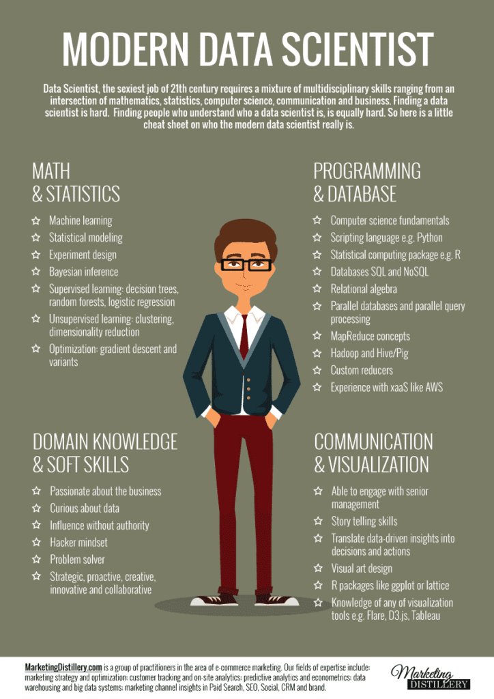
</div>
]


---
# Modulüberblick

<div align="center">
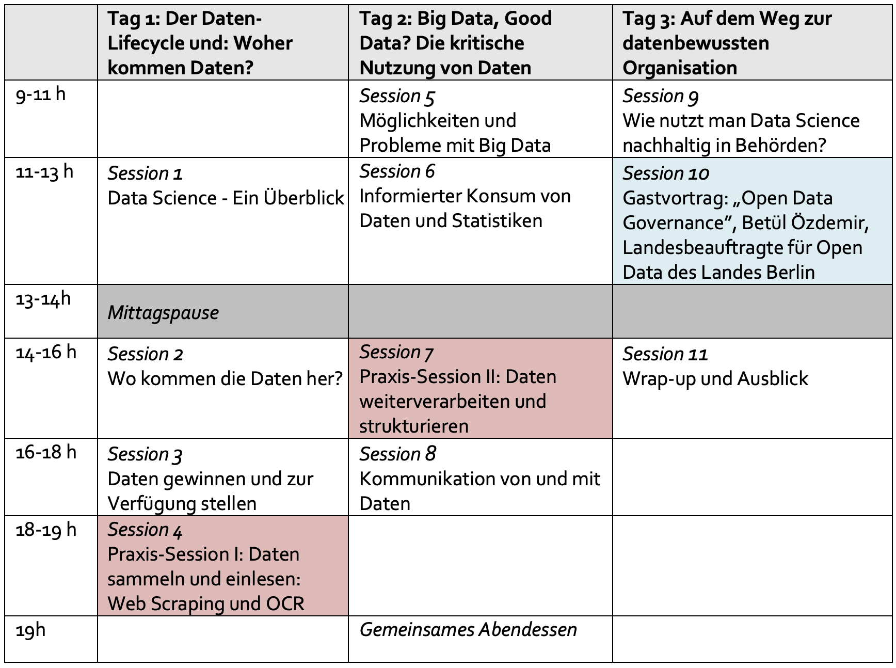
</div>


---
# Was wir nicht behandeln werden

.pull-left-small2[
## Programmierung
- Kenntnisse in Python, R, SQL usw. sind für die Datenwissenschaft unerlässlich
- Die Lernkurve ist steil und erfordert viel Übung
- Wir werfen einen (kleinen) Blick hinter die Kulissen
<br><br><br>

<div align="center">
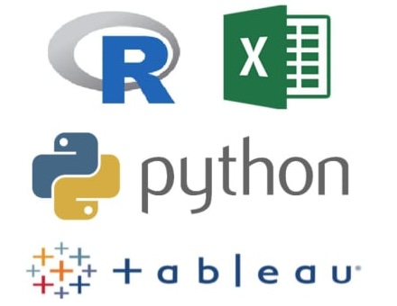 
</div>
]

.pull-left-small2[
## Aktive Modellierung
- Seriöse AI-Modellierung erfordert mehr theoretisches und praktisches Wissen, als wir in diesem Workshop abdecken können.
- Die Konzentration auf die Grundsätze statistischer Argumentation sollte ausreichen, um Daten und Modelle kritisch zu beurteilen.
<br>

<div align="center">
 
</div>
]

.pull-right-small2[
## Fortgeschrittenes Maschinelles Lernen, NLP
- ML, DL, NLP sind Technologien, die viele der spannendsten Anwendungen der Datenwissenschaft vorantreiben.
- Modul 3 wird hier anschließen; wir werden uns auf die Datengrundlagen konzentrieren.

<br>

<div align="center">
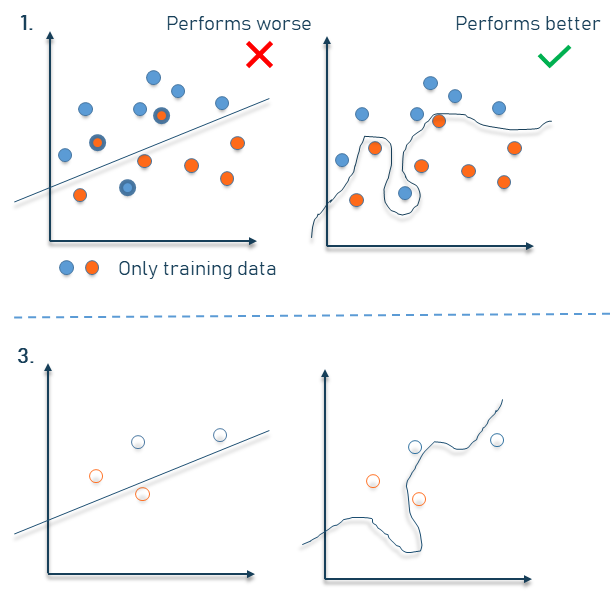 
</div>
]


---
# Weiterführende Literatur

<div align="center">


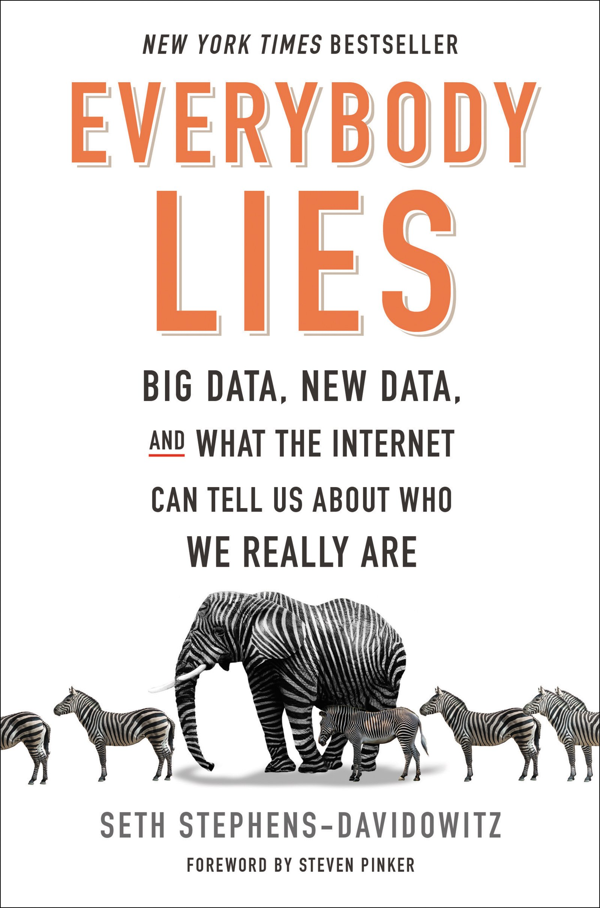
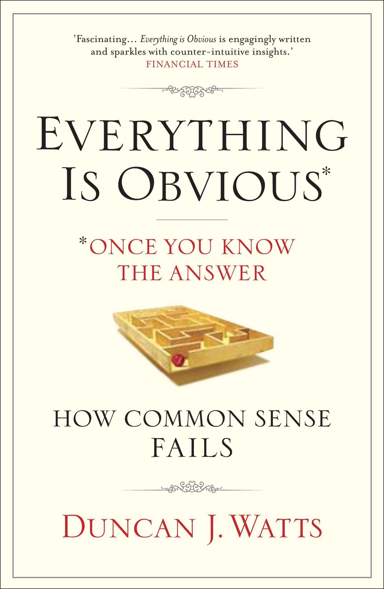
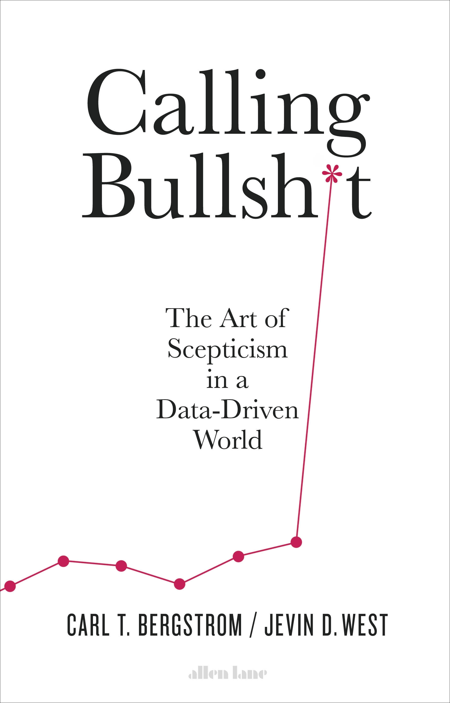
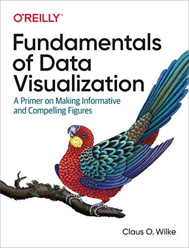<br>
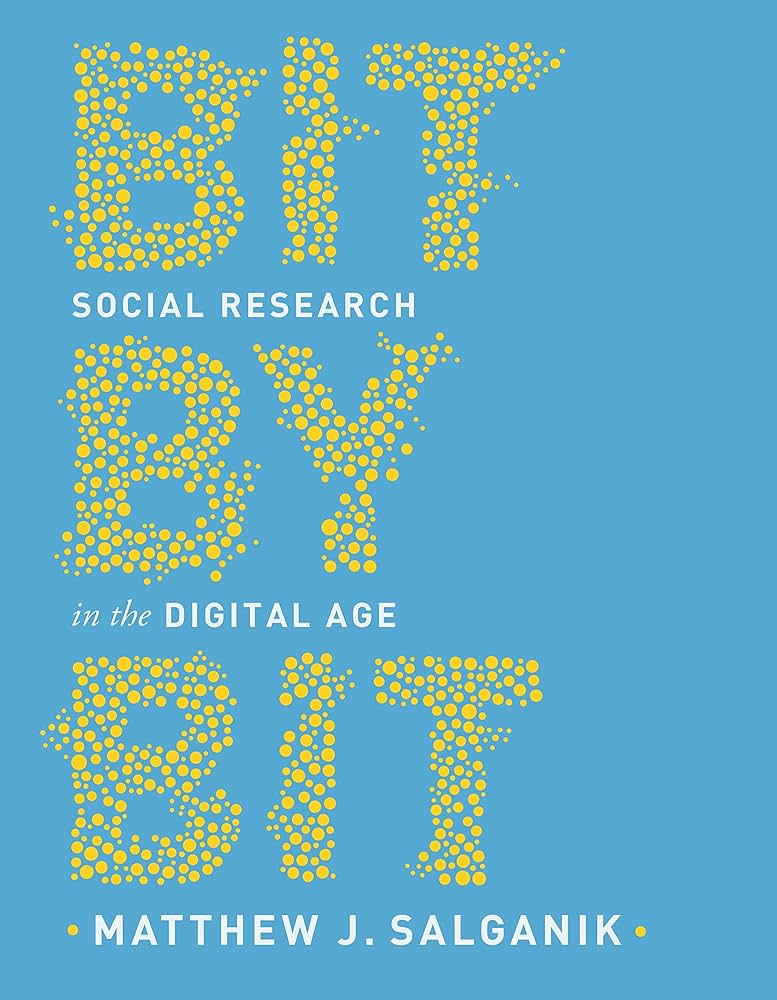
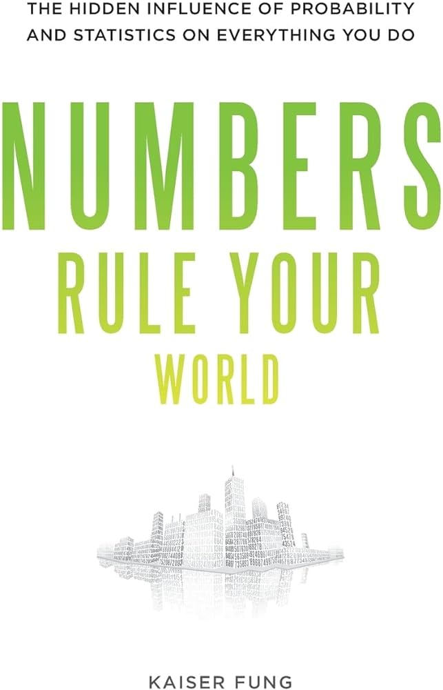
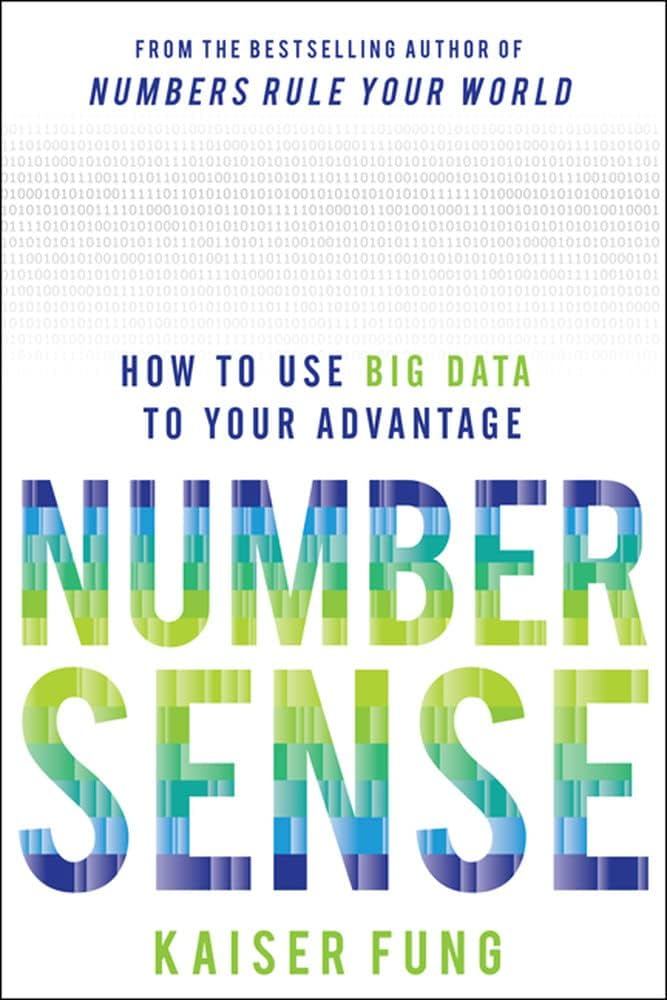
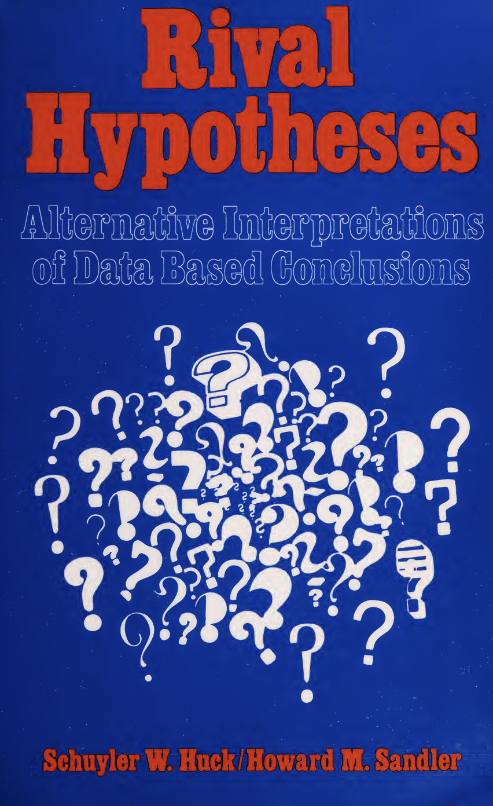
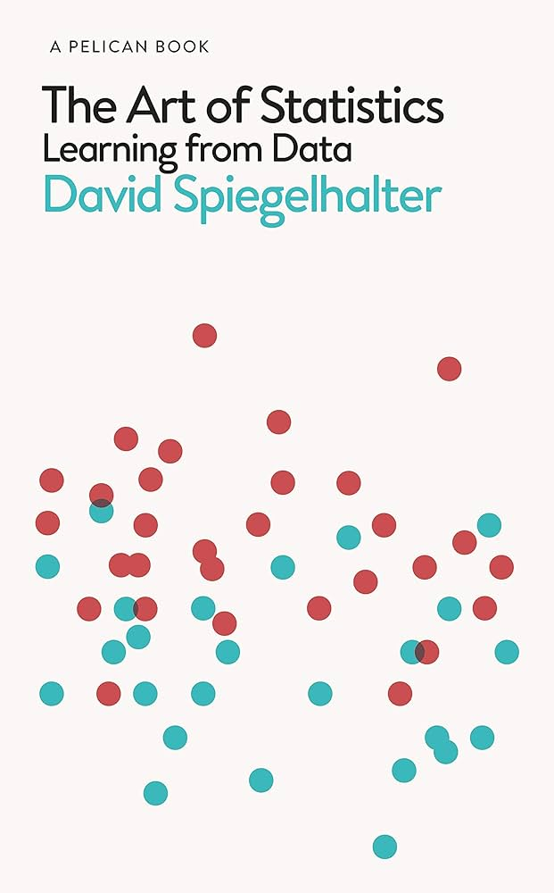
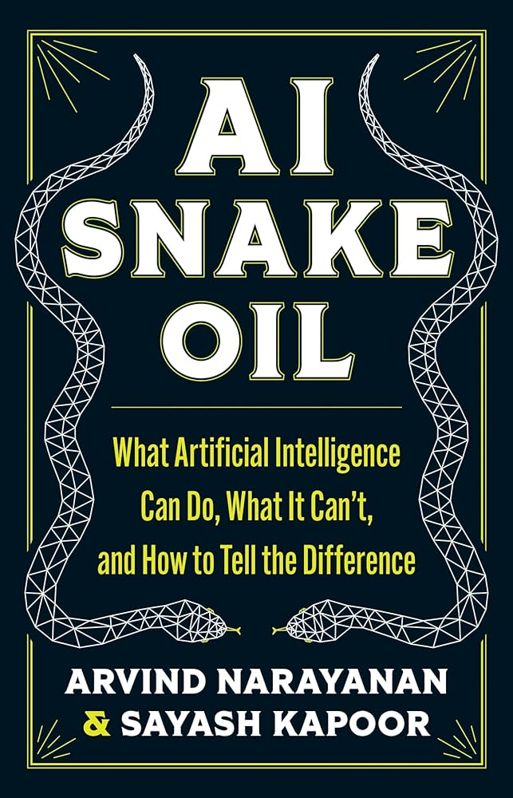
</div>


---
# Weiterführende Podcasts

<div align="center">
<br><br><br>


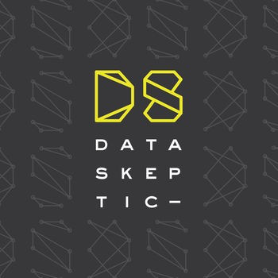
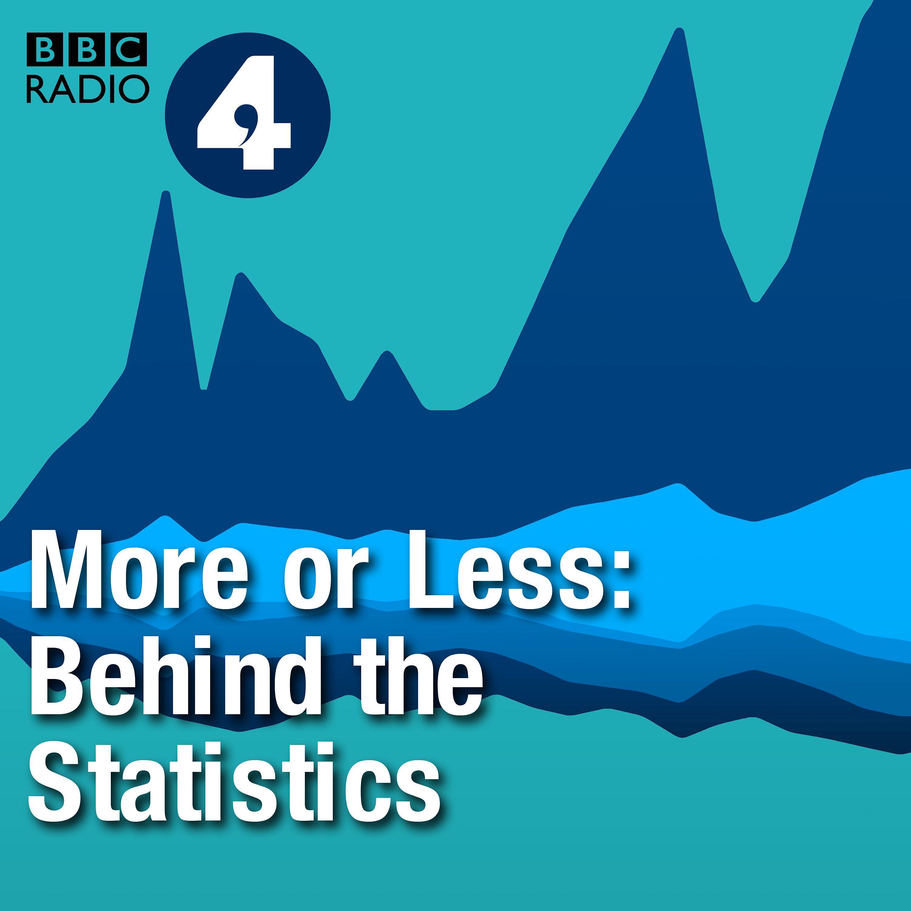
<br>


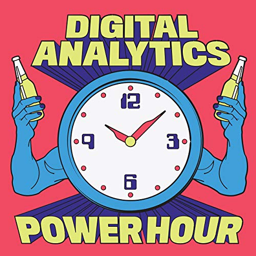
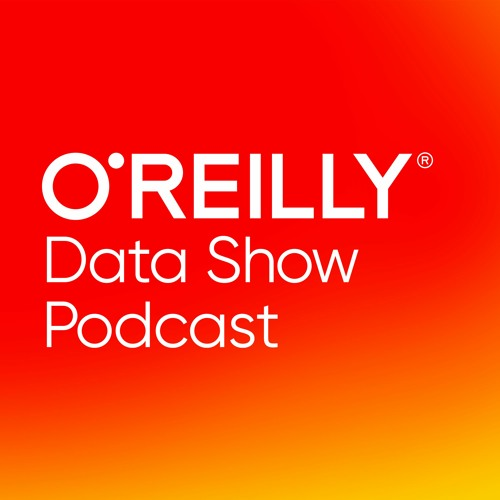
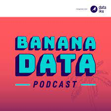


</div>


