```{css, echo=FALSE} 
@media print { # print out incremental slides; see https://stackoverflow.com/questions/56373198/get-xaringan-incremental-animations-to-print-to-pdf/56374619#56374619
  .has-continuation {
    display: block !important;
  }
}
```

```{r setup, include=FALSE}
# figures formatting setup
options(htmltools.dir.version = FALSE)
library(knitr)
opts_chunk$set(
  prompt = T,
  fig.align="center", #fig.width=6, fig.height=4.5, 
  # out.width="748px", #out.length="520.75px",
  dpi=300, #fig.path='Figs/',
  cache=T, #echo=F, warning=F, message=F
  engine.opts = list(bash = "-l")
  )

## Next hook based on this SO answer: https://stackoverflow.com/a/39025054
knit_hooks$set(
  prompt = function(before, options, envir) {
    options(
      prompt = if (options$engine %in% c('sh','bash')) '$ ' else 'R> ',
      continue = if (options$engine %in% c('sh','bash')) '$ ' else '+ '
      )
})

library(tidyverse)
library(hrbrthemes)
library(fontawesome)
```


# Überblick

<br><br>

1. [Was sind Daten?](#whatisdata)

2. [Datentypen - ein Überblick](#datatypes)

3. [Woher kommen die Daten?](#datasources)

4. [Eure Daten](#yourdata)


---
class: inverse, center, middle
name: whatisdata

# Was sind Daten?
<html><div style='float:left'></div><hr color='#EB811B' size=1px style="width:1000px; margin:auto;"/></html>

---
# Grundgedanken

.pull-left-wide[
## 1. Alles ist Daten.
]

.pull-right-small[
<div align="center">
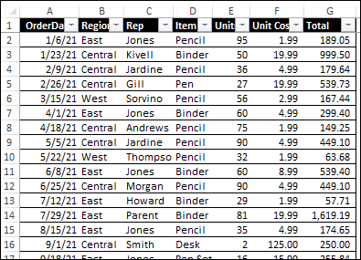

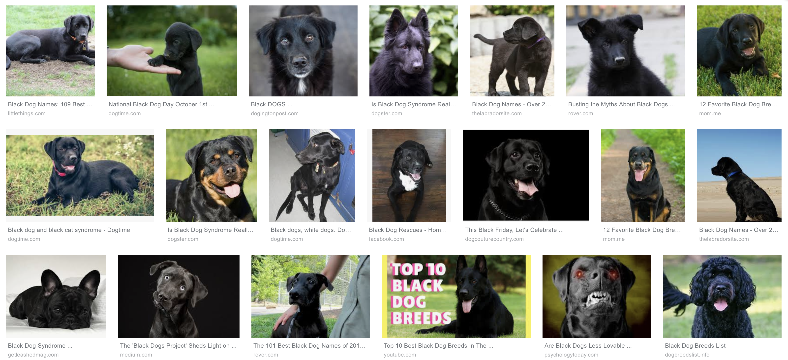
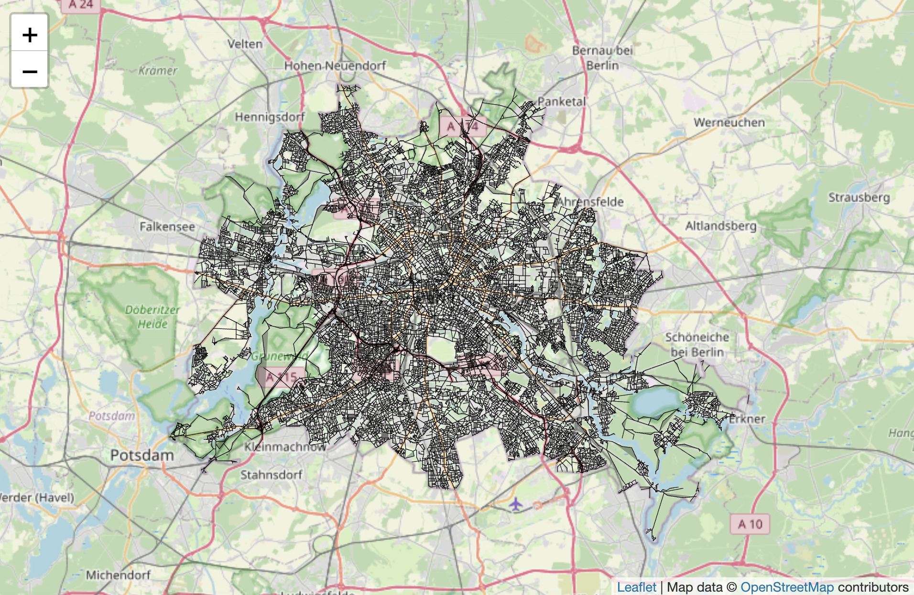

</div>
]


---
# Grundgedanken

.pull-left-wide[
## 1. Alles ist Daten.

## 2. Daten sind nicht gleich Information.
]

.pull-right-small[
<div align="center">
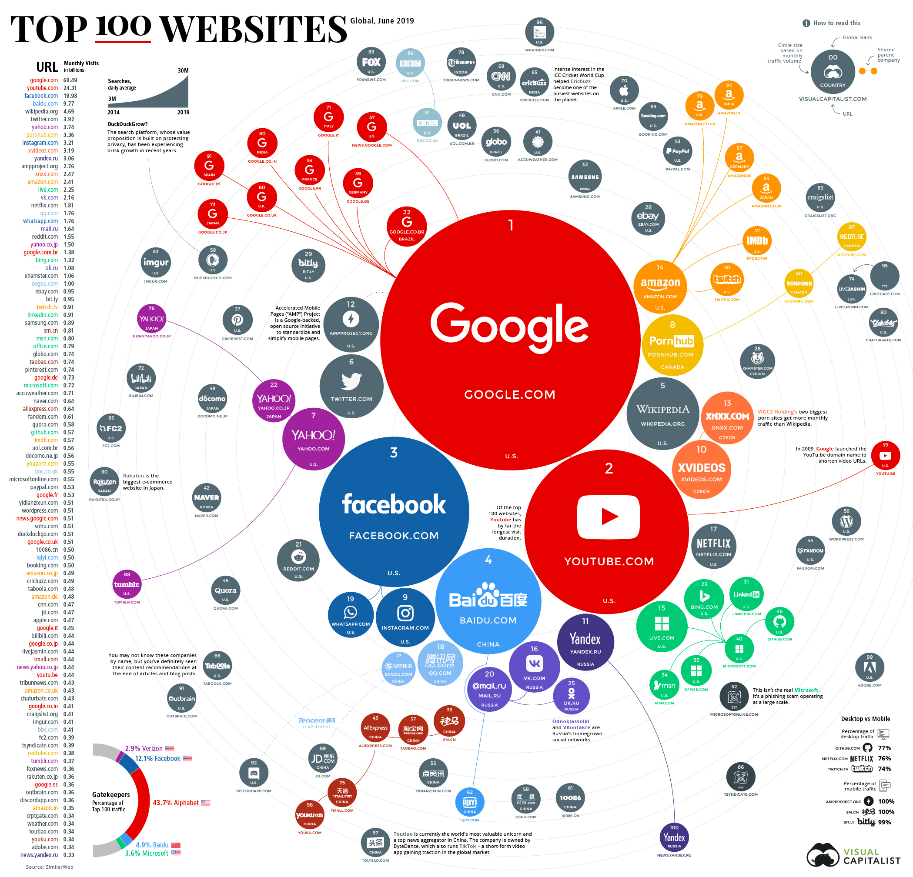

</div>
]


---
# Grundgedanken

.pull-left-wide[
## 1. Alles ist Daten.

## 2. Daten sind nicht gleich Information.

## 3. Wir können Daten klassifizieren danach, ...

]

.pull-right-small[
<div align="center">


</div>
]


---
# Grundgedanken

.pull-left-wide[
## 1. Alles ist Daten.

## 2. Daten sind nicht gleich Information.

## 3. Wir können Daten klassifizieren danach, ...

- wer sie generiert (Mensch vs. Maschine) bzw. woher sie stammen (*z.B. Verwaltung, Geschichte, Medizin usw.*)
]

.pull-right-small[
<div align="center">


</div>
]


---
# Grundgedanken

.pull-left-wide[
## 1. Alles ist Daten.

## 2. Daten sind nicht gleich Information.

## 3. Wir können Daten klassifizieren danach, ...

- wer sie generiert (Mensch vs. Maschine) bzw. woher sie stammen (*z.B. Verwaltung, Geschichte, Medizin usw.*)

- wie bewusst sie erhoben werden (prozessgeneriert vs. aktiv erhoben)

]

.pull-right-small[
<div align="center">


</div>
]


---
# Grundgedanken

.pull-left-wide[
## 1. Alles ist Daten.

## 2. Daten sind nicht gleich Information.

## 3. Wir können Daten klassifizieren danach, ...

- wer sie generiert (Mensch vs. Maschine) bzw. woher sie stammen (*z.B. Verwaltung, Geschichte, Medizin usw.*)

- wie bewusst sie erhoben werden (prozessgeneriert vs. aktiv erhoben)

- wie strukturiert sie sind (maschinenlesbar vs. nicht maschinenlesbar)
    
]

.pull-right-small[
<div align="center">


</div>
]


---
# Grundgedanken

.pull-left-wide[
## 1. Alles ist Daten.

## 2. Daten sind nicht gleich Information.

## 3. Wir können Daten klassifizieren danach, ...

- wer sie generiert (Mensch vs. Maschine) bzw. woher sie stammen (*z.B. Verwaltung, Geschichte, Medizin usw.*)

- wie bewusst sie erhoben werden (prozessgeneriert vs. aktiv erhoben)

- wie strukturiert sie sind (maschinenlesbar vs. nicht maschinenlesbar)

- was sie abbilden (welche Art von Information, z.B. Text, Bild, Geodaten, Netzwerkdaten)

]

.pull-right-small[
<div align="center">


</div>
]


---
# Grundgedanken

.pull-left-wide[
## 1. Alles ist Daten.

## 2. Daten sind nicht gleich Information.

## 3. Wir können Daten klassifizieren danach, ...

- wer sie generiert (Mensch vs. Maschine) bzw. woher sie stammen (*z.B. Verwaltung, Geschichte, Medizin usw.*)

- wie bewusst sie erhoben werden (prozessgeneriert vs. aktiv erhoben)

- wie strukturiert sie sind (maschinenlesbar vs. nicht maschinenlesbar)

- was sie abbilden (welche Art von Information, z.B. Text, Bild, Geodaten, Netzwerkdaten)

Und nach vielem mehr (Beständigkeit, Digitalisierung, etc.). Für uns eher relevant: Welche **Datentypen** sind **im Data-Science- und AI-Kontext** besonders relevant und wie machen wir sie nutzbar?
]

.pull-right-small[
<div align="center">


</div>
]


---
# Prozessproduzierte vs. aktiv generierte Daten

.pull-left[
## Prozessproduzierte Daten

- Daten, die als Nebenprodukt von Prozessen generiert werden
- Beispiele: Transaktionsdaten (z. B. E-Commerce), Log-Daten (z. B. Website-Clicks), Emails,  **Verwaltungsakten**
- Ein Großteil der Daten, die in KI-Anwendungen verwendet werden, sind prozessproduzierte Daten

<div align="center">
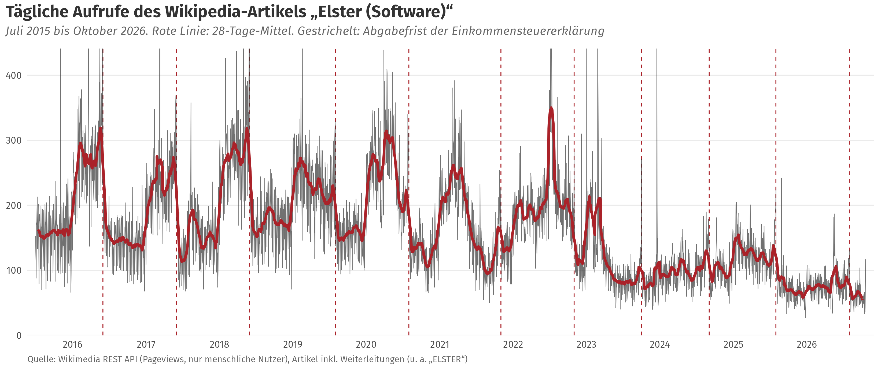
</div>
]

.pull-right[
## Aktiv generierte Daten

- Daten, zu einem bestimmten Zweck erhoben
- Beispiele: Umfragen, Experimente, Beobachtungen (z. B. manuelle Zählungen), Formulare
- Aktiv generierte Daten sind oft teurer und aufwendiger zu erheben, aber passgenauer für bestimmte Fragestellungen

<div align="center">

</div>
]


---
# Strukturierte, semistrukturierte, unstrukturierte Daten

.font90[
| | **Strukturierte Daten** | **Semistrukturierte Daten** | **Unstrukturierte Daten** |
|---|---|---|---|
| **Gestalt** | Tabellen mit festen Spalten und Datentypen | Verschachtelt, mit Markierungen (Tags, Schlüssel), aber ohne starres Schema | Rohmaterial ohne vorgegebene Struktur |
| **Typische Formate** | CSV, Excel, relationale Datenbanken | XML, JSON, XÖV-Nachrichten, E-Mails | Text, PDF, Bilder, Audio, Video |
| **In der Verwaltung** | Register, Fachverfahren, Statistik, Haushaltsdaten | Online-Anträge (XFall), elektronische Rechnungen (XRechnung), Schnittstellen zwischen Fachverfahren | Akten, Bescheide, Vermerke, Fotos, Protokolle, Bürgeranfragen |
| **Maschinenlesbar?** | direkt | mit einem Parser | oft erst nach Verarbeitung (OCR, Sprachmodelle, Bilderkennung) |
]

️✎ Die Grenzen sind fließend: Ein PDF-Bescheid ist unstrukturiert, die Daten darin stammen aus einem strukturierten Fachverfahren. Ein Teil von "KI in der Verwaltung" ist der Versuch, diesen Weg **rückwärts** zu gehen.

️✎ Formate (CSV, XML, JSON, XFall) sind Thema von **Session 3**; unstrukturierte Daten nutzbar machen (OCR) ist Thema der **Praxis-Sessions**.


---
class: inverse, center, middle
name: datatypes

# Datentypen - ein Überblick
<html><div style='float:left'></div><hr color='#EB811B' size=1px style="width:1000px; margin:auto;"/></html>

---
# Datentypen in Aktion

.pull-left-wide[
## Was KI-Anwendungen antreibt

- Die spektakulären Anwendungen der letzten Jahre laufen fast alle auf **unstrukturierten Daten**: Text, Code, Bilder, Satellitenaufnahmen, Verhaltensspuren.
- Die folgenden Beispiele zeigen jeweils: **Welcher Datentyp**, **woher die Daten kommen**, und **was dabei schiefgehen kann**.

## Einige Fragen zum Mitdenken

1. Welche Daten gehen in das System hinein, und wer hat sie erzeugt?
2. Wurde den Datenerzeuger:innen gesagt, wofür ihre Daten genutzt werden?
3. Gibt es Belege dafür, dass das System funktioniert?
]

.pull-right-small[
<div align="center">


</div>
]


---
# Textdaten: GitHub Copilot

.pull-left-wide[
## "Your AI Pair Programmer"
- [GitHub Copilot](https://en.wikipedia.org/wiki/GitHub_Copilot) ist ein KI-gestütztes Tool, das Entwickler/innen beim Schreiben von Code unterstützt.
- Wurde von GitHub & OpenAI entwickelt (ursprünglich auf GPT-3-Basis).
- Copilot kann Codevorschläge machen, die auf dem Kontext des Codes basieren, den Ihr gerade schreibt.
- Es kann auch ganze Funktionen schreiben, wenn man eine Beschreibung gibt (🖥️ Demonstration).
- Copilot ist in der Lage, in vielen verschiedenen Programmiersprachen zu arbeiten.

## Datengrundlage
- Massen an Code, vermutlich von Plattformen wie [GitHub](https://github.com/), [StackOverflow](https://stackoverflow.com/), etc.
- Substantieller Impact auf Developer-Community, aber auch [Kritik](https://www.theverge.com/2021/7/7/22561180/github-copilot-legal-copyright-fair-use-public-code) bzgl. Urheberrechten und Datenschutz.
]

.pull-right-small[
<br>
<div align="center">

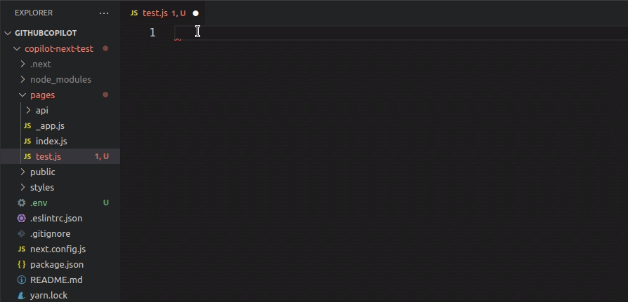
</div>

`Quelle` [Scalablepath.com](https://www.scalablepath.com/full-stack/ai-pair-programming-github-copilot-review)
]


---
# Satellitenbilder zur Messung von räumlichen Phänomenen

.pull-left-wide2[
## Das Potential von Satellitenbildern und Luftaufnahmen

- Mit massiv gestiegener **Auflösung** sowie **räumlicher** und **zeitlicher Abdeckung** werden Satellitenbilder mittlerweile für viele Forschungs- und kommerzielle Zwecke eingesetzt
- Rohdaten alleine sind wenig nützlich: Machine-Learning-Techniken, um Muster zu erkennen bzw. inferieren

## Beispiele

- Vorhersage von Armut [(Neal Jean et al., Science)](https://www.science.org/doi/10.1126/science.aaf7894)
- Vorhersage von ökonomischer Entwicklung [(Burke et al.)](https://www.nber.org/system/files/working_papers/w27879/w27879.pdf)
- Erkennung von Photovoltaik-Anlagen [(de Hoog et al.)](https://dl.acm.org/doi/abs/10.1145/3396851.3397681?casa_token=k1cHq7bdfDwAAAAA:Q4NCtoVgj_QZzDHtomreQisLf-iMaScXE5UGEzj2IRWTFvn49pGjYya80n-v-my0PbiSUaP0wC_K)
- Monitoring von Agrarwirtschaft und Ernteerträgen (siehe letzte Session)
]

.pull-right-small2[
<div align="center">
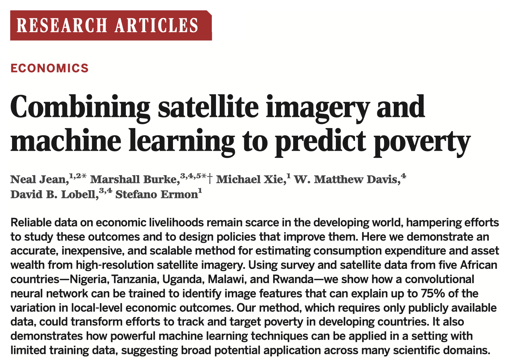
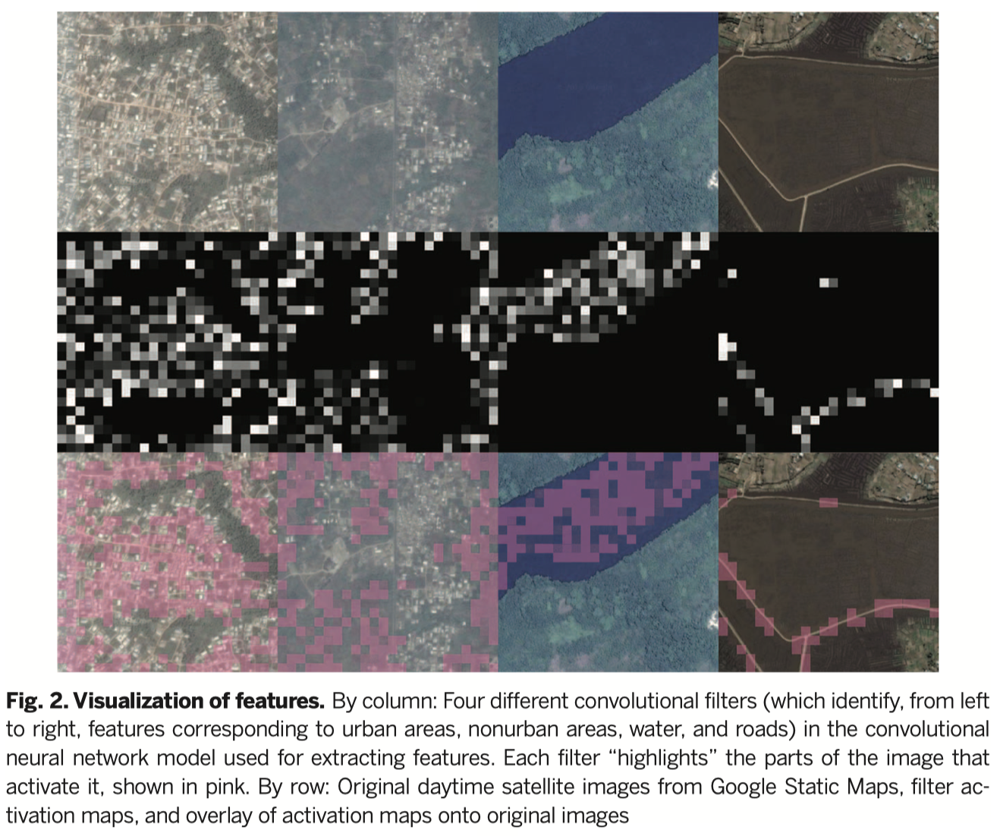
</div>
]

---
# Luftaufnahmen: Autobahnparkplatzerkennung

.pull-left[
<div align="center">
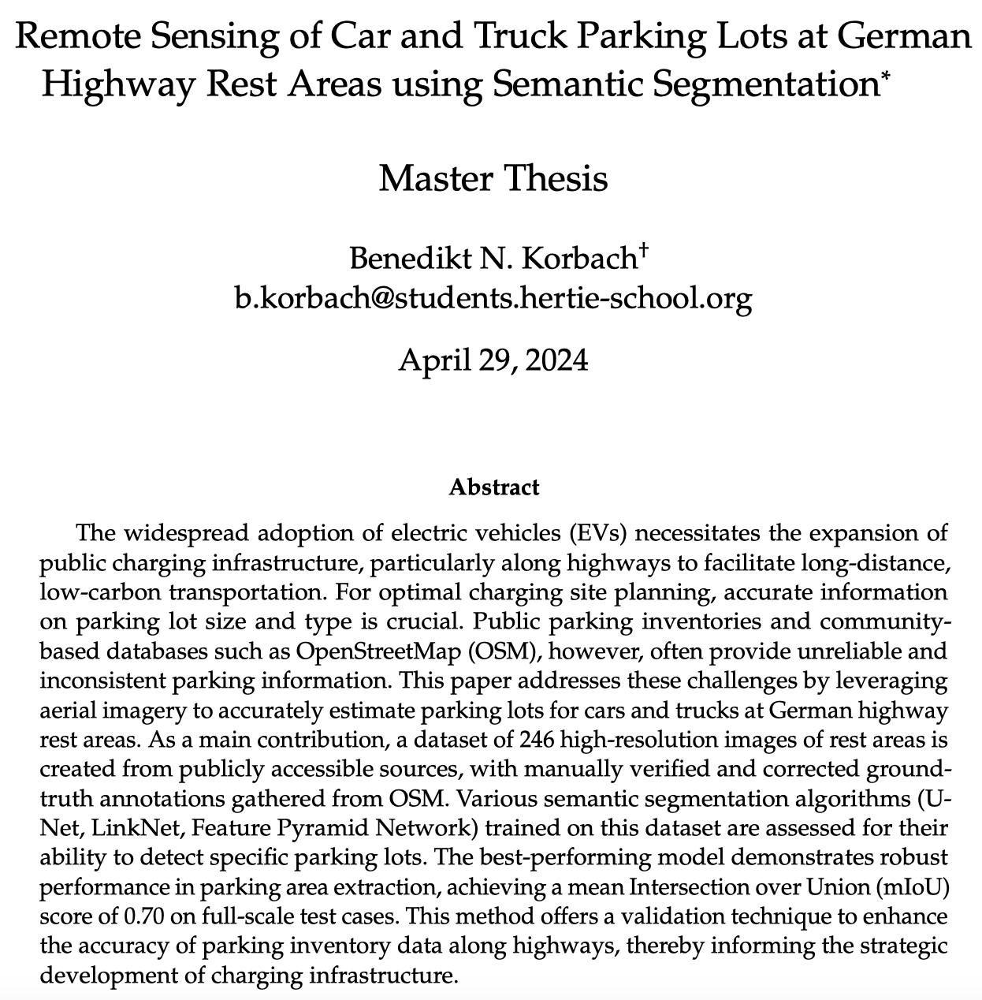
</div>
]

.pull-right[
<div align="center">
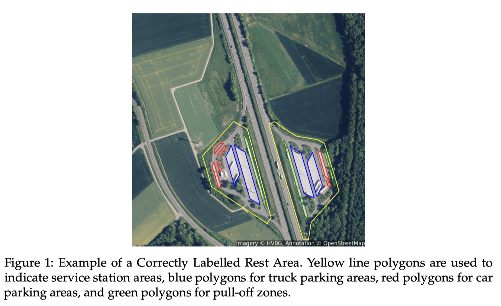
</div>
]

---
# Fotos: Googles Kindesmissbrauch-Prävention
.pull-left-wide[
## Anwendung und Ziel

- Image Content Moderation mit KI: [Google's efforts to combat Child Sexual Abuse Material (CSAM)](https://support.google.com/transparencyreport/answer/10330933?hl=en-GB) über Google Photos; Sperren von Accounts mutmaßlicher Täter
- Launch 2018: [Google Blogpost](https://blog.google/products/photos/using-technology-fight-child-exploitation/); letzter Stand [hier](https://blog.google/technology/safety-security/an-update-on-our-child-safety-efforts-and-commitments/)

## Evaluation und Probleme

- Keine belastbaren Angaben zu Accuracy des Tools; siehe auch [Narayanan/Kapoor, 2024: S. 181, 194](https://http://aisnakeoil.com/)
- Google Nutzer/innen kennen Erkennungskriterien nicht oder können Missklassifikation nur schwer anfechten
- [NYT Recherche:](https://www.nytimes.com/2022/08/21/technology/google-surveillance-toddler-photo.html) Familienvater fotografierte geschwollenen Intimbereich seines Babys für den Hausarzt, Missklassifikation als Kindesmissbrauch und Zugang zu allen Google Services, Google SIM Karte und Google beruflicher Account gesperrt; etliche weitere [Berichte](https://www.theverge.com/2022/8/21/23315513/google-photos-csam-scanning-account-deletion-investigation) von gesperrten Eltern

]

.pull-right-small[
<br>
<div align="center">

</div>
[Bildquelle](www.photos.google.com)
]


---
# Digitale Spurendaten: COVID-19-App-Nutzung

.pull-left[

<div align="center">
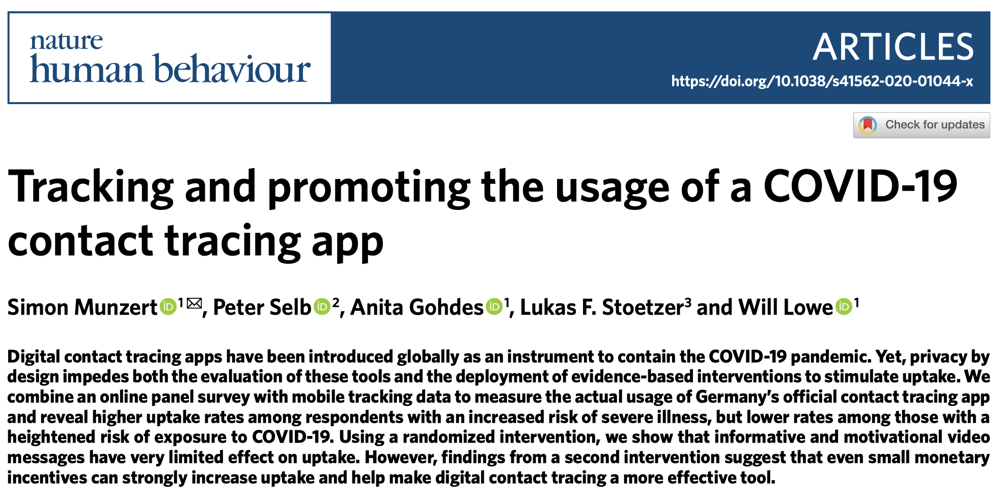
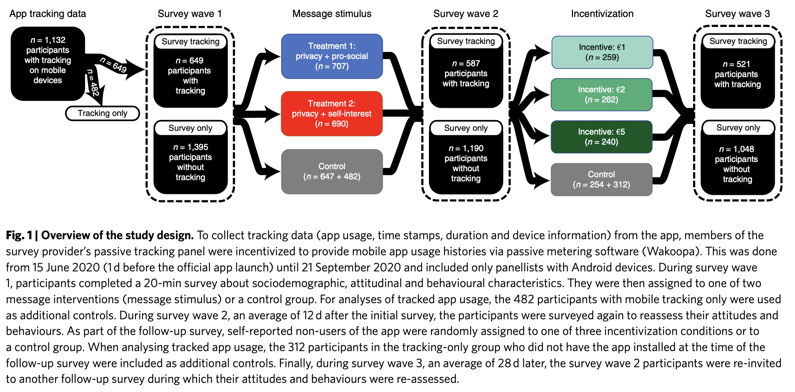
</div>
]

.pull-right[
<br>
<div align="center">
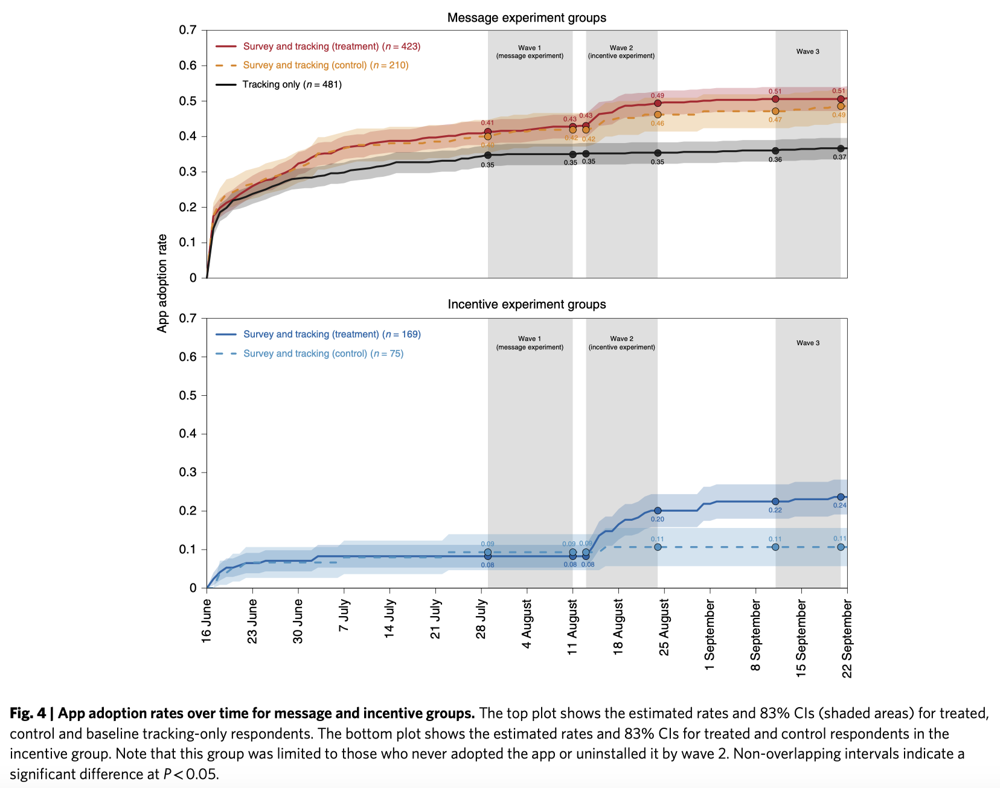
</div>
]

---
class: exercise, center, middle

# Übung

.content-box-white[
Welche Beispiele für Text-, Bild- und digitale Spurendaten fallen euch ein, die in Eurem Kontext genutzt werden (könnten)? 

Wie werden sie erzeugt?

Was sind mögliche Fehlerquellen?
]


---
class: inverse, center, middle
name: datasources

# Woher kommen die Daten?
<html><div style='float:left'></div><hr color='#EB811B' size=1px style="width:1000px; margin:auto;"/></html>


---
# Datenquellen in der Verwaltung

<table style="width:100%; border-collapse:collapse; table-layout:fixed; font-size:80%; line-height:1.25;">
<thead><tr style="height:2.4em;"><th style="width:24%; border:1px solid #ddd; padding:6px 10px;"><b>Quelle</b></th><th style="width:34%; border:1px solid #ddd; padding:6px 10px;"><b>Beispiele</b></th><th style="width:42%; border:1px solid #ddd; padding:6px 10px;"><b>Was das für die Qualität heißt</b></th></tr></thead>
<tbody>
<tr style="height:3.9em;"><td style="border:1px solid #ddd; padding:6px 10px; vertical-align:middle;"><b>Register</b></td><td style="border:1px solid #ddd; padding:6px 10px; vertical-align:middle; color:#8B0000; font-weight:bold; text-align:center;">???</td><td style="border:1px solid #ddd; padding:6px 10px; vertical-align:middle; color:#8B0000; font-weight:bold; text-align:center;">???</td></tr>
<tr style="height:3.9em;"><td style="border:1px solid #ddd; padding:6px 10px; vertical-align:middle;"><b>Fachverfahren und Akten</b></td><td style="border:1px solid #ddd; padding:6px 10px; vertical-align:middle; color:#8B0000; font-weight:bold; text-align:center;">???</td><td style="border:1px solid #ddd; padding:6px 10px; vertical-align:middle; color:#8B0000; font-weight:bold; text-align:center;">???</td></tr>
<tr style="height:3.9em;"><td style="border:1px solid #ddd; padding:6px 10px; vertical-align:middle;"><b>Amtliche Statistik</b></td><td style="border:1px solid #ddd; padding:6px 10px; vertical-align:middle; color:#8B0000; font-weight:bold; text-align:center;">???</td><td style="border:1px solid #ddd; padding:6px 10px; vertical-align:middle; color:#8B0000; font-weight:bold; text-align:center;">???</td></tr>
<tr style="height:3.9em;"><td style="border:1px solid #ddd; padding:6px 10px; vertical-align:middle;"><b>Sensoren und Infrastruktur</b></td><td style="border:1px solid #ddd; padding:6px 10px; vertical-align:middle; color:#8B0000; font-weight:bold; text-align:center;">???</td><td style="border:1px solid #ddd; padding:6px 10px; vertical-align:middle; color:#8B0000; font-weight:bold; text-align:center;">???</td></tr>
<tr style="height:3.9em;"><td style="border:1px solid #ddd; padding:6px 10px; vertical-align:middle;"><b>Externe und offene Daten</b></td><td style="border:1px solid #ddd; padding:6px 10px; vertical-align:middle; color:#8B0000; font-weight:bold; text-align:center;">???</td><td style="border:1px solid #ddd; padding:6px 10px; vertical-align:middle; color:#8B0000; font-weight:bold; text-align:center;">???</td></tr>
<tr style="height:3.9em;"><td style="border:1px solid #ddd; padding:6px 10px; vertical-align:middle;"><b>Eigene Erhebungen</b></td><td style="border:1px solid #ddd; padding:6px 10px; vertical-align:middle; color:#8B0000; font-weight:bold; text-align:center;">???</td><td style="border:1px solid #ddd; padding:6px 10px; vertical-align:middle; color:#8B0000; font-weight:bold; text-align:center;">???</td></tr>
</tbody>
</table>

️✎ **Was vermutet Ihr?** Welche Daten fallen in Eurem Haus in diese Kategorien, und was bedeutet ihre Herkunft für die Qualität?


---
# Datenquellen in der Verwaltung

<table style="width:100%; border-collapse:collapse; table-layout:fixed; font-size:80%; line-height:1.25;">
<thead><tr style="height:2.4em;"><th style="width:24%; border:1px solid #ddd; padding:6px 10px;"><b>Quelle</b></th><th style="width:34%; border:1px solid #ddd; padding:6px 10px;"><b>Beispiele</b></th><th style="width:42%; border:1px solid #ddd; padding:6px 10px;"><b>Was das für die Qualität heißt</b></th></tr></thead>
<tbody>
<tr style="height:3.9em;"><td style="border:1px solid #ddd; padding:6px 10px; vertical-align:middle;"><b>Register</b></td><td style="border:1px solid #ddd; padding:6px 10px; vertical-align:middle;">Melderegister, Handelsregister, Grundbuch, Fahrzeugregister</td><td style="border:1px solid #ddd; padding:6px 10px; vertical-align:middle;">Je Eintrag verlässlich, aber in Silos; Verknüpfung rechtlich eng begrenzt</td></tr>
<tr style="height:3.9em;"><td style="border:1px solid #ddd; padding:6px 10px; vertical-align:middle;"><b>Fachverfahren und Akten</b></td><td style="border:1px solid #ddd; padding:6px 10px; vertical-align:middle;">Antrags- und Fallbearbeitung, Bescheide, Vermerke</td><td style="border:1px solid #ddd; padding:6px 10px; vertical-align:middle;">Nebenprodukt der Sachbearbeitung; selten für Auswertung gedacht; oft nur als PDF</td></tr>
<tr style="height:3.9em;"><td style="border:1px solid #ddd; padding:6px 10px; vertical-align:middle;"><b>Amtliche Statistik</b></td><td style="border:1px solid #ddd; padding:6px 10px; vertical-align:middle;">Zensus, Mikrozensus, Wirtschaftsstatistiken</td><td style="border:1px solid #ddd; padding:6px 10px; vertical-align:middle;">Methodisch dokumentiert, aber aggregiert und zeitverzögert</td></tr>
<tr style="height:3.9em;"><td style="border:1px solid #ddd; padding:6px 10px; vertical-align:middle;"><b>Sensoren und Infrastruktur</b></td><td style="border:1px solid #ddd; padding:6px 10px; vertical-align:middle;">Verkehrszählung, Luftqualität, Pegel</td><td style="border:1px solid #ddd; padding:6px 10px; vertical-align:middle;">Groß und kontinuierlich; Messfehler und Lücken bei Ausfall</td></tr>
<tr style="height:3.9em;"><td style="border:1px solid #ddd; padding:6px 10px; vertical-align:middle;"><b>Externe und offene Daten</b></td><td style="border:1px solid #ddd; padding:6px 10px; vertical-align:middle;">Open-Data-Portale, Web, Satelliten</td><td style="border:1px solid #ddd; padding:6px 10px; vertical-align:middle;">Nachnutzbar, aber Zweck, Qualität und Lizenz prüfen</td></tr>
<tr style="height:3.9em;"><td style="border:1px solid #ddd; padding:6px 10px; vertical-align:middle;"><b>Eigene Erhebungen</b></td><td style="border:1px solid #ddd; padding:6px 10px; vertical-align:middle;">Befragungen, Evaluationen, Zählungen</td><td style="border:1px solid #ddd; padding:6px 10px; vertical-align:middle;">Passgenau, aber teuer; Antwortverzerrungen</td></tr>
</tbody>
</table>

️✎ Die meisten Daten in Behörden sind **prozessproduziert**: Sie entstehen, weil ein Verfahren bearbeitet wird, nicht, weil jemand sie auswerten wollte. Das hat Auswirkungen auf ihre Qualität und Nutzungpotentiale.


---
# Womit werden KI-Systeme gefüttert?

<table style="width:100%; border-collapse:collapse; table-layout:fixed; font-size:72%; line-height:1.25;">
<thead><tr style="height:2.4em;"><th style="width:20%; border:1px solid #ddd; padding:6px 8px;"><b>KI-Produkt</b></th><th style="width:26%; border:1px solid #ddd; padding:6px 8px;"><b>Funktion</b></th><th style="width:54%; border:1px solid #ddd; padding:6px 8px;"><b>Datenbasis</b></th></tr></thead>
<tbody>
<tr style="height:7.2em;"><td style="border:1px solid #ddd; padding:6px 8px; vertical-align:middle;"><b>Sprachmodelle</b><br>ChatGPT, Claude, Gemini</td><td style="border:1px solid #ddd; padding:6px 8px; vertical-align:middle;">Text generieren, zusammenfassen, programmieren, recherchieren</td><td style="border:1px solid #ddd; padding:6px 8px; vertical-align:middle; color:#8B0000; font-weight:bold; text-align:center;">???</td></tr>
<tr style="height:7.2em;"><td style="border:1px solid #ddd; padding:6px 8px; vertical-align:middle;"><b>Alexa</b><br>Amazon</td><td style="border:1px solid #ddd; padding:6px 8px; vertical-align:middle;">Sprachassistent; seit 2025 als „Alexa+“ auf Basis eines Sprachmodells</td><td style="border:1px solid #ddd; padding:6px 8px; vertical-align:middle; color:#8B0000; font-weight:bold; text-align:center;">???</td></tr>
<tr style="height:7.2em;"><td style="border:1px solid #ddd; padding:6px 8px; vertical-align:middle;"><b>Palantir Gotham</b><br>in Deutschland: HessenDATA, VeRA (Bayern), DAR (NRW)</td><td style="border:1px solid #ddd; padding:6px 8px; vertical-align:middle;">Analyseplattform der Polizei: Personen, Orte, Ereignisse über Datenbestände hinweg verknüpfen</td><td style="border:1px solid #ddd; padding:6px 8px; vertical-align:middle; color:#8B0000; font-weight:bold; text-align:center;">???</td></tr>
<tr style="height:7.2em;"><td style="border:1px solid #ddd; padding:6px 8px; vertical-align:middle;"><b>Stable Diffusion</b><br>Stability AI, Open Source</td><td style="border:1px solid #ddd; padding:6px 8px; vertical-align:middle;">Bilder aus Textbeschreibungen erzeugen</td><td style="border:1px solid #ddd; padding:6px 8px; vertical-align:middle; color:#8B0000; font-weight:bold; text-align:center;">???</td></tr>
</tbody>
</table>

️✎ **Was vermutet Ihr?** Woher stammen die Daten, mit denen diese Systeme trainiert oder betrieben werden?


---
# Womit werden KI-Systeme gefüttert?

<table style="width:100%; border-collapse:collapse; table-layout:fixed; font-size:72%; line-height:1.25;">
<thead><tr style="height:2.4em;"><th style="width:20%; border:1px solid #ddd; padding:6px 8px;"><b>KI-Produkt</b></th><th style="width:26%; border:1px solid #ddd; padding:6px 8px;"><b>Funktion</b></th><th style="width:54%; border:1px solid #ddd; padding:6px 8px;"><b>Datenbasis</b></th></tr></thead>
<tbody>
<tr style="height:7.2em;"><td style="border:1px solid #ddd; padding:6px 8px; vertical-align:middle;"><b>Sprachmodelle</b><br>ChatGPT, Claude, Gemini</td><td style="border:1px solid #ddd; padding:6px 8px; vertical-align:middle;">Text generieren, zusammenfassen, programmieren, recherchieren</td><td style="border:1px solid #ddd; padding:6px 8px; vertical-align:middle;">Frei zugängliches Web (Common Crawl), Bücher, Wikipedia, Foren, Code; bei GPT-3 noch offengelegt, seit GPT-4 <a href="https://arxiv.org/abs/2303.08774" target="_blank">nicht mehr</a>. Dazu <b>lizenzierte Inhalte</b> (<a href="https://openai.com/index/axel-springer-partnership/" target="_blank">Axel Springer</a>, <a href="https://openai.com/index/openai-and-reddit-partnership/" target="_blank">Reddit</a>) und <b>menschliches Feedback</b>, u.a. von Annotatoren in Kenia für unter 2 $/Stunde (<a href="https://time.com/6247678/openai-chatgpt-kenya-workers/" target="_blank">TIME 2023</a>).</td></tr>
<tr style="height:7.2em;"><td style="border:1px solid #ddd; padding:6px 8px; vertical-align:middle;"><b>Alexa</b><br>Amazon</td><td style="border:1px solid #ddd; padding:6px 8px; vertical-align:middle;">Sprachassistent; seit 2025 als „Alexa+“ auf Basis eines Sprachmodells</td><td style="border:1px solid #ddd; padding:6px 8px; vertical-align:middle;">Sprachaufnahmen aus Millionen Haushalten, Nutzungs- und Kaufhistorie, Smart-Home-Geräte. Seit 28.03.2025 gehen alle Aufnahmen in die Cloud, die lokale Verarbeitung wurde abgeschafft (<a href="https://arstechnica.com/gadgets/2025/03/everything-you-say-to-your-echo-will-be-sent-to-amazon-starting-on-march-28/" target="_blank">Ars Technica</a>). 2023 zahlte Amazon 25 Mio. $, weil Kinderaufnahmen unbegrenzt gespeichert wurden (<a href="https://www.justice.gov/opa/pr/amazon-agrees-injunctive-relief-and-25-million-civil-penalty-alleged-violations-childrens" target="_blank">DOJ/FTC</a>).</td></tr>
<tr style="height:7.2em;"><td style="border:1px solid #ddd; padding:6px 8px; vertical-align:middle;"><b>Palantir Gotham</b><br>in Deutschland: HessenDATA, VeRA (Bayern), DAR (NRW)</td><td style="border:1px solid #ddd; padding:6px 8px; vertical-align:middle;">Analyseplattform der Polizei: Personen, Orte, Ereignisse über Datenbestände hinweg verknüpfen</td><td style="border:1px solid #ddd; padding:6px 8px; vertical-align:middle;"><b>Keine eigenen Datenbestände</b>: Palantir liefert die Software, nicht die Daten („not in the business of collecting, mining, or selling data“, <a href="https://doi.org/10.1177/20539517241255108" target="_blank">Ulbricht/Egbert 2024</a>). Verknüpft wird, was die Polizei einspeist: Vorgangs- und Fallsysteme, Register, TKÜ, Funkzellenabfragen, ausgelesene Handys, soziale Netzwerke (<a href="https://dserver.bundestag.de/btd/21/056/2105625.pdf" target="_blank">BT-Drs. 21/5625</a>). Grenzen durch das <a href="https://www.bundesverfassungsgericht.de/SharedDocs/Entscheidungen/DE/2023/02/rs20230216_1bvr154719.html" target="_blank">BVerfG 2023</a>.</td></tr>
<tr style="height:7.2em;"><td style="border:1px solid #ddd; padding:6px 8px; vertical-align:middle;"><b>Stable Diffusion</b><br>Stability AI, Open Source</td><td style="border:1px solid #ddd; padding:6px 8px; vertical-align:middle;">Bilder aus Textbeschreibungen erzeugen</td><td style="border:1px solid #ddd; padding:6px 8px; vertical-align:middle;"><a href="https://laion.ai/blog/laion-5b/" target="_blank">LAION-5B</a>: 5,85 Mrd. Bild-Text-Paare, automatisch aus dem Web gesammelt, ohne Einwilligung der Urheber. Dez. 2023 wegen über 1.000 Missbrauchsdarstellungen zurückgezogen (<a href="https://cyber.fsi.stanford.edu/io/news/investigation-finds-ai-image-generation-models-trained-child-abuse" target="_blank">Stanford</a>), Aug. 2024 bereinigt als <a href="https://laion.ai/blog/relaion-5b/" target="_blank">Re-LAION-5B</a>. Getty verlor 2025 in London weitgehend (<a href="https://www.judiciary.uk/judgments/getty-images-v-stability-ai/" target="_blank">High Court</a>).</td></tr>
</tbody>
</table>

️✎ Die Quellen sind in der Tabelle verlinkt. Sprachmodell-Trainingsdaten sind seit 2023 Geschäftsgeheimnis; alle Angaben dazu stammen aus früheren Veröffentlichungen, Lizenzverträgen und Recherchen.


---
# Womit werden KI-Systeme gefüttert?

.pull-left[
## Drei Beobachtungen

1. **Die Daten sind oft nicht für den Zweck erhoben worden.** Webtexte, Sprachaufnahmen, Falldateien: alles Nebenprodukte, nachträglich zum Trainingsmaterial erklärt.

2. **Die Datenbasis ist die eigentliche Blackbox.** Modellarchitekturen sind publiziert, Trainingsdaten nicht. Bei Sprachmodellen weiß niemand außerhalb des Unternehmens, was drin ist.

3. **Bei Verwaltungssoftware bringt der Anbieter nicht zwangsläufig Daten mit.**  Die Qualität des Systems ist die Qualität **Eurer** Daten.
]

.pull-right[
.font90[
## Beispiele

| **Anwendung** | **Datenbasis** |
|---|---|
| **F13**, KI-Assistent der Landesverwaltung BW | Dokumente und Vorlagen der Landesverwaltung, dazu ein kommerzielles Sprachmodell |
| **Risikomanagement** der Finanzämter | Steuererklärungen, Vorjahresdaten, Kontrollmitteilungen Dritter |
| **Flächenmonitoring** Agrarförderung | Sentinel-Satellitenbilder plus Antragsdaten der Landwirte als Vergleichsmaßstab |
| **Sprachbiometrie** BAMF | Sprachproben aus Asylverfahren, Referenzsamples pro Dialekt |
| **Kommunale Chatbots** | Dienstleistungstexte des Serviceportals |
]
]


---
# Human in the loop

.pull-left-wide[
## Ohne Menschen keine KI

- Fast jedes KI-System braucht **menschliche Arbeit** an den Daten: Beispiele beschriften (Bilder, Texte, Tonaufnahmen), Modellantworten bewerten (das „Feedback“ hinter Sprachmodellen), Grenzfälle entscheiden, Fehler prüfen.
- Diese Arbeit ist unsichtbar, global verteilt und schlecht bezahlt. Sprachmodelle sind so „höflich“, weil Tausende Annotatoren, u.a. in Kenia und auf den Philippinen, Antworten sortiert haben.

## Wo diese Arbeit stattfindet

- **Datenannotations-Firmen**: Scale AI, Surge AI, Mercor, Appen, u.a. (Amazon Mechanical Turk, jahrelang die wichtigste Quelle für Annotationen und Umfragen, wurde am **30.9.2026** geschlossen.)
- **Content Moderation**: Meta, TikTok, YouTube beschäftigen Zehntausende, meist über Subunternehmer.
- **Unbezahlt, nebenbei**: Jede CAPTCHA-Lösung trainiert Bilderkennung
]

.pull-right-small[
<br>
<div align="center">
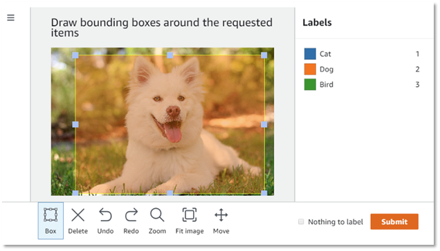

</div>
]


---
# Clickworking und Crowdsourcing

.pull-left-wide2[
## Plattformen

- **Mikrojobs**: Texte prüfen, Bilder beschriften, Daten erfassen, Antworten bewerten. Bezahlung pro Aufgabe.
- [Clickworker](https://www.clickworker.com/) (Deutschland, nach eigenen Angaben über 6 Mio. Registrierte), [Prolific](https://www.prolific.com/) (Forschung), [Toloka](https://toloka.ai/), [Appen](https://www.appen.com/), dazu die KI-Spezialisten Scale AI, Surge AI und Mercor, die inzwischen Fachkräfte (Ärzt:innen, Jurist:innen, Programmierer:innen) für anspruchsvolle Bewertungen anwerben.

## Ethische Fragen

- **Bezahlung und Arbeitsbedingungen**: Oft unter Mindestlohn; keine Absicherung; Belastung durch verstörende Inhalte (Moderation).
- **Globale Arbeitsteilung**: Die Annotation wandert dorthin, wo Arbeit billig ist; die Wertschöpfung bleibt beim Auftraggeber.
- **Datenschutz**: Wer annotiert Eure Akten, wenn Ihr ein Modell trainieren lasst, und wo sitzt diese Person?
]

.pull-right-small2[
<div align="center">
<br>
<span style="font-size:70%">2005–2026</span><br><br>

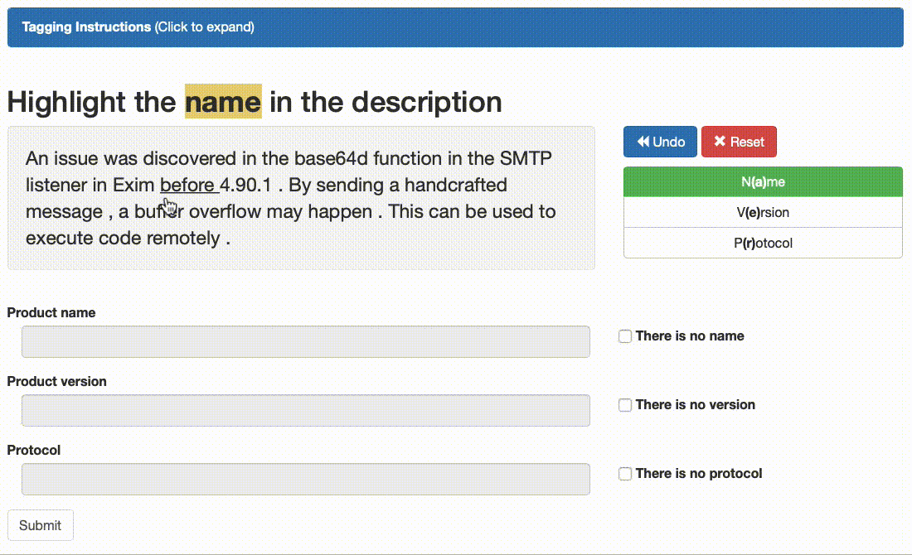
</div>

.font80[`Quelle` [TechPolicy.Press: Mechanical Turk is Closing (2026)](https://www.techpolicy.press/mechanical-turk-is-closing-the-workers-who-built-ai-are-still-here/)]
]


---
# Und wenn die Daten nicht passen?

.pull-left[
## Zwei Fragen, die wir morgen vertiefen werden

**Wer oder was ist in den Daten drin, wer nicht?** (Selektion)

- Ein Fachverfahren kennt nur die, die einen Antrag gestellt haben, nicht die Berechtigten, die es nicht getan haben.
- Ein Chatbot, trainiert auf Bürgeranfragen per Web, kennt die Anliegen derer nicht, die anrufen oder vorbeikommen.

**Wird gemessen, was gemeint ist?** (Messung)

- Eine Akte dokumentiert die Entscheidung, nicht den Sachverhalt samt Kontext und alle angestellten Erwägungen.
]

.pull-right[
## Take-aways für heute

- Der Kontext der Datenerhebung entscheidet, **für wen** und **wofür** ein System funktioniert.
- Fundamentale Qualitätsprobleme lassen sich nicht nachträglich wegtrainieren.
- Zur Beurteilung der Datengüte für KI-Anwendungen benötigt es dieses Kontextwissen - zum Beispiel zusammengetragen in einem Steckbrief.

<br>
<div align="center">
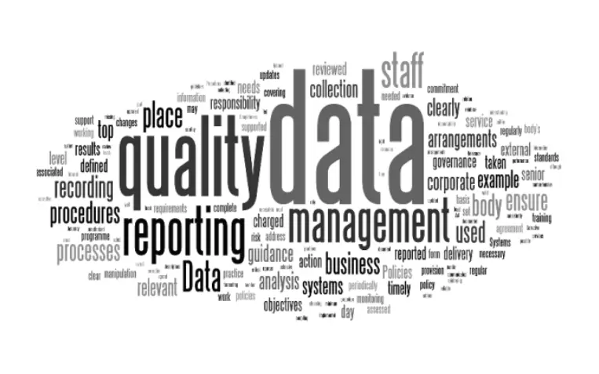
</div>
]


---
class: inverse, center, middle
name: yourdata

# Eure Daten
<html><div style='float:left'></div><hr color='#EB811B' size=1px style="width:1000px; margin:auto;"/></html>


---
# Ein Steckbrief für Datensätze

.pull-left-wide[
## „Datasheets for Datasets“

- Vorschlag von [Gebru et al. (2021)](https://doi.org/10.1145/3458723): Jeder Datensatz bekommt einen **Beipackzettel**, so wie elektronische Bauteile ein Datenblatt haben.
- Ziel: Wer einen Datensatz nutzt, soll wissen, wofür er entstanden ist und wofür er **nicht** taugt.

## Die Leitfragen

1. **Motivation**: Wofür und von wem wurde der Datensatz erstellt?
2. **Zusammensetzung**: Was ist eine Zeile? Gibt es sensible Daten, Lücken?
3. **Erhebung**: Wie, von wem, über welchen Zeitraum wurden Daten gesammelt?
4. **Aufbereitung**: Was wurde bereinigt, gefiltert, verändert? Gibt es die Rohdaten noch?
5. **Nutzung**: Wofür wurde er bisher verwendet? Wofür sollte er nicht verwendet werden?
6. **Pflege**: Wer ist verantwortlich? Wird er aktualisiert? Wie lange wird er aufbewahrt?
]

.pull-right-small[
<div align="center">
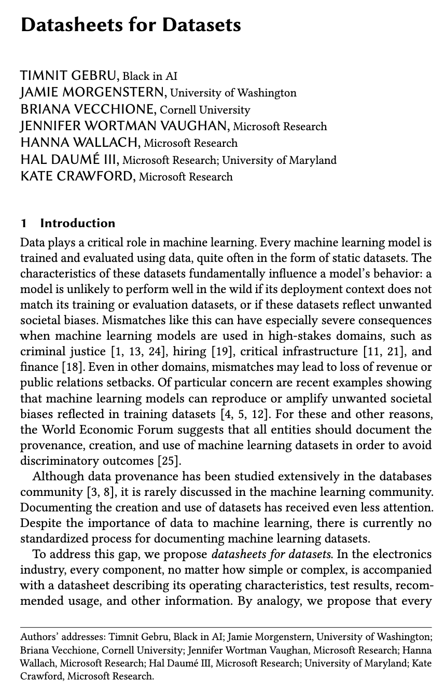
</div>
.font80[`Quelle` [Gebru et al. (2021), Communications of the ACM](https://doi.org/10.1145/3458723)]
]


---
class: exercise, center, middle

# Übung

.content-box-white[
**Daten-Poster-Karrussell**

<div align="left">
<ol>
  <li> 5 Gruppen à 5 Personen</li>
  <li> Jede Gruppe hat einen festen Poster-Standort.</li>
  <li> Jeweils eine Person bleibt beim eigenen Poster stehen und erklärt es.</li>
  <li> Die 4 anderen hören zu, stellen Fragen.</li>
  <li> Nach 3–4 Minuten wird gewechselt: Die nächste Person ist dran, bis alle 5 vorgestellt haben.</li>
</ol>
</div>
]


