```{css, echo=FALSE} 
@media print { # print out incremental slides; see https://stackoverflow.com/questions/56373198/get-xaringan-incremental-animations-to-print-to-pdf/56374619#56374619
  .has-continuation {
    display: block !important;
  }
}
```

```{r setup, include=FALSE}
# figures formatting setup
options(htmltools.dir.version = FALSE)
library(knitr)
opts_chunk$set(
  prompt = T,
  fig.align="center", #fig.width=6, fig.height=4.5, 
  # out.width="748px", #out.length="520.75px",
  dpi=300, #fig.path='Figs/',
  cache=T, #echo=F, warning=F, message=F
  engine.opts = list(bash = "-l")
  )

## Next hook based on this SO answer: https://stackoverflow.com/a/39025054
knit_hooks$set(
  prompt = function(before, options, envir) {
    options(
      prompt = if (options$engine %in% c('sh','bash')) '$ ' else 'R> ',
      continue = if (options$engine %in% c('sh','bash')) '$ ' else '+ '
      )
})

library(tidyverse)
library(hrbrthemes)
library(fontawesome)
```


# Überblick

<br><br>

1. [Daten-Organisation in Spreadsheets](#spreadsheets)

2. [Relationale Datenstrukturen](#relationaldata)

3. [Austauschformate: XML, JSON und die XÖV-Standards](#formats)

4. [Daten zur Verfügung stellen](#sharing)


---
# Daten vs. Datenformate


.pull-left-vwide[
## Datenformate

- [Datenformate](https://de.wikipedia.org/wiki/Datenformat) sind die **Art und Weise, wie Daten gespeichert und übertragen werden**.
- Sie sind **nicht** dasselbe wie Datentypen.
- Datenformate legen fest, wie Daten strukturiert und abgelegt werden, und wie sie bei ihrer Verarbeitung zu interpretieren sind.
- Es gibt eine nahezu unerschöpfliche Masse an Datenformaten, die sich zum Beispiel in der Vielfalt von [Dateinamenserweiterungen](https://de.wikipedia.org/wiki/Liste_von_Dateinamenserweiterungen) widerspiegelt.

## Wahl von Datenformaten

- Datenwissenschaftler haben oft mehr oder weniger ausgeprägte Präferenzen für bestimmte Datenformate und -strukturen.
- **Beispiel 1** (für einfach strukturierte Daten): Excel Binary File Format (.XLS) < Office Open XML (.XLSX) < [CSV](https://de.wikipedia.org/wiki/CSV_(Dateiformat)) 
- **Beispiel 2** (für semistrukturierte Daten): 
[JSON](https://de.wikipedia.org/wiki/JavaScript_Object_Notation) vs. [XML](https://de.wikipedia.org/wiki/Extensible_Markup_Language) 
- **Beispiel 3** (für vektorielle Geodaten):  [Shapefile](https://de.wikipedia.org/wiki/Shapefile) vs. [GeoJSON](https://de.wikipedia.org/wiki/GeoJSON) 
]

.pull-right-vsmall[
<br><br><br>
<div align="center">
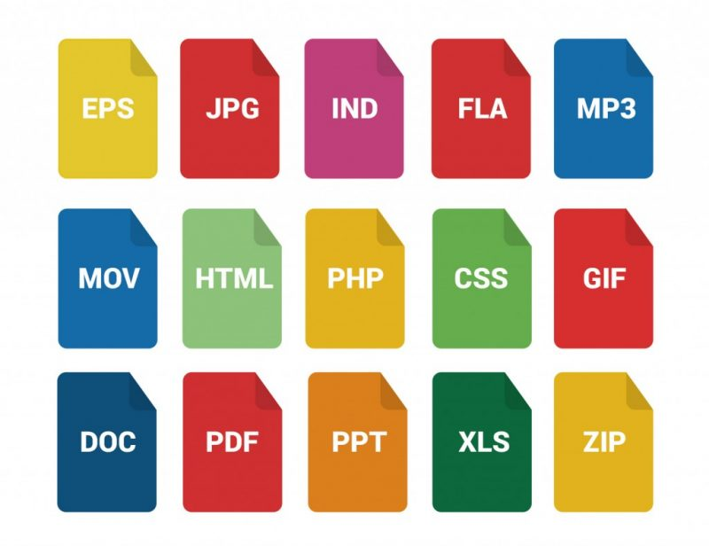
</div>
]


---
class: inverse, center, middle
name: spreadsheets

# Daten-Organisation in Spreadsheets
<html><div style='float:left'></div><hr color='#EB811B' size=1px style="width:1000px; margin:auto;"/></html>


---
# Die Verwaltung läuft auf Excel

.pull-left-wide2[
## Das verbreitetste Datenwerkzeug der Welt

- Excel ist in praktisch jeder Behörde installiert, jeder kann es öffnen und bedienen (..?). Deshalb ist das Spreadsheet die **Standardform der Datenhaltung** jenseits der Fachverfahren: Listen, Kennzahlen, Zuwendungen. 
- Typischer Lebenszyklus einer Verwaltungstabelle: Export aus dem Fachverfahren, Bearbeitung in Excel, **Versand per E-Mail**, Rückmeldung in einer bearbeiteten Kopie, Zusammenführung von Hand, Weiterleitung nach oben.

## Das Hin-und-her-Schubsen

- `Kennzahlen_2026_final.xlsx`, `Kennzahlen_2026_final_v2.xlsx`, `Kennzahlen_2026_final_v2_NEU_Korrektur_MS.xlsx`
- Welche Version stimmt? Wer hat was geändert? Wo ist das Original? Spalten werden umbenannt, Zeilen eingefügt, Formeln überschrieben, Formate „verschönert“. Jede Weitergabe ist ein **Medienbruch im Kleinen**.
]

.pull-right-small2[
<div align="center">

<br>
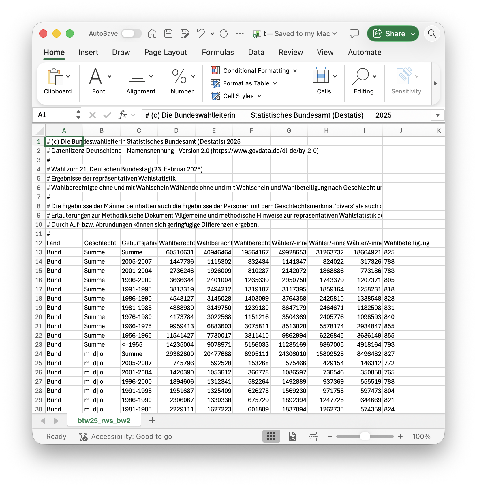
</div>

.font80[`Quelle` [Bundeswahlleiterin](https://bundeswahlleiterin.de/bundestagswahlen/2025/ergebnisse/repraesentative-wahlstatistik.html)
]
]


---
# Wenn das Spreadsheet die Datenbank ist

.pull-left[
## England, Oktober 2020

- Public Health England sammelte die Ergebnisse der Corona-Testlabore als CSV und überführte sie per Skript in **Excel-Vorlagen im alten XLS-Format**.
- XLS kann maximal **65.536 Zeilen**. Was darüber hinausging, wurde **stillschweigend abgeschnitten**.
- Zwischen dem 25. September und dem 2. Oktober 2020 fehlten so **15.841 positive Fälle** in der Meldung, rund 15 bis 20% aller Fälle. Ihre Kontakte wurden nicht nachverfolgt.

## Die Folgen

- [Fetzer und Graeber (2021)](https://doi.org/10.1073/pnas.2100814118) nutzen den Zufall des Fehlers als natürliches Experiment: In stärker betroffenen Regionen folgten mehr als **125.000 zusätzliche Infektionen** und über **1.500 zusätzliche Todesfälle**.
]

.pull-right[
<div align="center">

</div>

.font80[`Quellen` [BBC (2020)](https://www.bbc.com/news/technology-54423988); [The Conversation (2020)](https://theconversation.com/why-you-should-never-use-excel-to-count-coronavirus-cases-147681)]
]


---
# Excel verändert Daten, ohne zu fragen

.pull-left[
## Automatische „Korrekturen“

- **Gen-Namen werden zu Datumsangaben**: `SEPT2` wird zu `2-Sep`, `MARCH1` zu `1-Mar`. [Ziemann et al. (2016)](https://doi.org/10.1186/s13059-016-1044-7) fanden solche Fehler in rund **20% aller Genetik-Publikationen** mit Excel-Anhängen. 2020 wurden die Gene umbenannt, weil Excel nicht zu ändern war.
- **Führende Nullen verschwinden**: Die Postleitzahl `01067` (Dresden) wird zur Zahl `1067`. Das Gleiche passiert mit Aktenzeichen, Kontonummern, Gemeindeschlüsseln.
- **Lange Zahlen werden gerundet**: Ab 16 Stellen schneidet Excel ab; `1,23457E+15` statt der Kennnummer.
- **Trennzeichen**: Deutsche Excel-Versionen lesen CSV mit Komma als eine einzige Spalte, weil das Komma hier Dezimaltrenner ist.
]

.pull-right[
## Was daraus folgt

- Excel **interpretiert** Daten beim Öffnen. Was Ihr seht, ist nicht unbedingt, was gespeichert ist.
- Jede Übergabe einer Tabelle zwischen Rechnern, Sprachversionen und Programmen ist eine **potenzielle Fehlerquelle**.
- Wer Daten **weitergibt**, sollte sie in einem Format weitergeben, das nicht interpretiert wird (Text, siehe gleich), und dokumentieren, was die Spalten bedeuten.

<div align="center">

</div>
]


---
# Gute Tabellen: zwölf Regeln (1/2)

.pull-left-wide[
.font90[
1. **Seid konsistent.** Gleiche Schreibweise für gleiche Dinge: nicht `m`, `männlich`, `M`, `Mann` in einer Spalte. Gleiche Kennung für fehlende Werte (leer oder `NA`), gleiche Dateinamen-Logik, gleiche Spaltennamen in allen Tabellen.

2. **Schreibt Datumsangaben als `JJJJ-MM-TT`.** `2026-10-27` ist eindeutig, sortierbar und international (ISO 8601). Alles andere wird früher oder später falsch gelesen.

3. **Lasst keine Zellen leer.** Leer heißt: unbekannt, nicht zutreffend, vergessen oder „siehe oben“? Schreibt es hin.

4. **Eine Information pro Zelle.** Nicht `Berlin, 10117` in einer Zelle, sondern zwei Spalten. Keine Einheiten in der Zahl (`12 km`), sondern eine Spalte `distanz_km`.

5. **Macht ein Rechteck daraus.** Eine Kopfzeile, darunter eine Zeile pro Beobachtung, eine Spalte pro Merkmal. Keine verbundenen Zellen, keine Zwischenüberschriften, keine Summenzeilen im Datenbereich, keine zwei Tabellen auf einem Blatt.

6. **Erstellt ein Datenwörterbuch.** Eine zweite Tabelle: Spaltenname, Bedeutung, Einheit, erlaubte Werte, Quelle.
]
]

.pull-right-small[
<br>
<div align="center">
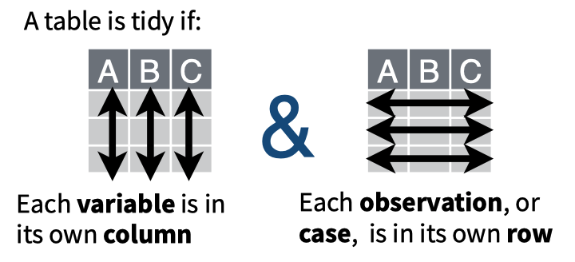
</div>

.font80[`Quelle` [Broman und Woo (2018), Data organization in spreadsheets, The American Statistician](https://doi.org/10.1080/00031305.2017.1375989), frei lesbar unter [kbroman.org/dataorg](https://kbroman.org/dataorg/).]
]


---
# Gute Tabellen: zwölf Regeln (2/2)

.pull-left-wide[
.font90[
<ol start="7">
<li><p><b>Keine Berechnungen in den Rohdaten.</b> Rohdaten sind unantastbar. Summen, Prozente, Diagramme kommen in eine separate Datei oder ein separates Blatt.</p></li>
<li><p><b>Keine Farben und Formatierungen als Information.</b> „Rot markiert heißt geprüft“ ist für Menschen lesbar, für Maschinen unsichtbar und beim nächsten Export weg. Macht eine Spalte <code>geprueft</code> mit <code>ja</code>/<code>nein</code>.</p></li>
<li><p><b>Wählt gute Namen.</b> Spaltennamen ohne Leerzeichen, Umlaute und Sonderzeichen: <code>antrag_datum</code> statt <code>Datum des Antrags (neu)</code>. Kurz, aber sprechend.</p></li>
<li><p><b>Macht Sicherungskopien.</b> Und schützt die Rohdaten vor Überschreiben (schreibgeschützt ablegen).</p></li>
<li><p><b>Nutzt Datenvalidierung bei der Eingabe.</b> Excel kann Dropdown-Listen und Wertebereiche erzwingen. Das verhindert <code>Bayenr</code> und <code>31.02.2026</code>.</p></li>
<li><p><b>Speichert Daten als Text.</b> CSV (oder TSV) ist das einzige Format, das in 20 Jahren noch jedes Programm liest. Excel-Dateien sind Arbeitsdateien, keine Archivdateien.</p></li>
</ol>
]
]

.pull-right-small[
<br>
<div align="center">
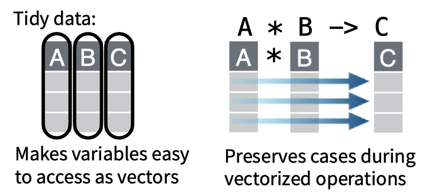
</div>

<br>
️✎ Die meisten dieser Regeln laufen auf eines hinaus: **Trennt die Daten von ihrer Darstellung.**
]


---
# Vom Hin-und-her-Schubsen zum geteilten Datenbestand

.pull-left-wide[
## Woran man erkennt, dass eine Tabelle zur Datenbank geworden ist

- Mehrere Personen bearbeiten sie, und es gibt Konflikte.
- Sie wird regelmäßig aktualisiert und an andere verschickt.
- Andere Tabellen oder Berichte hängen davon ab.
- Es gibt mehr als eine Version, und niemand weiß, welche gilt.
- Sie hat mehr als ein paar tausend Zeilen.

## Stufen der Besserung

1. **Eine Quelle der Wahrheit**: Eine Datei an einem Ort, nicht per Mail; Änderungen nur dort.
2. **Trennung von Erfassung und Auswertung**: Rohdaten-Tabelle plus separate Auswertungsdateien.
3. **Geteilte Tabelle mit Rechten** (SharePoint, Nextcloud, Google Sheets): gleichzeitiges Arbeiten, Änderungshistorie.
4. **Datenbank mit Eingabemaske**: Wenn Regeln, Mehrbenutzerzugriff und Verknüpfungen nötig sind.
]

.pull-right-small[
<br>
<div align="center">
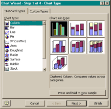
</div>

<br>
️✎ Die Frage ist nicht „Excel oder nicht Excel“, sondern: **Wer ist für diese Daten verantwortlich, und wo ist das Original?**
]


---
class: inverse, center, middle
name: relationaldata

# Relationale Datenstrukturen
<html><div style='float:left'></div><hr color='#EB811B' size=1px style="width:1000px; margin:auto;"/></html>


---
# Die Allgegenwärtigkeit von relationalen Datenstrukturen

.pull-left-wide[
### Von Tabellen...

- Wenn Ihr an Daten auf Eurem Laptop denkt, habt Ihr möglicherweise ein [Spreadsheet](https://de.wikipedia.org/wiki/Tabellenkalkulation) im Kopf.
- In der Tat arbeitet ein Großteil der klassischen "statistischen" Software (SPSS, Stata, MS Excel) standardmäßig mit Spreadsheets als Dateninput.
- Gleichzeitig ist einer Eurer ersten Gedanken möglicherweise auch [dateibasiert](https://en.wikipedia.org/wiki/List_of_file_formats). Die Daten werden in Dateien gespeichert, und diese Dateien werden von unserer Datenverwaltungssoftware gelesen (und erstellt).
- In vielen Fällen ist eine **zweidimensionale Datenstruktur** sinnvoll. Wir nutzen zum Beispiel
  - Befragte x Einstellungen
  - Bezirke x Merkmale
  - Beiträge in sozialen Medien x Textmerkmale
]

.pull-right-small[
<br><br>
<div align="center">
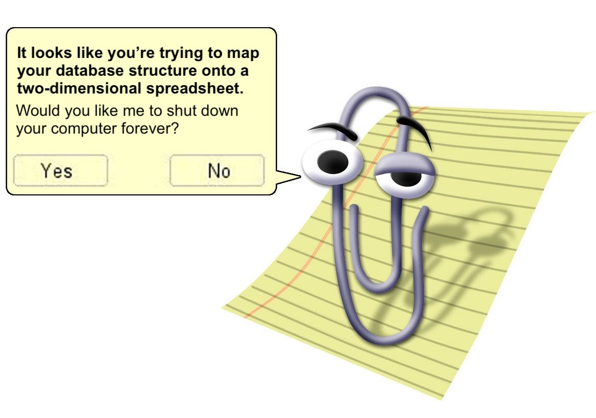 
</div>
]


---
# Die Allgegenwärtigkeit von mehrdimensionalen Datenstrukturen

.pull-left-small2[
<div align="center">
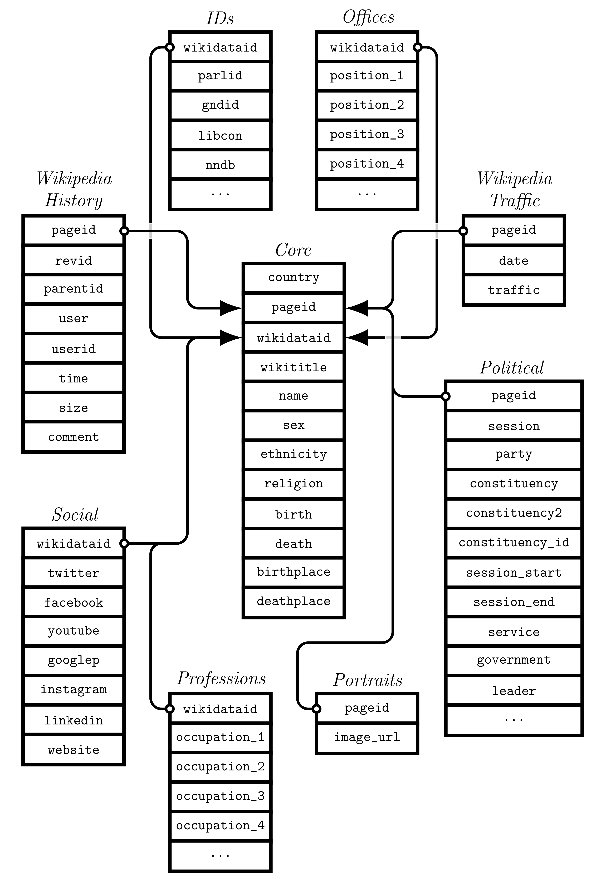
</div>
`Credit` [saschagobel/legislatoR](https://github.com/saschagobel/legislatoR)
]

.pull-right-wide2[
### ... zu komplexen Datenstrukturen

- Je länger man jedoch darüber nachdenkt, desto problematischer wird es, Daten systematisch in zweidimensionalen Strukturen abzulegen.
- **Beispiele**:
  - Befragte x Einstellungen x Länder x Zeit
  - Bezirke x Unterbezirke Merkmale x Zeit
  - Beiträge in sozialen Medien x Retweets x Benutzer x Benutzereigenschaften x Netzwerkmerkmale x Metadaten
- Die Abbildung von dreidimensionalen auf zweidimensionale Strukturen ist technisch einfach machbar.
- Bei **vielfachen heterogenen Datenquellen** wird es unübersichtlich.
- Die Verwaltung komplexer Datenstrukturen ist nur ein Vorteil der Verwendung von **Datenbanken**.
]


---
# Datenbanken

### Was sind Datenbanken?

- Datenbanken sind eine organisierte Sammlung von Daten.
- Sie sind so organisiert, dass sie ein effizientes Abrufen von Daten(-selektionen) ermöglichen.
- Sie enthalten Daten + Metadaten über Struktur und Organisation.
- Der Zugriff auf sie erfolgt im Allgemeinen über ein Datenbankmanagementsystem.

### Wo sind Datenbanken?

- Datenbanken können lokal oder dezentral, im Arbeitsspeicher oder auf der Festplatte existieren.
- Wenn sie lokal gespeichert sind, werden sie als Binärdatei (nicht als Textdatei) gespeichert.
- Im Allgemeinen denken wir an ein **Client-Server-Modell**:
  - Datenbanken befinden sich auf einem **Server**, der sie verwaltet.
  - Die Benutzer interagieren mit dem Server über ein **Client**-Programm.
  - Mehrere Benutzer können auf dieselbe Datenbank **gleichzeitig zugreifen**.


---
# Wann Datenbanken nützlich werden

.pull-left[
### Größe und Struktur
- Ihr habt **Datenmengen, die den Arbeitsspeicher** auf Eurem Computer übersteigen. Datenbanken sind nur durch die verfügbare Festplattengröße begrenzt (oder können auf mehrere Festplatten/Rechner verteilt werden) und lassen sich schnell und häufig abfragen.
- Eure **Datenstruktur ist komplex**. Datenbanken erlauben es, Daten mit komplexen Datenstrukturen zu speichern, abzurufen und zu untergliedern.
- Ihr legt Wert auf **Datenqualität** und habt klare Vorstellungen, wie Daten aussehen sollen. Mit Hilfe von Datenbanken könnt Ihr spezifische Regeln für die Erweiterung und Aktualisierung Eurer Datenbank definieren.
]

--

.pull-right[
### Zugänglichkeit und Gleichzeitigkeit
- Ihr **arbeitet gemeinsam mit anderen** an einem Datenprojekt. Mit einer Datenbank habt Ihr eine gemeinsame, zuverlässige Infrastruktur zur Verfügung, auf die mehrere Benutzer gleichzeitig zugreifen können.
- Wenn mehrere Parteien beteiligt sind, können Nutzerprivilegien wichtig sein (z. B. nur Lesezugriff, Zugriff auf Teile der Daten, eingeschränkte Verwaltungsrechte usw.). Die meisten Datenbanken erlauben die **Definition unterschiedlicher Nutzungsrechte für verschiedene Benutzer**.
]


---
# Codds relationales Modell für Datenbanken

.pull-left[
- Das Konzept relationaler Datenbanken baut auf dem [relational model (RM)](https://en.wikipedia.org/wiki/Relational_model) auf, das 1969/1970 von [Edgar F. "Ted" Codd](https://en.wikipedia.org/wiki/Edgar_F._Codd) vorgeschlagen wurde.
- Codd beschrieb das RM formal, führte es aber auch mit Konzepten ein, die auch heute noch verwendet werden (Normalisierung, Schlüssel, Joins, usw.).
- Die Grundannahme des relationalen Modells ist, dass alle Daten als Relationen (Tabellen) dargestellt werden können.
- Informationen werden dann durch in Beziehung stehende Datenwerte dargestellt.

<div align="center">

</div>
]


.pull-right-center[
<div align="center">
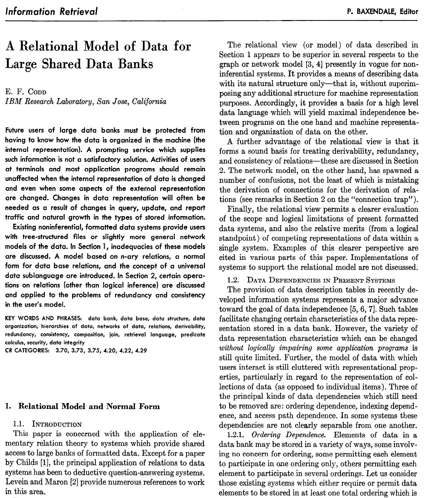
</div>
`Credit` [Communications of the ACM 13(6), 1970](https://dl.acm.org/doi/10.1145/362384.362685)
]


---
# Tabellarische Daten: Beispiel

.pull-left[
### Speicherung von Daten in Tabellen

- Eine einzige Tabelle stellt bereits Beziehungen her: Alle Daten in einer Zeile gehören zu demselben Datensatz.
- Wenn wir komplexere Beziehungen darstellen wollen (z. B. das Gewicht einer Person zweimal messen oder das Gewicht ihrer Kinder ebenfalls messen), können wir Daten von einer Tabelle zur anderen in Beziehung setzen.

### Beispiel

- Wir haben Daten über Peter, Paul und Mary gesammelt.
- Wir haben Informationen über Geburtstage, Telefonnummern und Lieblingsspeisen.
- Wie können wir diese Informationen in Tabellen darstellen?
]

--

.pull-right[
<div align="center">
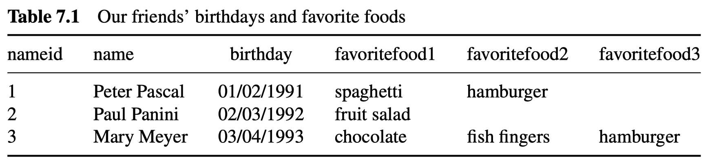
</div>
<div align="center">
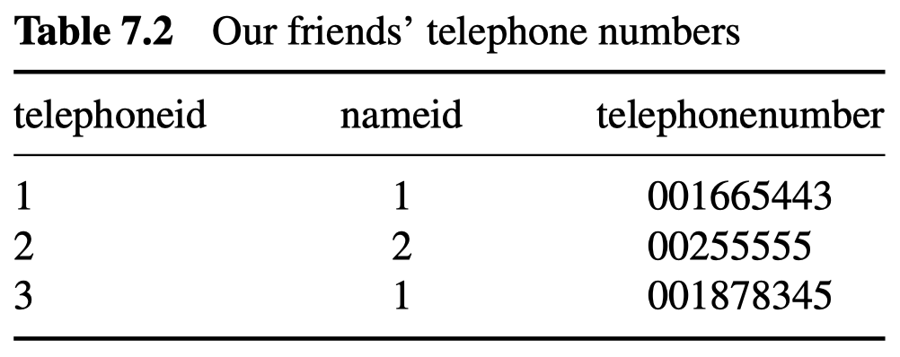
</div>

- Wir beginnen mit der Darstellung der Daten in zwei Tabellen.
- Sie sind über den Schlüssel `nameid` verknüpft, so dass wir die vollständigen Namen nicht in die Tabelle der Telefonnummern aufnehmen müssen.
- Beachtet, dass wir hier eine 1:m (one-to-many) Beziehung haben, da Peter zwei Telefonnummern hat.
]

---
# Tabellarische Daten: Beispiel

.pull-left[
### Speicherung von Daten in Tabellen

- Eine einzige Tabelle stellt bereits Beziehungen her: Alle Daten in einer Zeile gehören zu demselben Datensatz.
- Wenn wir komplexere Beziehungen darstellen wollen (z. B. das Gewicht einer Person zweimal messen oder das Gewicht ihrer Kinder ebenfalls messen), können wir Daten von einer Tabelle zur anderen in Beziehung setzen.

### Beispiel

- Wir haben Daten über Peter, Paul und Mary gesammelt.
- Wir haben Informationen über Geburtstage, Telefonnummern und Lieblingsspeisen.
- Wie können wir diese Informationen in Tabellen darstellen?
]

.pull-right[
<div align="center">

</div>
<div align="center">

</div>

- Die Art und Weise, wie wir die Daten speichern, ist jedoch nicht ideal. In der ersten Tabelle haben wir drei Spalten, die praktisch das Gleiche messen. Und was, wenn es noch mehr Lieblingsessen gibt? Das Hinzufügen von Informationen auf diese Weise führt zu einer Menge redundanter Informationen.
- Wir können die Daten normalisieren, um Redundanzen zu vermeiden.
]


---
# Tabellarische Daten: Beispiel

.pull-left[
### Speicherung von Daten in Tabellen

- Eine einzige Tabelle stellt bereits Beziehungen her: Alle Daten in einer Zeile gehören zu demselben Datensatz.
- Wenn wir komplexere Beziehungen darstellen wollen (z. B. das Gewicht einer Person zweimal messen oder das Gewicht ihrer Kinder ebenfalls messen), können wir Daten von einer Tabelle zur anderen in Beziehung setzen.

### Beispiel

- Wir haben Daten über Peter, Paul und Mary gesammelt.
- Wir haben Informationen über Geburtstage, Telefonnummern und Lieblingsspeisen.
- Wie können wir diese Informationen in Tabellen darstellen?
]

.pull-right[
<div align="center">
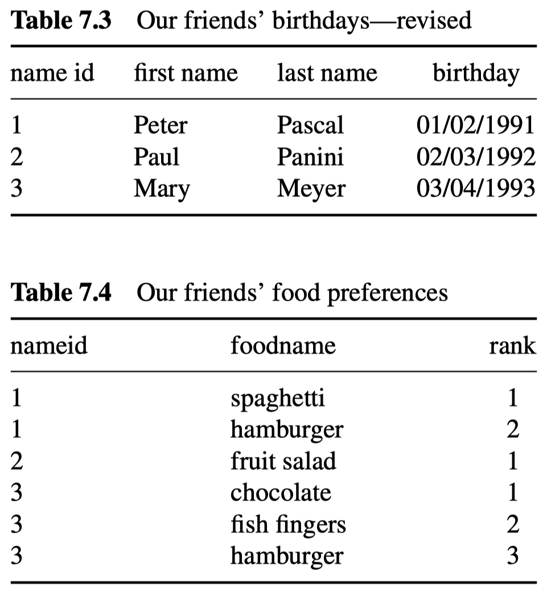
</div>

- Besser ist es, die Informationen aufzuteilen und eine weitere Tabelle für die Essenspräferenzen zu erstellen.
- Es bleibt immer noch etwas Redundanz übrig. Ist es wirklich notwendig, "Hamburger" zweimal in der Tabelle zu haben?
]


---
# Tabellarische Daten: Beispiel

.pull-left[
### Speicherung von Daten in Tabellen

- Eine einzige Tabelle stellt bereits Beziehungen her: Alle Daten in einer Zeile gehören zu demselben Datensatz.
- Wenn wir komplexere Beziehungen darstellen wollen (z. B. das Gewicht einer Person zweimal messen oder das Gewicht ihrer Kinder ebenfalls messen), können wir Daten von einer Tabelle zur anderen in Beziehung setzen.

### Beispiel

- Wir haben Daten über Peter, Paul und Mary gesammelt.
- Wir haben Informationen über Geburtstage, Telefonnummern und Lieblingsspeisen.
- Wie können wir diese Informationen in Tabellen darstellen?
]

.pull-right[
<div align="center">
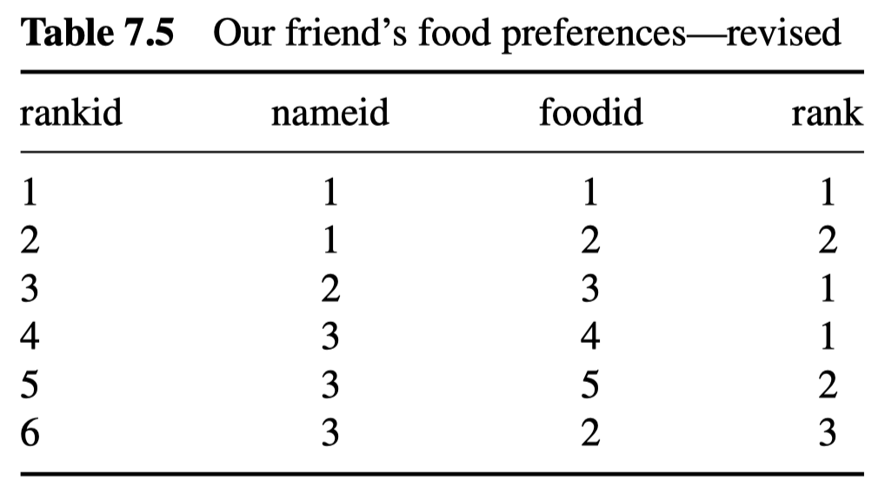
</div>
<div align="center">
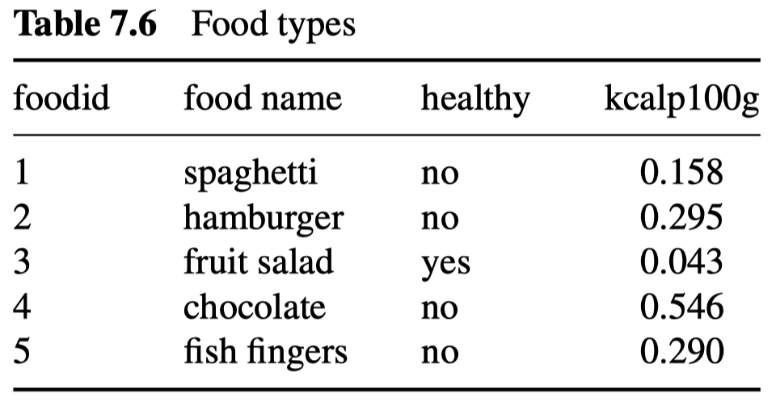
</div>

- Jetzt ist es besser.
- Bei der Umstrukturierung der Informationen in unserer Datenbank haben wir **Redundanz (Duplikation)** vermieden.
- Dies ist der Prozess der **Datenbanknormalisierung**.
]


---
exclude: true

# Was ist SQL?

### Hintergrund und Geschichte

- SQL (ausgesprochen [ɛsˌkjuːˈɛl] wie in S-Q-L, oder [siːkwəl] wie in sequel) steht für **Structured Query Language**. Ursprünglich hieß sie SEQUEL (Structured English Query Language), wurde aber aufgrund von Markenrechtsproblemen fallen gelassen.
- Es handelt sich um eine domänenspezifische Sprache, die für die Abfrage von Daten in relationalen Datenbanken entwickelt wurde.
- Ursprünglich wurde sie 1974 bei IBM von [Donald D. Chamberlin](https://en.wikipedia.org/wiki/Donald_D._Chamberlin) und [Raymond F. Boyce](https://en.wikipedia.org/wiki/Raymond_F._Boyce) entwickelt.

--

### Warum SQL?

- Es gibt zwar unterschiedliche Datenbanktypen, aber die meisten relationalen Datenbanken, denen Ihr begegnen werdet, sprechen SQL.
- Die wichtigste Fähigkeit für die Arbeit mit Datenbanken ist das Erlernen von SQL. 
- SQL wird in vielen (den meisten?) Stellenausschreibungen für Datenwissenschaftler als erforderliche Fähigkeit aufgeführt.


---
# Datenbankmanagementsysteme

.pull-left-wide[
### Was sind DBMS?

- Datenbankmanagementsysteme (DBMS) bieten **effiziente**, **zuverlässige**, **bequeme**, **sichere** Speicherung von und Zugriff auf **massive** Daten.
    - **Effizient**: Einfach schnell.
    - **Zuverlässig**: Hohe Betriebszeit.
    - **Komfortabel**: Hochwertige Abfragesprachen.
    - **Sicher**: Robust gegenüber Stromausfällen, Knotenausfällen, usw.
    - **Mehrbenutzer**: Gleichzeitigkeitskontrolle. Nicht nur ein Benutzer, sondern mehrere.
    - **Massiv**: Denkt an Terabytes, nicht an Gigabytes. Verarbeitung von Daten, die sich außerhalb des Speichers befinden.
- Es gibt [etliche DBMS](https://en.wikipedia.org/wiki/List_of_relational_database_management_systems) allein für relationale Datenbankstrukturen.
- RDBMS unterscheiden sich in Bezug auf Fähigkeiten, implementierte Funktionen, Betriebssystemunterstützung und vieles mehr. Siehe [The Database Database](https://technically.dev/database-database) für einen Überblick.
]

.pull-right-small[
<div align="center">
<br>


</div>
]


---
# Datenbanken in der Verwaltung: Wo liegen die Daten?

.font90[
### Fachverfahren statt Datenbank

- Behördendaten stecken fast immer in **Fachverfahren**: Software für einen Aufgabenbereich (Meldewesen, Kfz-Zulassung, Sozialleistungen, Bauanträge). Darunter läuft ein DBMS, das der Fachbereich nie sieht: Er bedient Masken, nicht Tabellen.
- Betrieb meist beim **IT-Dienstleister** (Dataport, AKDB, regio iT, ekom21 …) oder beim Hersteller. Wer die Daten auswerten will, braucht also einen Zugang, der im Vertrag steht, nicht nur eine Exportfunktion.

### Register: viele, dezentral, nicht vernetzt

- Deutschland hat **über 375 Registertypen**, historisch gewachsen und föderal verteilt: das Melderegister bei jeder Gemeinde, das Handelsregister bei den Amtsgerichten, das Fahrzeugregister beim KBA ([ÖFIT 2025](https://www.oeffentliche-it.de/blog/die-registermodernisierung-register-vernetzen-verwaltung-digitalisieren/), [IT-Planungsrat 2021](https://www.IT-Planungsrat.de/fileadmin/beschluesse/2021/Beschluss2021-05_Registermodernisierung.pdf)).
- Die Trennung ist **gewollt**: Das [Volkszählungsurteil (1983)](https://www.bundesverfassungsgericht.de/SharedDocs/Entscheidungen/DE/1983/12/rs19831215_1bvr020983.html) verbietet ein einheitliches Personenkennzeichen und verlangt Zweckbindung. Jede Verknüpfung über Register hinweg braucht eine Rechtsgrundlage.

### Herstellerabhängigkeit

- Der Bund hat 2023 einen **Rahmenvertrag über 4,6 Mrd. €** mit Oracle geschlossen (Laufzeit bis 2030); laut einer Deloitte-Analyse für das BMI laufen rund 75% der Daten der Bundesverwaltung über Oracle-Produkte ([Computerwoche 2023](https://www.computerwoche.de/a/bundesregierung-zahlt-milliarden-an-oracle-und-microsoft,3698126), [Tagesspiegel Background 2024](https://background.tagesspiegel.de/digitalisierung-und-ki/briefing/umstrittener-vier-milliarden-deal-mit-oracle)). Open-Source-DBMS wie PostgreSQL gelten als Weg zu mehr digitaler Souveränität.
]


---
# Registermodernisierung: vernetzen statt zusammenlegen

.pull-left[
.font90[
### Ziel: Once-Only

- Bürger und Unternehmen sollen Nachweise **nur einmal** vorlegen; die Verwaltung holt sie sich bei der zuständigen Stelle. Grundlage: EU-[Single-Digital-Gateway-Verordnung](https://eur-lex.europa.eu/eli/reg/2018/1724/oj?locale=de) (2018) und [Registermodernisierungsgesetz](https://www.gesetze-im-internet.de/idnrg/) (2021).
- Die **Steuer-ID wird Identifikationsnummer** für 51 priorisierte Register (Melde-, Personenstands-, Fahrzeugregister …), Frist Ende 2028.

### Architektur: NOOTS

- Keine zentrale Datenbank, sondern ein **Vermittlungssystem** (Nationales Once-Only-Technical-System): Register bleiben, wo sie sind; Nachweise werden einzeln, mit Einwilligung und protokolliert abgerufen.
- Das **Datenschutzcockpit** zeigt Bürgern, welche Behörde wann welche Daten abgerufen hat.
]
]

.pull-right[
.font90[
### Stand

- **14.01.2026**: erster Nachweisabruf über das NOOTS (Fahrzeugregister des KBA für einen Bewohnerparkausweis in Baden-Württemberg); Gewerbeanmeldung mit Handelsregister-Abruf in NRW folgt ([BVA](https://www.bva.bund.de/SharedDocs/Pressemitteilungen/DE/2026/20260114_livegang_noots.html)).
- Flächen-Rollout ab **November 2026**; Betrieb beim Bundesverwaltungsamt.

### Kritik

- Die Steuer-ID als **Quasi-Personenkennzeichen** widerspreche dem Volkszählungsurteil; die Humanistische Union klagt ([HU](https://www.humanistische-union.de/thema/humanistische-union-laesst-steuer-id-gerichtlich-ueberpruefen/)). Österreich nutzt bereichsspezifische Kennungen.
]
]


---
# Was Führungskräfte über ihre Datenbanken wissen sollten

.font90[
## Vier Fragen, die Ihr Eurer IT oder Eurem Dienstleister auch ohne technisches Detailwissen stellen könnt

1. **Wo liegen unsere Daten?** <br> Welche Fachverfahren nutzen wir, welche Daten stecken darin, und wer betreibt sie: unser eigenes Rechenzentrum, ein kommunaler IT-Dienstleister, der Hersteller oder ein Cloud-Anbieter?
2. **Kommen wir an unsere Daten heran?** <br> Können wir sie vollständig und in einem offenen Format (z. B. CSV, XML) herausholen, auch ohne den Hersteller zu fragen? Gibt es eine dokumentierte Schnittstelle? Und steht das so im Vertrag? Wer das erst beim Anbieterwechsel klärt, zahlt doppelt.
3. **Können wir die Daten auswerten, ohne den laufenden Betrieb zu stören?** <br> Das System, in dem die Sachbearbeitung täglich arbeitet, ist nicht zum Auswerten da. Gibt es eine Kopie der Daten für Analysen und Berichte, und wer darf darauf zugreifen?
4. **Worauf passt die Datenbank selbst auf?** <br> Welche Fehler verhindert sie automatisch (Pflichtfelder, feste Auswahllisten, keine doppelten Einträge), und welche werden nur in Schulungen angesprochen? Wer darf was sehen und ändern, und wird das protokolliert?

️✎ Datenbank-Kompetenz auf Leitungsebene heißt nicht, SQL-Abfragen zu schreiben, sondern zu wissen, **wo die Daten liegen, wem sie gehören und wer sie herausbekommt**. Alles andere lässt sich beauftragen.
]


---
class: inverse, center, middle
name: formats

# Austauschformate: XML, JSON und die XÖV-Standards
<html><div style='float:left'></div><hr color='#EB811B' size=1px style="width:1000px; margin:auto;"/></html>


---
# Warum Austauschformate?

.pull-left[
## Excel ist kein Austauschformat

- Eine Excel-Datei transportiert **Darstellung** (Formate, Farben, Spaltenbreiten, Formeln).
- Für den Austausch zwischen **Programmen** braucht man Formate, die eindeutig Daten und deren Struktur transportieren.

## Was ein gutes Austauschformat kann

- **Maschinenlesbar** ohne Rätselraten: Struktur ist explizit.
- **Validierbar**: Man kann prüfen, ob eine Datei den Regeln entspricht (Schema).
- **Offen dokumentiert**: Keine Abhängigkeit von einem Hersteller.
- **Textbasiert**: In jedem Editor lesbar, versionierbar, langlebig.
]

.pull-right[

## Drei Familien

- **Tabellen als Text**: CSV, TSV. Eine Zeile pro Datensatz, Trennzeichen zwischen Feldern. Einfach, universell, aber nur für flache Tabellen.
- **Hierarchische Formate**: XML, JSON. Können verschachtelte Strukturen abbilden (z.B. ein Antrag mit mehreren Anlagen). Das Format der Web-APIs und der Verwaltungsschnittstellen.
- **Binäre Formate**: Parquet, Datenbankdateien. Effizient für große Datenmengen, aber nur mit Spezialsoftware lesbar.

<div align="center">

</div>
]


---
# XML: Extensible Markup Language

.pull-left[
## Grundidee

- Daten werden in **Elemente** eingeschlossen, die mit Tags markiert sind: `<Name>Mustermann</Name>`.
- Elemente können **verschachtelt** werden und **Attribute** tragen.
- Ein **Schema** (XSD) legt fest, welche Elemente erlaubt sind, in welcher Reihenfolge, mit welchen Datentypen. Das lässt automatische **Validierung** zu.
- **Namensräume** (`xmlns`) verhindern, dass `<Name>` in zwei Standards etwas Verschiedenes bedeutet.

## Wo XML lebt

- Fast alle **XÖV-Standards** der deutschen Verwaltung, die elektronische Rechnung (XRechnung), Office-Dokumente (DOCX ist gezipptes XML), RSS-Feeds, viele ältere Web-Schnittstellen (SOAP).
]

.pull-right[
## Beispiel

```{}
<?xml version="1.0" encoding="UTF-8"?>
<Personen>
  <Person id="1">
    <Name>van Pelt, Lucy</Name>
    <Geschlecht>weiblich</Geschlecht>
    <Alter>32</Alter>
  </Person>
  <Person id="2">
    <Name>Peppermint, Patty</Name>
    <Geschlecht>weiblich</Geschlecht>
    <Alter/>
  </Person>
  <Person id="3">
    <Name>Brown, Charlie</Name>
    <Geschlecht>männlich</Geschlecht>
    <Alter>27</Alter>
  </Person>
</Personen>
```
]


---
# JSON: JavaScript Object Notation

.pull-left-wide[
## Grundidee

- Daten stehen in **Schlüssel-Wert-Paaren**: `"name": "Brown, Charlie"`. Schlüssel immer in Anführungszeichen, Werte nur, wenn sie Text sind.
- Geschweifte Klammern `{ }` fassen ein **Objekt** zusammen (ein Datensatz), eckige Klammern `[ ]` eine **Liste** (mehrere Datensätze). Beides lässt sich beliebig **verschachteln**.
- Kein Schema vorgeschrieben, aber möglich (JSON Schema). Kompakter als XML, für Menschen gut lesbar.

## Wo JSON lebt

- Praktisch jede **Web-API** und jedes **Open-Data-Portal** antwortet in JSON (Session 4). Konfigurationsdateien, moderne Schnittstellen zwischen Programmen, die Metadaten bei [FIT-Connect](https://www.fitko.de/produktmanagement/fit-connect).
- Einlesen ist in jeder Sprache ein Einzeiler, in R etwa mit `jsonlite::fromJSON()`: Aus der Liste rechts wird direkt eine Tabelle mit drei Zeilen.
]

.pull-right-small[
## Beispiel

```{}
[
  {
    "id": 1,
    "name": "van Pelt, Lucy",
    "geschlecht": "weiblich",
    "alter": 32
  },
  {
    "id": 2,
    "name": "Peppermint, Patty",
    "geschlecht": "weiblich",
    "alter": null
  },
  {
    "id": 3,
    "name": "Brown, Charlie",
    "geschlecht": "männlich",
    "alter": 27
  }
]
```

️✎ Dieselben drei Datensätze wie im XML-Beispiel, mit etwa der Hälfte der Zeichen.
]


---
# XML oder JSON?

.font90[
| | **XML** | **JSON** |
|---|---|---|
| **Entstanden** | 1998, aus der Dokumentenwelt (SGML) | 2001, aus der Webprogrammierung (JavaScript) |
| **Umfang** | Manchmal unnötig ausführlich, viel Markup | Kompakt |
| **Schema und Validierung** | Ausgereift (XSD), verpflichtend in der Verwaltung | Vorhanden (JSON Schema), weniger verbreitet |
| **Typische Nutzung** | Verwaltungsstandards (XÖV), E-Rechnung, Dokumentformate, ältere Schnittstellen | Web-APIs, Open-Data-Portale, Konfigurationsdateien, moderne Schnittstellen |
| **Werkzeuge** | Jede Programmiersprache; spezialisierte Validatoren | Jede Programmiersprache; direkt im Browser lesbar |
| **Für Euch relevant** | Was zwischen Fachverfahren und Portalen fließt | Was Ihr von Open-Data-Portalen und Web-APIs bekommt |
]

️✎ **Kein Entweder-oder**: Dieselben Daten lassen sich verlustfrei in beide Richtungen übersetzen. [FIT-Connect](https://docs.fitko.de/fit-connect/docs/getting-started/submission/data), die Übermittlungsinfrastruktur des IT-Planungsrats, beschreibt jede Einreichung mit Metadaten nach JSON Schema und transportiert die Fachdaten wahlweise als JSON oder XML, je nachdem, was das Fachschema (FIM oder XÖV) vorgibt.


---
# XÖV: die Datenstandards der deutschen Verwaltung

.pull-left-wide2[
## Das Problem

- Bund, 16 Länder, rund 11.000 Kommunen, hunderte Fachverfahren von dutzenden Herstellern. Wenn jede Stelle mit jeder eine eigene Schnittstelle baut, entsteht **„Schnittstellen-Spaghetti“** mit unbezahlbaren Wartungskosten.

## Die Antwort

- **XÖV** (XML in der öffentlichen Verwaltung) ist ein **Standardisierungsrahmen**: gemeinsame Methoden, Bausteine und Entwurfsregeln, nach denen Fachstandards gebaut werden. 
- Koordiniert von der [KoSIT](https://www.xoev.de/) (Koordinierungsstelle für IT-Standards, Bremen) im Auftrag des IT-Planungsrats.
- Standards werden **XÖV-zertifiziert** und im [XRepository](https://www.xrepository.de/) veröffentlicht, samt Schemata und Codelisten.
- Gemeinsame Bausteine (Name, Anschrift, Datum, Behördenkennung) werden **wiederverwendet**.
]

.pull-right-small2[
## Beispiele

.font80[
| Standard | Wofür |
|---|---|
| **XMeld** | Meldewesen: Datenaustausch zwischen Meldebehörden |
| **XPersonenstand** | Geburten, Eheschließungen, Sterbefälle |
| **XBau** | Bauanträge und Baugenehmigungen |
| **XRechnung** | Elektronische Rechnung an öffentliche Auftraggeber |
| **xdomea** | Austausch von Akten und Vorgängen (E-Akte) |
| **XFall** | Antragsdaten von Portalen in Fachverfahren |
]
]


---
# Beispiel XFall: ein Antrag auf dem Weg ins Fachverfahren

.pull-left[
## Worum es geht

- Das Land betreibt **ein Antragsportal** für alle Kommunen. Die Kommunen bearbeiten die Anträge in **hunderten verschiedenen Fachverfahren**.
- XFall legt fest, wie die Antragsdaten vom Portal ins Fachverfahren kommen: **ein Format, egal welcher Hersteller**.
- Entwickelt von fünf Ländern und der Stadt Münster, u.a. für Gewerbeanmeldung, Kfz-Ummeldung, Elterngeld, Führungszeugnis.

️✎ Rechts: eine Gewerbeanmeldung, auf das Wesentliche gekürzt. Drei Blöcke, die in jedem XFall-Antrag vorkommen.
]

.pull-right[
## Die Fachnachricht (XFall-Daten 4.0.0)

.font70[
```xml
<xfd:gewerbe.gewerbeanmeldung.05001002 xFallDatenVersion="4.0.0">

  <!-- 1. Wer schickt das, wann? -->
  <xfd:transport>
    <xfd:erstelltUm>2026-10-27T09:14:00</xfd:erstelltUm>
    <xfd:erstelltVon>Serviceportal Niedersachsen</xfd:erstelltVon>
  </xfd:transport>

  <!-- 2. Wer stellt den Antrag? (AS = Antragstellerin) -->
  <xfd:beteiligter>
    <xfd:rolle><code>AS</code></xfd:rolle>
    <xfd:vorname>Erika</xfd:vorname>
    <xfd:familienname>Mustermann</xfd:familienname>
    <xfd:anschrift> ... </xfd:anschrift>
  </xfd:beteiligter>

  <!-- 3. Was wird beantragt? -->
  <xfd:ags><code>03159016</code></xfd:ags>            <!-- Göttingen -->
  <xfd:taetigkeit>Einzelhandel mit Fahrrädern</xfd:taetigkeit>
  <xfd:wzschluessel>47.64.1</xfd:wzschluessel>
  <xfd:datum>2026-11-01</xfd:datum>
  <xfd:anmeldegrund><code>NG</code></xfd:anmeldegrund> <!-- Neugründung -->

</xfd:gewerbe.gewerbeanmeldung.05001002>
```
]
]


---
# Beispiel XFall: ein Antrag auf dem Weg ins Fachverfahren

.pull-left[
## Drei Dinge zum Mitnehmen

1. **Umschlag und Inhalt sind getrennt.** Der Container (links die Fachnachricht, rechts der Umschlag) trägt Absender, Empfänger, Anlagen und Frist. Er ist für alle Verfahren gleich; nur der Inhalt wechselt.
2. **Bausteine werden wiederverwendet.** Person, Anschrift, Kommunikation sind einmal definiert und tauchen in jedem Antragstyp gleich auf.
3. **Codes statt Freitext.** `AS`, `NG`, `03159016`: Jeder Code verweist auf eine Codeliste mit Version. Das Fachverfahren muss nichts interpretieren.

️✎ Das Fachverfahren prüft die Nachricht gegen das Schema. Fehlt ein Pflichtfeld oder stimmt ein Code nicht, wird der Antrag gar nicht erst angenommen.

.font80[`Quellen` [XFall-Daten 4.0.0](https://www.xrepository.de/details/urn:xoev-de:it-plr:standard:xfall-daten), [XFall-Container 3.0.0](https://www.xrepository.de/details/urn:xoev-de:it-plr:standard:xfall-container); Beispieldateien in `materials/`.]
]

.pull-right[
## Der Umschlag (XFall-Container 3.0.0)

.font70[
```xml
<xfc:application.transport.0300001>
  <xfc:header>
    <xfc:messageID>urn:uuid:3f6c2a1e-...</xfc:messageID>
  </xfc:header>

  <!-- Absenderin: das Bürgerkonto -->
  <xfc:partner>
    <xfc:partnerID>buergerkonto-ni-00012345</xfc:partnerID>
    <xfc:authentNiveau><code>4</code></xfc:authentNiveau>
  </xfc:partner>

  <!-- Empfänger: das Gewerbeamt -->
  <xfc:partner>
    <xfc:partnerID>03159016-gewerbeamt</xfc:partnerID>
    <xfc:orgName1>Stadt Göttingen</xfc:orgName1>
  </xfc:partner>

  <!-- Anlagen und Frist -->
  <xfc:document><xfc:name>Ausweiskopie</xfc:name></xfc:document>
  <xfc:deadline><xfc:endDate>2026-11-27</xfc:endDate></xfc:deadline>

  <!-- Der Inhalt: die Fachnachricht von eben -->
  <xfc:implementation>
    <xfd:gewerbe.gewerbeanmeldung.05001002> ... </xfd:...>
  </xfc:implementation>
</xfc:application.transport.0300001>
```
]
]

---
class: exercise, center, middle

# Übung: Eine XFall-Nachricht auseinandernehmen

.content-box-white[
**Öffnet diese Datei im Browser** (eine echte, schema-valide Gewerbeanmeldung):

[raw.githack.com/hertie-ai-certificate/modul-2-2026/main/d1s3-datengewinnung/materials/beispiel-gewerbeanmeldung_xfall-daten-4.0.0.xml](https://raw.githack.com/hertie-ai-certificate/modul-2-2026/main/d1s3-datengewinnung/materials/beispiel-gewerbeanmeldung_xfall-daten-4.0.0.xml)

<div align="left">
<ol>
  <li> <b>Wer</b> meldet <b>was</b> an, und ab <b>wann</b>?</li>
  <li> Findet drei Stellen mit <code>&lt;code&gt;…&lt;/code&gt;</code>. Was bedeuten die Codes, und woher kommt die Liste?</li>
  <li> Welcher Block wäre bei einer <b>Kfz-Ummeldung</b> genau gleich?</li>
  <li> Was steht <b>nicht</b> drin, was ein Sachbearbeiter zum Bescheid noch bräuchte?</li>
</ol>
</div>

**Jeder für sich, 5 Minuten.** Die Kommentare in der Datei helfen.
]

---
# Checkliste: Daten bereitstellen

.pull-left[
## Bevor Ihr einen Datensatz weitergebt

1. **Rechteck**: Eine Tabelle, eine Kopfzeile, keine Formatierung als Information.
2. **Format**: CSV (UTF-8, Trennzeichen angeben) für Tabellen; JSON oder XML für verschachtelte Daten. Excel höchstens zusätzlich.
3. **Datenwörterbuch**: Jede Spalte erklärt, Einheiten, Codes, fehlende Werte.
4. **Steckbrief**: Zweck, Erhebung, Zeitraum, Stand, bekannte Lücken, Ansprechperson.
5. **Kennungen**: Amtliche Schlüssel statt Namen, wo es sie gibt.
6. **Lizenz**: Explizit nennen, auch intern.
7. **Ort**: Eine stabile Adresse, keine E-Mail-Anlage.
8. **Datenschutz**: Personenbezug geprüft, ggf. aggregiert oder anonymisiert, Freigabe dokumentiert.
]

.pull-right[
## Und die Gegenprobe

- Könnte eine Kollegin aus einem anderen Haus den Datensatz **ohne Rückfrage** nutzen?
- Könnte ein Programm ihn **ohne menschliches Zutun** einlesen?
- Wüsste jemand in fünf Jahren noch, **was die Zahlen bedeuten**?

️✎ Mehr zum Umgang mit Open Data, Veröffentlichung und Nutzung an Tag 3!

<div align="center">

</div>
]