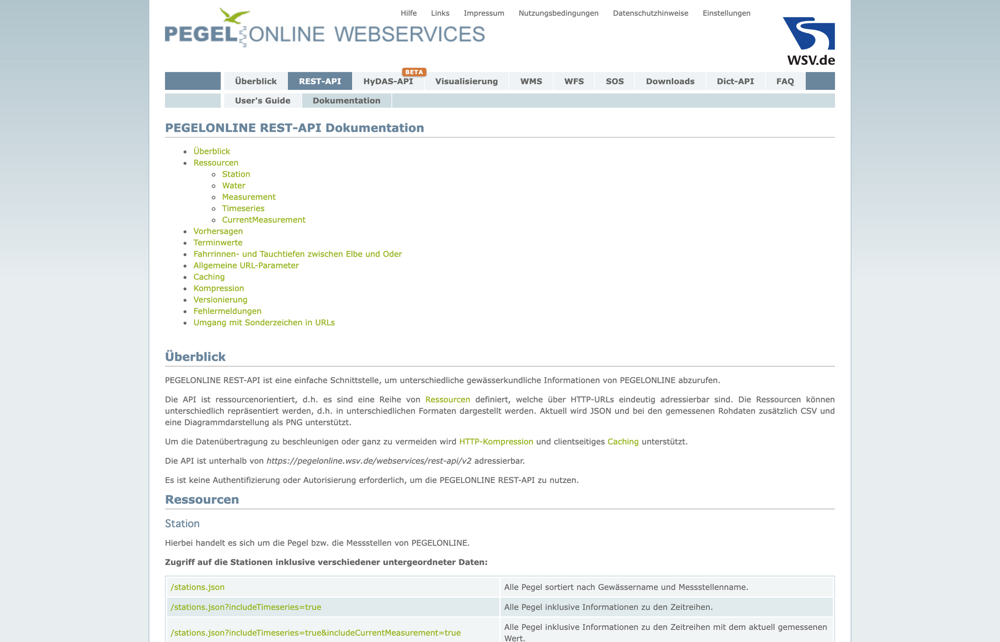
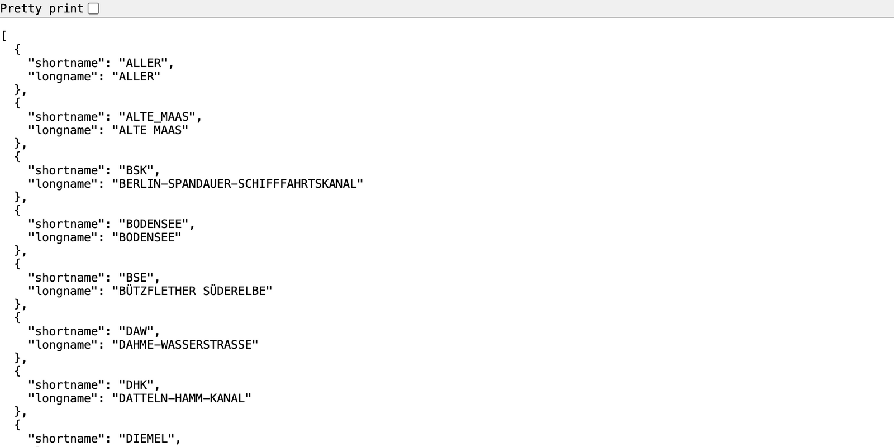
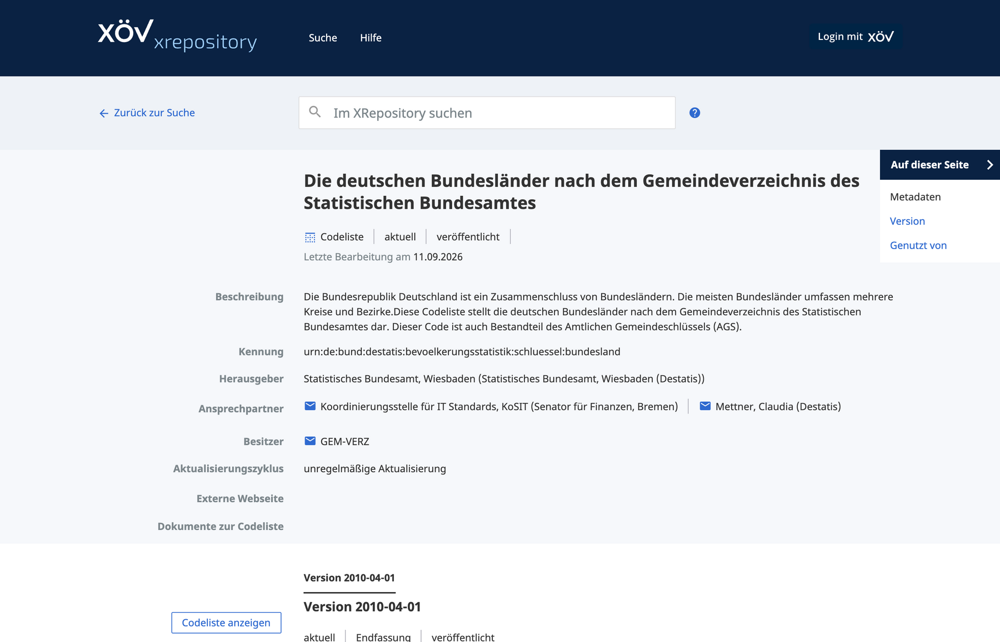

```{r setup, include=FALSE}
knitr::opts_chunk$set(echo = TRUE, message = FALSE, warning = FALSE, fig.align = "center")
options(width = 100)
```

# Die Idee

In der Scraping-Fallstudie haben wir Daten aus Seiten geholt, die für Menschen gemacht sind. Eine **API** (Application Programming Interface) ist der Weg, den der Anbieter für Programme vorgesehen hat: Ihr schickt eine Adresse, zurück kommen **nur Daten**, meist als JSON, in der Verwaltung oft als XML. Kein Layout, das sich ändert, keine Werbung.

Drei Behörden-APIs, drei Lektionen:

1. **Pegelonline** (Wasserstraßen- und Schifffahrtsverwaltung): JSON lesen, filtern, kartieren.
2. **XRepository** (Koordinierungsstelle für IT-Standards): XÖV-Codelisten als JSON und als XML.
3. **GovData**: die Metadaten-API, mit der man herausfindet, welche Daten es überhaupt gibt.

**Was Ihr braucht:** R mit `tidyverse`, `httr2`, `jsonlite`, `xml2`, `leaflet`. Das Skript liegt als `behoerden-apis.R` daneben.

```{r pakete}
library(tidyverse)
library(httr2)      # Anfragen stellen
library(jsonlite)   # JSON lesen
library(xml2)       # XML lesen
library(leaflet)    # Karten

user_agent <- "Hertie-School-Datenkurs (munzert@hertie-school.org)"
```

# Schritt 1: Die Dokumentation lesen

Bei einer API beginnt alles mit der **Dokumentation**: Welche Adressen gibt es, welche Parameter, in welchem Format kommt die Antwort? Pegelonline beschreibt das auf einer Seite.

```{r doku, eval=FALSE}
browseURL("https://www.pegelonline.wsv.de/webservice/dokuRestapi")
```


<div class="bildunterschrift">Die REST-API-Dokumentation von Pegelonline: Ressourcen (Station, Water, Measurement), Adressen und Parameter. Keine Anmeldung, kein Schlüssel.</div>

Eine API-Anfrage ist eine **URL**. Öffnet sie im Browser, und Ihr seht die Antwort: keine Webseite, sondern JSON.

```{r browser, eval=FALSE}
browseURL("https://www.pegelonline.wsv.de/webservices/rest-api/v2/waters.json")
```


<div class="bildunterschrift">Dieselbe Adresse im Browser: eine Liste von Gewässern, jedes ein Objekt mit zwei Feldern. Das ist JSON.</div>

<div class="merke">**Merke:** JSON besteht aus Listen (`[ ]`) und Objekten mit Feldern (`{ "name": "wert" }`). Eine Liste gleich gebauter Objekte ist nichts anderes als eine Tabelle.</div>

# Schritt 2: Pegelonline, JSON lesen und kartieren

Dieselbe Anfrage in R. Weil wir das Muster oft brauchen, gleich als Funktion: Adresse bauen, Parameter anhängen, abschicken, JSON in eine Tabelle verwandeln.

```{r hole-json}
hole_json <- function(url, ...) {
  request(url) |>
    req_url_query(...) |>
    req_user_agent(user_agent) |>
    req_perform() |>
    resp_body_string() |>
    fromJSON(flatten = TRUE)
}

basis <- "https://www.pegelonline.wsv.de/webservices/rest-api/v2/"
gewaesser <- hole_json(paste0(basis, "waters.json"))
head(gewaesser)
```

Jetzt die Stationen, mit dem Parameter `includeCurrentMeasurement=true`, der an jede den letzten Messwert hängt. Die Antwort ist verschachtelt: `timeseries` enthält pro Station eine kleine Tabelle. `unnest()` klappt sie auf.

```{r stationen}
stationen <- hole_json(paste0(basis, "stations.json"),
                       includeTimeseries = "true", includeCurrentMeasurement = "true")
nrow(stationen)

pegel <- stationen |>
  select(uuid, pegel = longname, water = water.longname, agency, latitude, longitude, timeseries) |>
  unnest(timeseries) |>
  filter(shortname == "W") |>                       # W = Wasserstand
  select(uuid, pegel, water, agency, latitude, longitude,
         wasserstand_cm = currentMeasurement.value,
         zeitpunkt = currentMeasurement.timestamp,
         status = currentMeasurement.stateMnwMhw)

count(pegel, status, sort = TRUE)
```

Mit Koordinaten direkt auf die Karte. Der Status vergleicht den aktuellen Wert mit den langjährigen Mittelwerten.

```{r karte}
farbe <- colorFactor(c("#1D375B", "#C2001A", "grey60", "#EB811B"),
                     levels = c("normal", "high", "unknown", "low"))
leaflet(pegel |> filter(!is.na(wasserstand_cm), status %in% c("normal", "high", "low", "unknown"))) |>
  addTiles() |>
  addCircleMarkers(lng = ~longitude, lat = ~latitude, radius = 4, stroke = FALSE, fillOpacity = 0.8,
                   color = ~farbe(status),
                   popup = ~paste0("<b>", pegel, "</b><br>", water, "<br>", wasserstand_cm, " cm (", status, ")")) |>
  addLegend("bottomright", pal = farbe, values = ~status, title = "Wasserstand")
```

Für einen einzelnen Pegel liefert die API die Zeitreihe; `start = "P7D"` heißt „die letzten 7 Tage“.

```{r zeitreihe, fig.width=8, fig.height=3.5, dev="ragg_png", dpi=120}
muehlendamm <- pegel |> filter(str_detect(pegel, "MÜHLENDAMM OP")) |> pull(uuid)
messwerte <- hole_json(paste0(basis, "stations/", muehlendamm, "/W/measurements.json"), start = "P7D") |>
  mutate(timestamp = as_datetime(timestamp))

ggplot(messwerte, aes(timestamp, value)) +
  geom_line(colour = "#1D375B") +
  labs(title = "Pegel Berlin-Mühlendamm (Oberpegel), letzte 7 Tage", x = NULL, y = "Wasserstand (cm)",
       caption = "Quelle: Pegelonline, WSV") +
  theme_minimal(base_family = "Fira Sans")
```

Alle 15 Minuten ein Wert, direkt aus dem Messnetz des Bundes. Das ist der Unterschied zum Scraping: Diese Daten sind **zum Abrufen gemacht**.

**Aufgabe 1:** Sucht die Pegel an Eurem Fluss (`filter(str_detect(water, "RHEIN"))`). Wie viele melden gerade `high` oder `low`? Holt für einen die Zeitreihe der letzten 30 Tage (`start = "P30D"`).

# Schritt 3: XRepository, Codelisten als JSON und XML

In Session 3 habt Ihr die XÖV-Standards kennengelernt. Ihre Bausteine sind **Codelisten**: Bundesländer, Staaten, Rechtsformen. Wer eine XFall- oder XMeld-Nachricht baut, verwendet genau diese Codes. Die KoSIT veröffentlicht sie im XRepository, jede mit einer eindeutigen Kennung (URN).


<div class="bildunterschrift">Die Codeliste der Bundesländer im XRepository: Kennung, Herausgeber, Version. Dieselbe Seite gibt es als API.</div>

```{r xrep-json}
xrep <- "https://www.xrepository.de/api/codeliste/"
urn_bundesland <- "urn:de:bund:destatis:bevoelkerungsstatistik:schluessel:bundesland"

bundesland <- hole_json(paste0(xrep, urn_bundesland, "/gueltigeVersion/json"))
bundesland$metadaten$nameLang
bundesland_tbl <- bundesland$daten |> as_tibble(.name_repair = ~bundesland$spalten$spaltennameTechnisch)
bundesland_tbl
```

Dieselbe Liste im Originalformat **Genericode**, dem XML-Format, das XÖV für Codelisten vorschreibt. XML braucht mehr Arbeit: Namensräume ausschalten, dann mit XPath (dem Gegenstück zu den CSS-Selektoren aus dem Scraping) navigieren.

```{r xrep-xml}
doc <- request(paste0(xrep, urn_bundesland, "/gueltigeVersion/genericode")) |>
  req_user_agent(user_agent) |>
  req_perform() |>
  resp_body_xml() |>
  xml_ns_strip()

doc |> xml_children() |> xml_name()      # Annotation, Identification, ColumnSet, SimpleCodeList
doc |> xml_find_first("//Identification/Version") |> xml_text()

bundesland_aus_xml <- doc |> xml_find_all("//SimpleCodeList/Row") |>
  map(\(row) {
    werte <- xml_find_all(row, "Value")
    tibble(spalte = xml_attr(werte, "ColumnRef"),
           wert   = werte |> xml_find_first("SimpleValue") |> xml_text())
  }) |>
  list_rbind(names_to = "zeile") |>
  pivot_wider(names_from = spalte, values_from = wert) |>
  select(-zeile)

identical(bundesland_aus_xml$SCHLUESSEL, bundesland_tbl$SCHLUESSEL)
```

<div class="merke">**Merke:** JSON ist bequemer, XML ist das, was die Standards verlangen. In einer XFall-Nachricht steht nicht „Niedersachsen“, sondern der Code `03` mit Verweis auf diese Codeliste und ihre Version. So hängen Datenstandards, Codelisten und Schnittstellen zusammen.</div>

**Aufgabe 2:** Holt eine Codeliste, die zu Eurem Haus passt (auf [xrepository.de](https://www.xrepository.de/) suchen: Rechtsform, Familienstand, Dokumentart). Wie viele Einträge hat sie, welche Version gilt?

# Schritt 4: GovData, welche Daten gibt es überhaupt?

Die dritte API liefert **Daten über Daten**. GovData läuft auf der Open-Source-Software CKAN, deren API alle Datenportale der Welt teilen, auch daten.berlin.de, open.nrw und data.europa.eu.

```{r govdata}
ckan <- "https://ckan.govdata.de/api/3/action/package_search"
suche <- hole_json(ckan, q = "Gewerbeanmeldung", rows = 50)
suche$result$count     # so viele Datensätze gibt es zum Suchbegriff

suche$result$results |>
  as_tibble() |>
  transmute(titel = title, anbieter = organization.title, lizenz = license_id,
            aktualisiert = as_date(metadata_modified)) |>
  head(10)
```

Welche Formate bieten die Anbieter an? Jeder Datensatz hat `resources`, wieder verschachtelt.

```{r govdata-formate}
suche$result$results |>
  as_tibble() |>
  select(title, resources) |>
  unnest(resources) |>
  count(format, sort = TRUE) |>
  head(8)
```

Von hier ist es ein Schritt zu den Daten selbst: Die `url` jeder Ressource zeigt auf eine CSV-, JSON- oder XML-Datei.

**Aufgabe 3:** Sucht nach Datensätzen Eurer Behörde oder Eures Themenfelds. Gibt es sie? In welchem Format, unter welcher Lizenz, wann zuletzt aktualisiert?

# Was wir mitnehmen

- **Dokumentation zuerst.** Ohne sie ratet Ihr. Verzeichnis für Behörden-APIs: [bund.dev](https://bund.dev/).
- **Das Grundmuster ist immer gleich**: Adresse, Parameter, abschicken, Antwort in eine Tabelle verwandeln. Verschachteltes mit `unnest()` aufklappen.
- **Schlüssel, Grenzen, Lizenzen**: Viele APIs verlangen einen Schlüssel (nie in geteilten Code), begrenzen die Anfragen (Antwortcode 429: zu schnell) und haben eine Lizenz, meist Datenlizenz Deutschland oder CC BY.
- **Eure Behörde ist auch Anbieterin**: Open-Data-Portale liefern mit CKAN automatisch eine API. FIT-Connect und NOOTS sind APIs. Eine API-Dokumentation lesen zu können, ist Verwaltungskompetenz.
