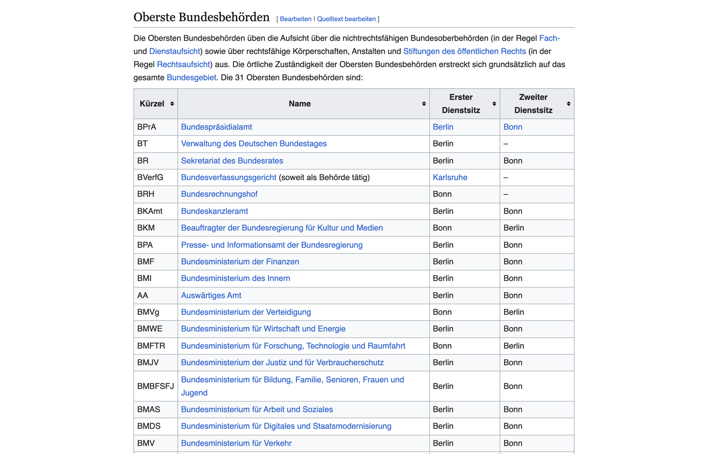
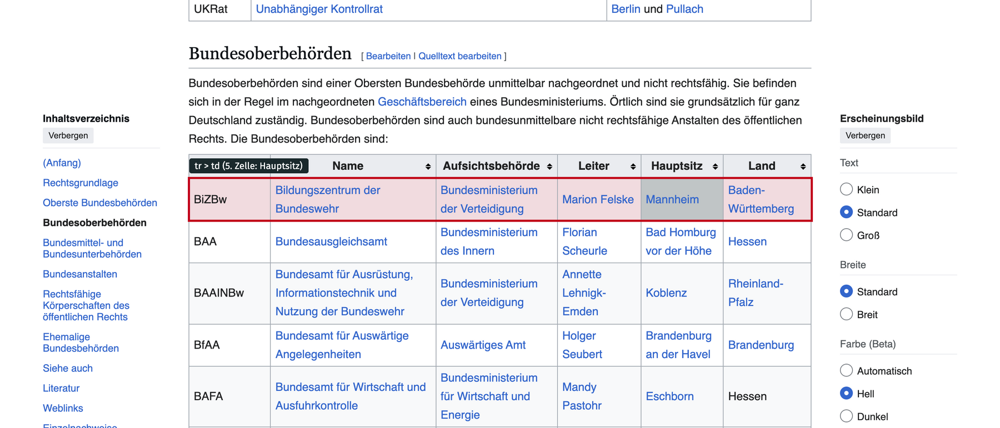
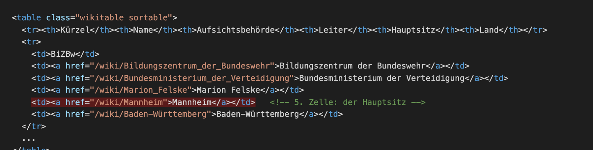

```{r setup, include=FALSE}
knitr::opts_chunk$set(echo = TRUE, message = FALSE, warning = FALSE, fig.align = "center")
options(width = 100)
```

# Die Frage

Wo sitzt der Bund? Wikipedia führt alle [Obersten Bundesbehörden und Bundesoberbehörden](https://de.wikipedia.org/wiki/Bundesbehörde_(Deutschland)) in zwei Tabellen, mit Sitz. Wir holen die Tabellen in R, verwandeln die Ortsnamen in Koordinaten und zeichnen eine Karte.

**Was Ihr braucht:** R mit `tidyverse`, `rvest`, `httr2`, `sf`, `giscoR`, `ragg`. Das vollständige Skript liegt als `behoerden-karte.R` daneben.

```{r pakete}
library(tidyverse)
library(rvest)      # HTML lesen und auswählen
library(httr2)      # Anfragen an die Geokodier-API
library(sf)         # Geodaten
library(giscoR)     # Ländergrenzen von Eurostat

user_agent <- "Hertie-School-Datenkurs (munzert@hertie-school.org)"
```

# Schritt 1: Die Seite ansehen

Vor dem Code kommt der Browser. Wir öffnen die Seite und schauen, was da ist: fünf Tabellen, wir brauchen die ersten beiden.

```{r browser, eval=FALSE}
url <- "https://de.wikipedia.org/wiki/Bundesbehörde_(Deutschland)"
browseURL(url)
```


<div class="bildunterschrift">Die Tabelle der Obersten Bundesbehörden: Kürzel, Name, erster und zweiter Dienstsitz.</div>

Dann **Rechtsklick auf eine Tabellenzeile, „Untersuchen“** (Chrome, Firefox, Edge). Der Inspektor zeigt, wie die Seite unter der Oberfläche aussieht: Die Tabelle ist ein `<table>`, jede Zeile ein `<tr>`, jede Zelle ein `<td>`. Der Hauptsitz steht in der fünften Zelle jeder Zeile.


<div class="bildunterschrift">Eine Zeile der Tabelle „Bundesoberbehörden“, so wie der Inspektor sie zeigt: ein `tr` mit sechs `td`, die fünfte ist der Hauptsitz.</div>

Im Quelltext („Seitenquelltext anzeigen“) sieht dieselbe Zeile so aus:


<div class="bildunterschrift">Verkürzter HTML-Quelltext der Zeile. Die Ortsnamen sind Links, der Text dazwischen ist das, was wir brauchen.</div>

<div class="merke">**Merke:** Eine Webseite ist Text mit Struktur. Scraping heißt, diese Struktur zu lesen: Tabelle, Zeile, Zelle. Alles Weitere ist Aufräumen.</div>

# Schritt 2: Die Seite in R laden

`read_html()` holt genau den Text, den der Browser bekommt. `html_elements()` wählt daraus aus, mit denselben Bezeichnern, die der Inspektor zeigt: `table.wikitable` heißt „alle Tabellen mit der Klasse wikitable“.

```{r laden}
url <- "https://de.wikipedia.org/wiki/Bundesbehörde_(Deutschland)"
seite <- read_html(url)

tabellen <- html_elements(seite, "table.wikitable")
length(tabellen)
```

Welche Tabelle ist welche? Die Überschrift vor jeder Tabelle verrät es.

```{r ueberschriften}
map_chr(tabellen, \(t) html_text2(html_element(t, xpath = "preceding::h2[1]")))
```

`html_table()` macht aus einer HTML-Tabelle einen Datensatz.

```{r tabellen}
oberste <- html_table(tabellen[[1]])
obere   <- html_table(tabellen[[2]])
oberste
```

# Schritt 3: Aufräumen

Zwei Tabellen mit verschiedenen Spalten; wir brauchen pro Behörde Kürzel, Name, Typ und **einen** Sitz. Bei „Berlin und Pullach“ nehmen wir den ersten Ort, Zusätze wie „(vorläufig)“ und Fußnoten fallen weg.

```{r aufraeumen}
erster_ort <- function(x) {
  x |>
    str_remove_all("\\[\\d+\\]") |>              # Fußnoten [3]
    str_remove("\\s*\\(.*?\\)") |>               # "(vorläufig)"
    str_split_i(" und |,|/| – | –", 1) |>        # ersten Ort nehmen
    str_squish()
}

behoerden <- bind_rows(
  oberste |> transmute(kuerzel = Kürzel, name = Name, typ = "Oberste Bundesbehörde",
                       sitz = erster_ort(`Erster Dienstsitz`), aufsicht = NA_character_),
  obere   |> transmute(kuerzel = Kürzel, name = Name, typ = "Bundesoberbehörde",
                       sitz = erster_ort(Hauptsitz), aufsicht = Aufsichtsbehörde)
) |>
  mutate(name = str_remove_all(name, "\\[\\d+\\]") |> str_squish())

count(behoerden, typ)
count(behoerden, sitz, sort = TRUE) |> head(8)
```

# Schritt 4: Geokodieren

Aus Ortsnamen werden Koordinaten. Wir fragen einen **Geokodierer** per API: Photon (photon.komoot.io) auf Basis von OpenStreetMap, kostenlos, ohne Schlüssel. Fällt Photon aus, springt Nominatim ein, der Geokodierer von OpenStreetMap selbst (höchstens eine Anfrage pro Sekunde). Jeder Ort wird nur einmal abgefragt, das Ergebnis landet in einer CSV.

```{r geokodierer}
frage_ab <- function(req) {
  antwort <- tryCatch(req |> req_timeout(10) |> req_error(is_error = \(r) FALSE) |> req_perform(),
                      error = \(e) NULL)
  if (is.null(antwort) || resp_status(antwort) != 200) return(NULL)
  resp_body_json(antwort)
}

geokodiere <- function(ort) {
  js <- request("https://photon.komoot.io/api/") |>
    req_user_agent(user_agent) |>
    req_url_query(q = paste(ort, "Deutschland"), lang = "de", limit = 1, osm_tag = "place") |>
    frage_ab()
  Sys.sleep(0.5)
  if (length(js$features) > 0) {
    k <- js$features[[1]]$geometry$coordinates
    return(tibble(lon = k[[1]], lat = k[[2]], dienst = "Photon"))
  }
  js <- request("https://nominatim.openstreetmap.org/search") |>
    req_user_agent(user_agent) |>
    req_url_query(q = ort, countrycodes = "de", format = "jsonv2", limit = 1) |>
    frage_ab()
  Sys.sleep(1.1)
  if (length(js) > 0) {
    return(tibble(lon = as.numeric(js[[1]]$lon), lat = as.numeric(js[[1]]$lat), dienst = "Nominatim"))
  }
  tibble(lon = NA_real_, lat = NA_real_, dienst = NA_character_)
}
```

```{r geokodieren}
cache_datei <- "daten/orte-geokodiert.csv"
if (file.exists(cache_datei)) {
  orte_geo <- read_csv(cache_datei, show_col_types = FALSE)
} else {
  orte_geo <- distinct(behoerden, sitz) |> mutate(koord = map(sitz, geokodiere)) |> unnest(koord)
  write_csv(orte_geo, cache_datei)
}
behoerden_geo <- left_join(behoerden, orte_geo, by = "sitz")
filter(behoerden_geo, is.na(lat)) |> nrow()   # 0 = alle Orte gefunden
```

<div class="merke">**Merke:** Geokodieren ist selbst eine Datenquelle mit Fehlern. „Langen“ gibt es mehrfach in Deutschland; der Zusatz „Deutschland“ und die Prüfung der Treffer gehören dazu.</div>

# Die Karte

```{r karte, fig.width=8.5, fig.height=10, dev="ragg_png", dpi=120}
laender <- gisco_get_nuts(nuts_level = 1, country = "DE", resolution = "03", year = "2021")
deutschland <- st_union(laender)

punkte <- behoerden_geo |>
  filter(!is.na(lat)) |>
  count(sitz, lon, lat, name = "n") |>
  st_as_sf(coords = c("lon", "lat"), crs = 4326)

ggplot() +
  geom_sf(data = deutschland, fill = "#f2f2f2", colour = NA) +
  geom_sf(data = laender, fill = NA, colour = "white", linewidth = 0.6) +
  geom_sf(data = punkte, aes(size = n), colour = "#C2001A", alpha = 0.75) +
  ggrepel::geom_text_repel(
    data = punkte |> filter(n >= 2),
    aes(label = paste0(sitz, " (", n, ")"), geometry = geometry),
    stat = "sf_coordinates", family = "Fira Sans", size = 3.4, colour = "#1A292C",
    min.segment.length = 0, segment.colour = "grey60") +
  scale_size_area(max_size = 16, breaks = c(1, 5, 10, 20), name = "Behörden am Ort") +
  coord_sf(crs = 25832) +
  labs(title = paste0(nrow(behoerden_geo), " Bundesbehörden, ", nrow(punkte), " Standorte"),
       subtitle = "Oberste Bundesbehörden und Bundesoberbehörden nach erstem Dienstsitz bzw. Hauptsitz",
       caption = paste0("Quelle: de.wikipedia.org, abgerufen ", format(Sys.Date(), "%d.%m.%Y"),
                        ". Geokodierung: OpenStreetMap. Grenzen: Eurostat GISCO.")) +
  theme_void(base_family = "Fira Sans", base_size = 13) +
  theme(plot.title = element_text(face = "bold", size = 17),
        plot.subtitle = element_text(colour = "#555555", margin = margin(b = 8)),
        plot.caption = element_text(colour = "#888888", size = 8, hjust = 0),
        plot.title.position = "plot", plot.caption.position = "plot",
        plot.background = element_rect(fill = "white", colour = NA))
```

Bonn und Berlin tragen den Bund, der Rest verteilt sich auf knapp 30 Städte. Wer beaufsichtigt wie viele Bundesoberbehörden?

```{r aufsicht}
behoerden_geo |>
  filter(typ == "Bundesoberbehörde") |>
  count(aufsicht, sort = TRUE)
```

# Was wir mitnehmen

- **Erst schauen, dann scrapen.** Browser und Inspektor zeigen die Struktur; der Code folgt ihr.
- **Vier Zeilen holen die Daten, der Rest ist Aufräumen.** Fußnoten, Doppelsitze, Klammern: Das ist die eigentliche Arbeit, und sie ist bei jeder Quelle anders.
- **Scraping ist fragil.** Ändert Wikipedia die Spaltenreihenfolge, bricht das Skript. Für den Dauerbetrieb braucht es eine API (nächste Fallstudie) oder eine Vereinbarung mit der Quelle.
- **Höflich bleiben.** Absender angeben (User-Agent), Pausen zwischen Anfragen, Ergebnisse zwischenspeichern.

**Zum Weiterspielen:** Nehmt die dritte Tabelle (Bundesmittel- und Bundesunterbehörden) dazu. Was ändert sich an der Karte, was am Aufräumcode?
