```{css, echo=FALSE} 
@media print { # print out incremental slides; see https://stackoverflow.com/questions/56373198/get-xaringan-incremental-animations-to-print-to-pdf/56374619#56374619
  .has-continuation {
    display: block !important;
  }
}
```

```{r setup, include=FALSE}
# figures formatting setup
options(htmltools.dir.version = FALSE)
library(knitr)
opts_chunk$set(
  prompt = T,
  fig.align="center", #fig.width=6, fig.height=4.5, 
  # out.width="748px", #out.length="520.75px",
  dpi=300, #fig.path='Figs/',
  cache=T, #echo=F, warning=F, message=F
  engine.opts = list(bash = "-l")
  )

## Next hook based on this SO answer: https://stackoverflow.com/a/39025054
knit_hooks$set(
  prompt = function(before, options, envir) {
    options(
      prompt = if (options$engine %in% c('sh','bash')) '$ ' else 'R> ',
      continue = if (options$engine %in% c('sh','bash')) '$ ' else '+ '
      )
})

library(tidyverse)
library(hrbrthemes)
library(fontawesome)
```


# Inhaltsverzeichnis

<br><br>

1. [Warum statistische Kompetenz?](#why)

2. [Wahrscheinlichkeit verstehen](#probability)

3. [Klassifikationsmetriken verstehen](#classification)

---
class: inverse, center, middle
name: why

# Warum statistische Kompetenz?
<html><div style='float:left'></div><hr color='#EB811B' size=1px style="width:1000px; margin:auto;"/></html>


---
# Sind bestimmte Musikgenres tödlicher als andere?

.pull-left[
<div align="center">
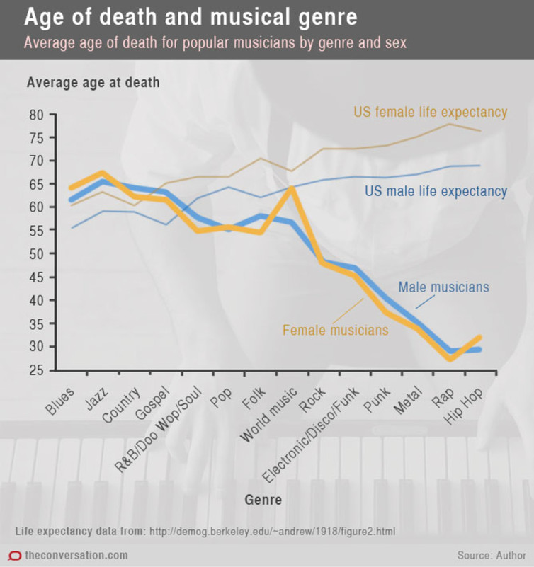
</div>

`Quelle` [The Conversation](https://theconversation.com/music-to-die-for-how-genre-affects-popular-musicians-life-expectancy-36660) <br> 
`Hintergrund` [Calling Bullshit](https://callingbullshit.org/case_studies/case_study_musician_mortality.html)
]

.pull-right[
> [Study author Dianna Kenny] found that musicians from older genres – including blues, jazz, country and gospel – have similar lifespans to American people their own age. The life expectancy for R&B musicians is slightly lower, while the life expectancy for newer genres like rock, techno, punk, metal, rap and hip hop is significantly shorter."

<div align="right">Ana Swanson, <a href="https://www.washingtonpost.com/news/wonk/wp/2015/04/15/the-causes-of-musicians-deaths-by-genre/">Washington Post</a></div>

> "It's a cautionary tale to some degree," Kenny told the Washington Post. "People who go into rap music or hip hop or punk, they're in a much more occupational hazard profession compared to war. We don't lose half our army in a battle."

<div align="right">Dianna Kenny, <a href="https://www.washingtonpost.com/news/morning-mix/wp/2015/03/25/over-half-of-dead-hip-hop-artists-were-murdered-study-finds/">quoted by Washington Post</a></div>
]


---
# Weitere Evidenz

.pull-left[
<div align="center">

</div>
]

--

.pull-right[
## Einige Probleme mit der Evidenz

1. **Sanity check:** Sind manche Genres wirklich so tödlich? Sterben z. B. Rap-Musiker wirklich mit einem Durchschnittsalter von ~30 Jahren?
2. **Datenzensierung:** Einige Genres sind jünger als andere, und die Auswertung setzt voraus, dass die Musiker bereits gestorben sind. Die meisten Rap- und Hip-Hop-Stars sind heute noch am Leben - Lebensdauer unbekannt!
3. **Bedingte Wahrscheinlichkeiten:** Die Wahrscheinlichkeiten der einzelnen Todesursachen hängen davon ab, dass der Tod zum Zeitpunkt der Untersuchung bereits eingetreten ist.
4) (Kleineres Problem) Liniendiagramm für kategoriale Daten?  [Keine gute Idee.](https://www.jmp.com/en_gb/statistics-knowledge-portal/exploratory-data-analysis/line-graph.html#:~:text=Line%20graphs%20do%20not%20make,might%20have%20a%20defined%20order.)
]


---
# Lösung des Falles

.pull-left[

|                       	| Evidenz und Schlüsse                           	|
|-----------------------	|----------------------------------------------------	|
| **Der Tatort**   	| Musikgenre korreliert mit Todesalter                 	|
| **Die Verdächtigen**    	| Lifestyle (z.B. Drogenkonsum), Alter des Genres, unvollständige Datenerhebung |
| **Die Tatwaffe** 	| Konfundierung durch Daten-Zensur                              	|

> "In other words, it's not that rap stars will likely die young; it's that the rap stars who have died certainly died young because rap hasn't been around long enough for it to be otherwise." <div align="right">Carl Bergstrom and Jevin West, <a href="https://callingbullshit.org/case_studies/case_study_musician_mortality.html">Calling Bullshit</a><sup>1</sup></div>

<div class="font50"><br><br><sup>1</sup>Die Autorin Dianna Kenny hat mit einer plausiblen Antwort reagiert und auf eine <a href="http://dx.doi.org/10.21091/mppa.2016.1007">besser designte Studie verwiesen</a>, deren Evidenz konsistent mit den ursprünglichen Mustern zu sein scheint.</div>
]

.pull-right-center[
<div align="center">
<br>
<b>Inspector Lestrade:</b><br>
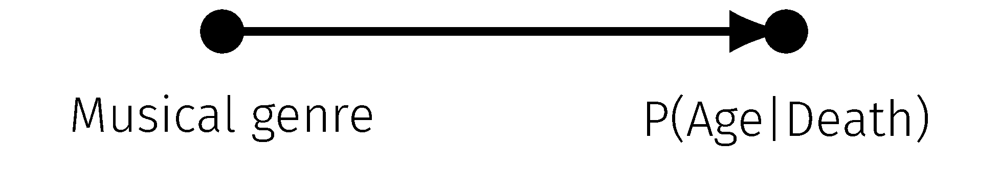
<br>
<b>Sherlock:</b><br>
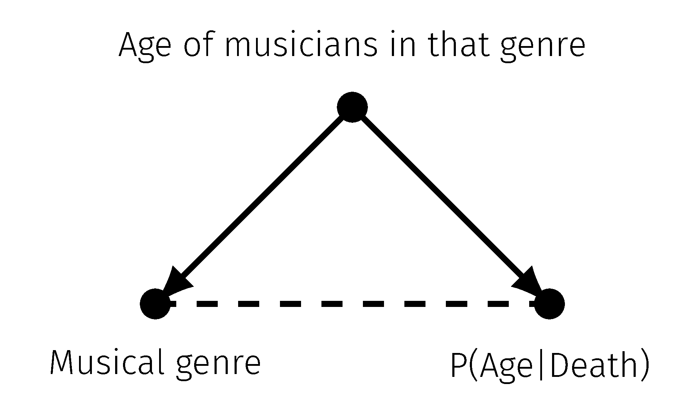
</div>
]

---
# Wie gut ist ein Mammographie-Screening?

.pull-left-wide2[
## Szenario

Eine Frau ohne Symptome nimmt am Mammographie-Screening teil. Bekannt ist:

- Etwa **1%** der Frauen in dieser Altersgruppe haben Brustkrebs (Prävalenz).
- Hat eine Frau Brustkrebs, fällt der Test mit **90%** Wahrscheinlichkeit positiv aus (Sensitivität).
- Hat eine Frau keinen Brustkrebs, fällt der Test trotzdem mit **9%** Wahrscheinlichkeit positiv aus (Falsch-positiv-Rate).

## Aufgabe

Der Befund ist positiv. Wie wahrscheinlich ist es, dass die Frau tatsächlich Brustkrebs hat?

️✎ Schätzt zuerst intuitiv, dann rechnet.
]

.pull-right-small2[
<div align="center">
<br><br>
</div>
.font80[Mobile Mammographie-Einheit am Krankenhaus Lysekil, Schweden. `Quelle` [W.carter, Wikimedia Commons](https://commons.wikimedia.org/wiki/File:Mammography_trailer_at_Lysekil_hospital_3.jpg), CC BY 4.0]
]


---
# Wie gut ist ein Mammographie-Screening?

<div align="center">
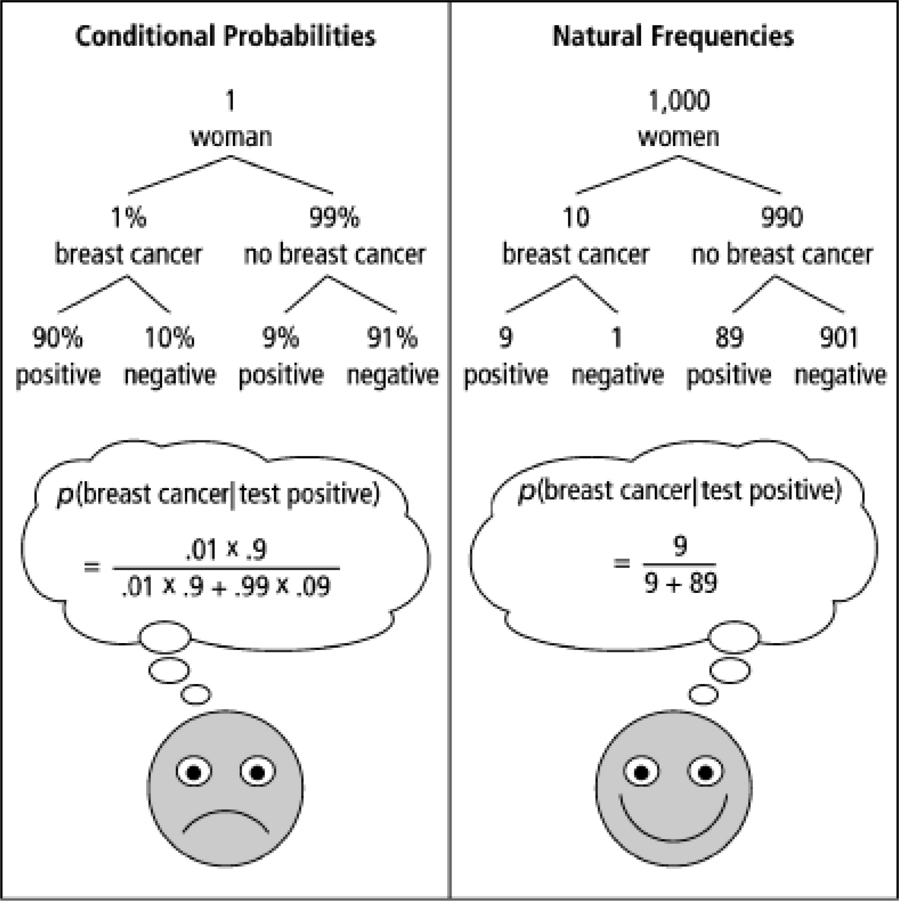
</div>


---
# Warum statistische Kompetenz?

.pull-left[
## Auch Profis scheitern daran

- Gigerenzer und Kollegen legten 160 Gynäkologinnen und Gynäkologen die Kennzahlen des Mammographie-Screenings vor (Prävalenz 1%, Sensitivität 90%, Falsch-positiv-Rate 9%) und fragten: Wie wahrscheinlich ist Brustkrebs bei positivem Befund?
- Richtig wären etwa **9%**. Die Mehrheit antwortete **81 bis 90%**; nur ein Fünftel lag richtig. Es ging um ihr eigenes Fachgebiet.
- Dieselbe Rechnung steckt in jedem KI-Alarm, jedem Betrugsscore, jedem Screening-Programm. Wer sie beherrscht, bewertet Systeme; wer nicht, glaubt Prospekten.

.font80[`Quelle` [Gigerenzer et al. (2007), Psychological Science in the Public Interest](https://doi.org/10.1111/j.1539-6053.2008.00033.x)]
]

.pull-right[
## Zahlen sind das Medium Eurer Entscheidungen

- Vorlagen, Evaluationen, Kennzahlen, Dashboards: Fast jede Entscheidung, die über Euren Tisch geht, stützt sich auf Zahlen, die jemand anderes erzeugt hat.
- Jedes KI-Angebot kommt mit einer Zahl: „95% Genauigkeit“, „Trefferquote 0,9“, etc. Ob das gut oder gefährlich ist, hängt von Fragen ab, die der Anbieter mglw. nicht beantwortet.
]


---
class: inverse, center, middle
name: probability

# Wahrscheinlichkeit verstehen
<html><div style='float:left'></div><hr color='#EB811B' size=1px style="width:1000px; margin:auto;"/></html>

---
# Wahrscheinlichkeiten

.pull-left-wide[
## Was sind Wahrscheinlichkeiten?<sup>1</sup>

- Wahrscheinlichkeiten quantifizieren die Möglichkeit eines Ereignisses
- Wahrscheinlichkeiten liegen zwischen 0 und 1 (oder 0 und 100%)
- Wahrscheinlichkeiten können verbal oder numerisch kommuniziert werden

## Relevanz von Wahrscheinlichkeiten für politische Entscheidungen

Wahrscheinlichkeiten sind ...
- ... das Kernstück der Risikobewertung und Entscheidungsfindung
- ... werden zur Quantifizierung von Unsicherheit verwendet
- ... zur Bewertung der Wirksamkeit von Maßnahmen
- ... eine Kernmetrik für AI-basierte Entscheidungssysteme

.footnote[<sup>1</sup>[Hier](https://bookdown.org/kevin_davisross/probsim-book) eine gute Einführung in die Wahrscheinlichkeitsrechnung und Simulation.]
]

.pull-right-small[
<div align="center">
<br><br>
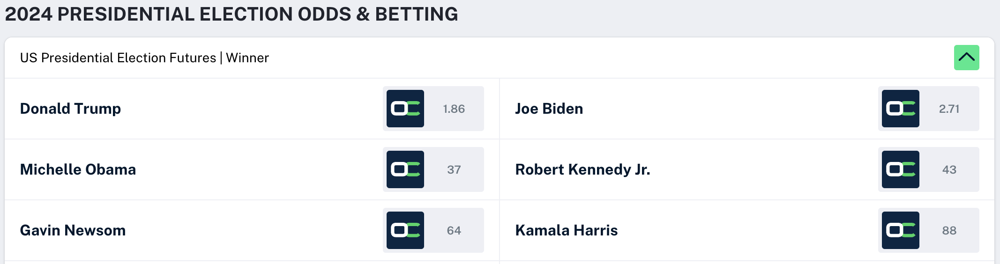<br><br>
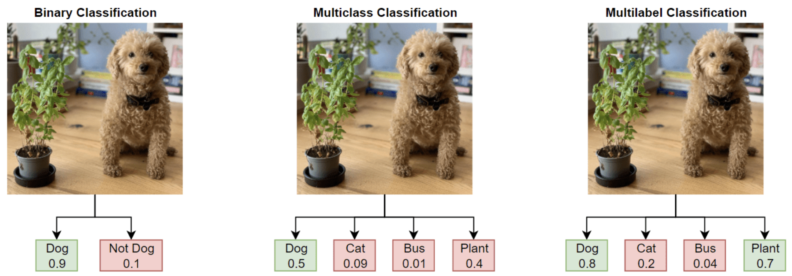
</div>
]

---
# Marginale, bedingte und gemeinsame Wahrscheinlichkeiten

.pull-left[
## Randwahrscheinlichkeit
- Die Wahrscheinlichkeit des Eintretens eines Ereignisses: $p(A)$
- Unbedingte Wahrscheinlichkeit ist nicht von einem anderen Ereignis abhängig
- 🎲 Beispiel: $p(\text{Würfeln einer 5}) = 1/6$

## Bedingte Wahrscheinlichkeit
- Die Wahrscheinlichkeit, dass das Ereignis A eintritt, wenn das Ereignis B eintritt: $p(A|B)$
- Wichtig: Die Randwahrscheinlichkeit von B spielt hier keine Rolle!
- 🎲 Beispiel: $p(\text{Würfeln einer 5|Würfeln ungerader Zahl}) = 1/3$
]

.pull-right[
## Gemeinsame Wahrscheinlichkeit
- Die Wahrscheinlichkeit, dass Ereignis A und Ereignis B eintreten: $p(\text{A und B}) = p(A ∩ B)$
- 🎲 Beispiel: $p(\text{Würfeln einer 5 und einer geraden Zahl}) = 0$

<div align="center">
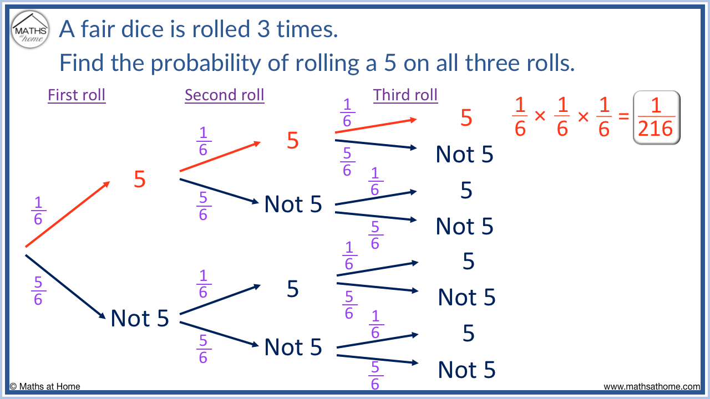
</div>
]

---
# Bedingte Wahrscheinlichkeiten


<div align="center">
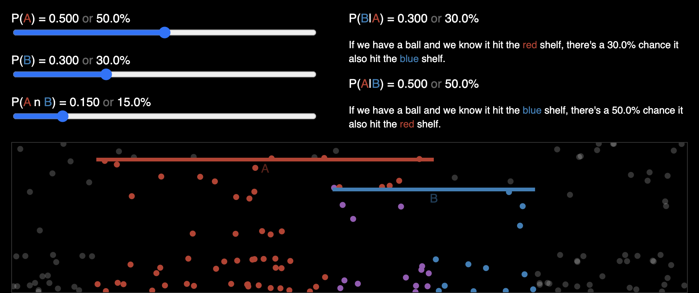
</div>

`Quelle` [Victor Powell, setosa.io](https://setosa.io/conditional/) (Siehe zur interaktiven Simulation)

---
# Puzzle

.pull-left[
## Wie können alle der folgenden Punkte wahr sein?

1. Ein Impfstoff ist hochwirksam beim Schutz gegen eine Krankheit.
2. Die meisten Menschen, die die Krankheit bekommen, sind geimpft worden.
]

.pull-right[
<br>
<div align="center">

</div>
`Quelle` [Hakan Nural, Unsplash](https://www.fiercehealthcare.com/payers/health-plans-prepare-cover-covid-19-vaccine-tests)
]

---
# Puzzle

.pull-left[
## Wie können alle der folgenden Punkte wahr sein?

1. Ein Impfstoff ist hochwirksam beim Schutz gegen eine Krankheit.
2. Die meisten Menschen, die die Krankheit bekommen, sind geimpft worden.

## Base Rate Fallacy ("Prävalenzfehler")

- Dies ist ein klassischer Fall des „Base Rate Fallacy“ oder „Prosecutor's Fallacy“.
- Wenn die Impfrate $P(geimpft)$ in der Bevölkerung hoch ist, besteht eine möglicherweise höhere Chance, dass eine zufällig ausgewählte kranke Person (z.B. im Krankenhaus) geimpft als ungeimpft ist.
]

.pull-right[
<br>
<div align="center">

</div>
`Quelle` [Hakan Nural, Unsplash](https://www.fiercehealthcare.com/payers/health-plans-prepare-cover-covid-19-vaccine-tests)
]

---
# "Base rate fallacy", illustriert

<div align="center">
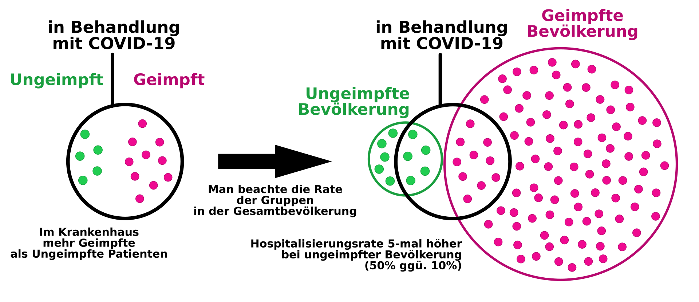
</div>
`Quelle` [Marc Rumilly](https://twitter.com/MarcRummy/status/1464178903224889345) 

---
# Relevanz für AI-basierte Entscheidungssysteme


.pull-left[
## Politik für seltene Ereignisse

- Diverse Politikmaßnahmen sind darauf ausgerichtet, seltene und gleichzeitig extrem kostspielige Ereignisse zu verhindern.
- Beispiele: Terroranschläge, Krieg, Naturkatastrophen
- Die Vorhersage solcher Ereignisse ist von Natur aus schwierig.
- KI-gestützte Erkennungssysteme versprechen hohe Erkennungsraten. Aber selbst bei einer sehr hohen Genauigkeit kann die Anzahl der falsch-positiven Meldungen inakzeptabel hoch sein.

## Leitfaden

- Berücksichtigt bei der Evaluation von solchen Tools immer die **Basiswahrscheinlichkeit**.
- Wählt geeignete Performanzmetriken (FPR, FNR, etc. - mehr dazu später).
]

--

.pull-right[
## Beispiel: [Terrorismuserkennung](https://en.wikipedia.org/wiki/Base_rate_fallacy)
- In einer Stadt mit 1 Mio. Einwohnern gibt es 100 Terroristen und 999.900 Nicht-Terroristen: $p(\text{Terrorist}) = 0,0001$
- Überwachung mit Gesichtserkennungssoftware mit zwei Fehlerquoten von 1%:
  1. Falsch-negativ-Rate (FNR): $p(\text{kein Alarm}|\text{Terrorist}) = 0,01$
  2. Falsch-positiv-Rate (FPR): $p(\text{Alarm}|\text{kein Terrorist}) = 0.01$

**Was bedeutet das, wenn wir einen Alarm erhalten?**<sup>1</sup>
  $p(\text{Terrorist}|\text{Alarm})=\frac{p(\text{Alarm}|\text{Terrorist})p(\text{Terrorist})}{p(\text{Alarm})}$ $=\frac{0.99 * 0.0001}{0.01} = 0.01$

.footnote[<div class="font50"><br><sup>1</sup>$p(\text{Alarm}) = p(\text{Alarm}|\text{Terrorist})*p(\text{Terrorist})$ $+ p(\text{Alarm}|\text{Nicht-Terrorist})*p(\text{Nicht-Terrorist})$ $=$
  $p(\text{Terrorist}|\text{Alarm})$ $= 0.99*0.0001 + 0.01*0.9999 = 0.01$</div>]
]

---
#  Kommunikation von Wahrscheinlichkeiten mit verbalen Ausdrücken

.pull-left-wide2[
<div align="center">
<br>
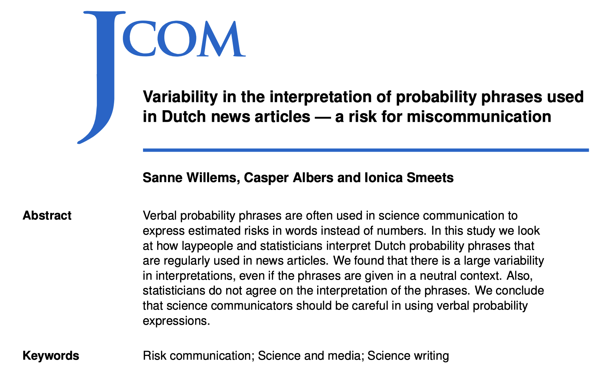
</div>
`Quelle` [Willems et al. 2020](https://doi.org/10.22323/2.19020203)
]

.pull-right-small2[
<div align="center">
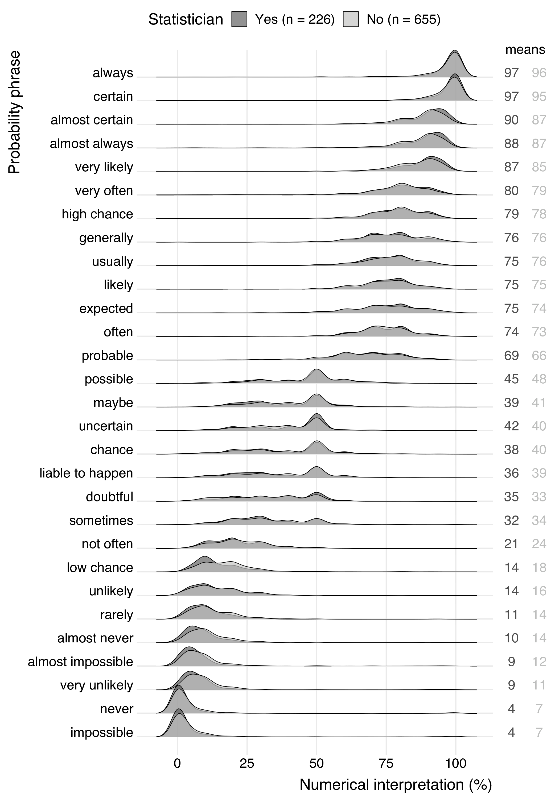
</div>
]

---
# Was bedeutet die Wahrscheinlichkeit für verschiedene Berufe?

.pull-left[
<div align="center">
<br>
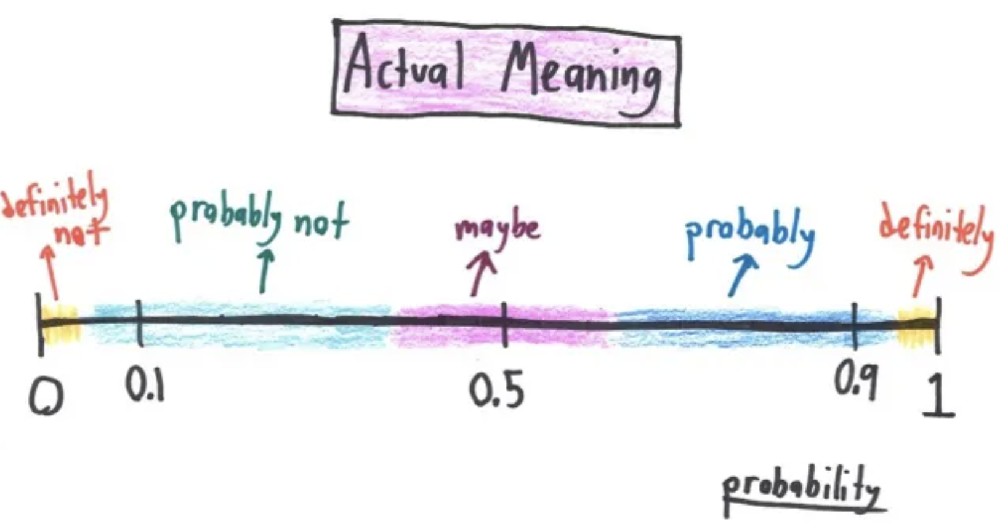
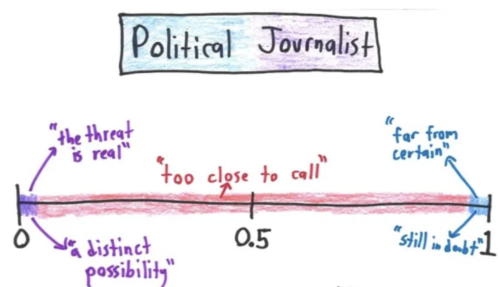
</div>
]

.pull-right[
<div align="center">
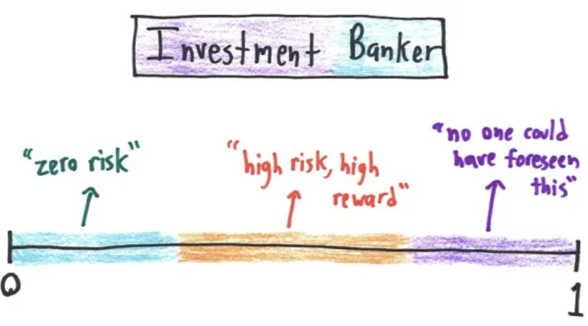
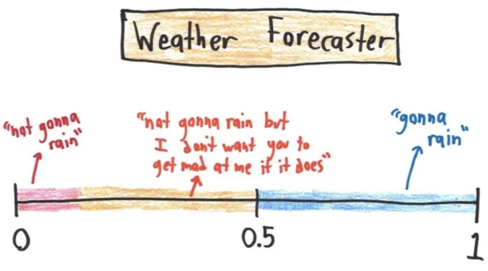
</div>
]

`Quelle` [Ben Orlin](https://mathwithbaddrawings.com/2015/09/23/what-does-probability-mean-in-your-profession/)

---
class: inverse, center, middle
name: classification

# Klassifikationsmetriken verstehen
<html><div style='float:left'></div><hr color='#EB811B' size=1px style="width:1000px; margin:auto;"/></html>

---
# Vorhersage der Rückfälligkeit von Straftätern

.pull-left[
## Hintergrund

- Correctional Offender Management Profiling for Alternative Sanctions (COMPAS) ist ein von Northpointe (jetzt Equivant) entwickeltes Entscheidungshilfeinstrument, das von US-Gerichten zur **Bewertung der Rückfallwahrscheinlichkeit** eingesetzt wird.
- Erstellt mehrere Skalen (Risiko der vorzeitigen Entlassung, allgemeine Rückfälligkeit, gewalttätige Rückfälligkeit) auf der Grundlage von Faktoren wie Alter, Vorstrafen und Drogenmissbrauch
- Der Algorithmus ist urheberrechtlich geschützt und seine inneren Abläufe sind nicht öffentlich.

<br><br>

`Quelle` [Leitfaden für Praktiker zum COMPAS Core](https://s3.documentcloud.org/documents/2840784/Practitioner-s-Guide-to-COMPAS-Core.pdf)
]


.pull-right[
<div align="center">
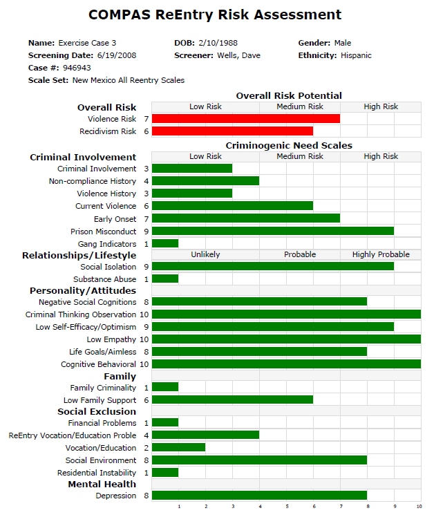
</div>
]

---
# Vorhersage der Rückfälligkeit von Straftätern

.pull-left[
## Hintergrund

- Correctional Offender Management Profiling for Alternative Sanctions (COMPAS) ist ein von Northpointe (jetzt Equivant) entwickeltes Entscheidungshilfeinstrument, das von US-Gerichten zur **Bewertung der Rückfallwahrscheinlichkeit** eingesetzt wird.
- Erstellt mehrere Skalen (Risiko der vorzeitigen Entlassung, allgemeine Rückfälligkeit, gewalttätige Rückfälligkeit) auf der Grundlage von Faktoren wie Alter, Vorstrafen und Drogenmissbrauch
- Der Algorithmus ist urheberrechtlich geschützt und seine inneren Abläufe sind nicht öffentlich.

<br><br>

`Quelle` [Leitfaden für Praktiker zum COMPAS Core](https://s3.documentcloud.org/documents/2840784/Practitioner-s-Guide-to-COMPAS-Core.pdf)
]

.pull-right[
<div align="center">

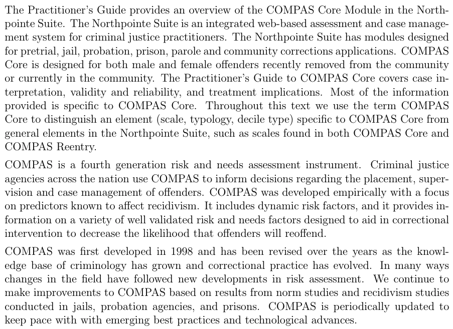
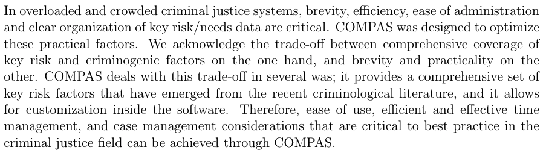
</div>
]

---
# Vorhersage der Rückfälligkeit von Straftätern

.pull-left[
## Die ProPublica und andere Untersuchungen

- Im Jahr 2016 veröffentlichte ProPublica eine Untersuchung, die zeigte, dass COMPAS **voreingenommen gegenüber Afroamerikanern** war
- **Bias:** Der Algorithmus sagte bei Afroamerikanern mit höherer Wahrscheinlichkeit falsch voraus, dass Angeklagte wieder straffällig werden würden.
- **Mangelnde Präzision:** Nur 20 % der Personen, denen Gewaltverbrechen vorhergesagt wurden, wurden tatsächlich straffällig (in einer späteren Studie wurde der Wert auf 65 % geschätzt - schlechter als eine Gruppe von Nicht-Experten)

<br><br><br>
`Quelle` [ProPublica 2016](https://www.propublica.org/article/how-we-analyzed-the-compas-recidivism-algorithm)
]

.pull-right[
<div align="center">
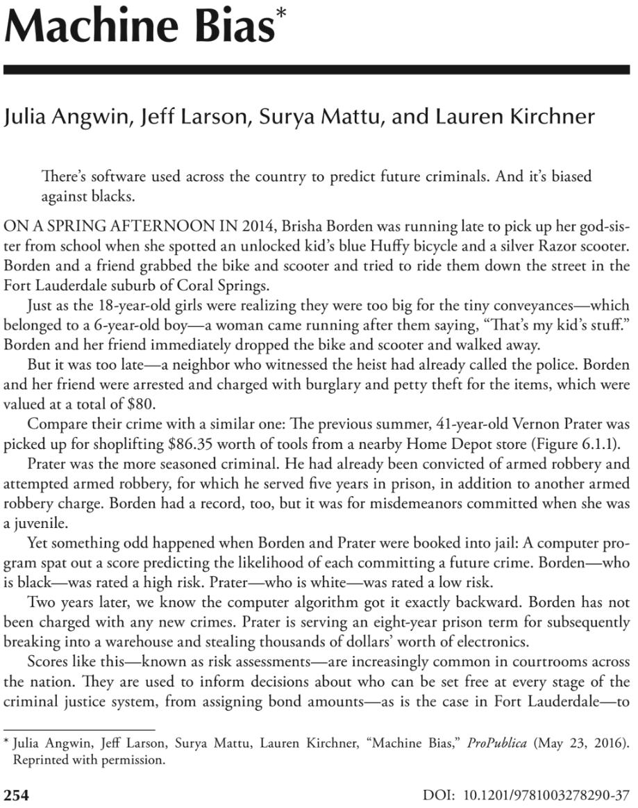
</div>
]

---
# Vorhersage der Rückfälligkeit von Straftätern

.pull-left[
## Die ProPublica und andere Untersuchungen

- Im Jahr 2016 veröffentlichte ProPublica eine Untersuchung, die zeigte, dass COMPAS **voreingenommen gegenüber Afroamerikanern** war
- **Bias:** Der Algorithmus sagte bei Afroamerikanern mit höherer Wahrscheinlichkeit falsch voraus, dass Angeklagte wieder straffällig werden würden.
- **Mangelnde Präzision:** Nur 20 % der Personen, denen Gewaltverbrechen vorhergesagt wurden, wurden tatsächlich straffällig (in einer späteren Studie wurde der Wert auf 65 % geschätzt - schlechter als eine Gruppe von Nicht-Experten)

<br><br>

`Quelle` [Dressel and Fair, 2018, Science Advances](https://www.science.org/doi/epdf/10.1126/sciadv.aao5580)
]

.pull-right[
<div align="center">
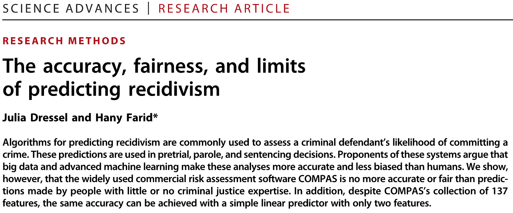
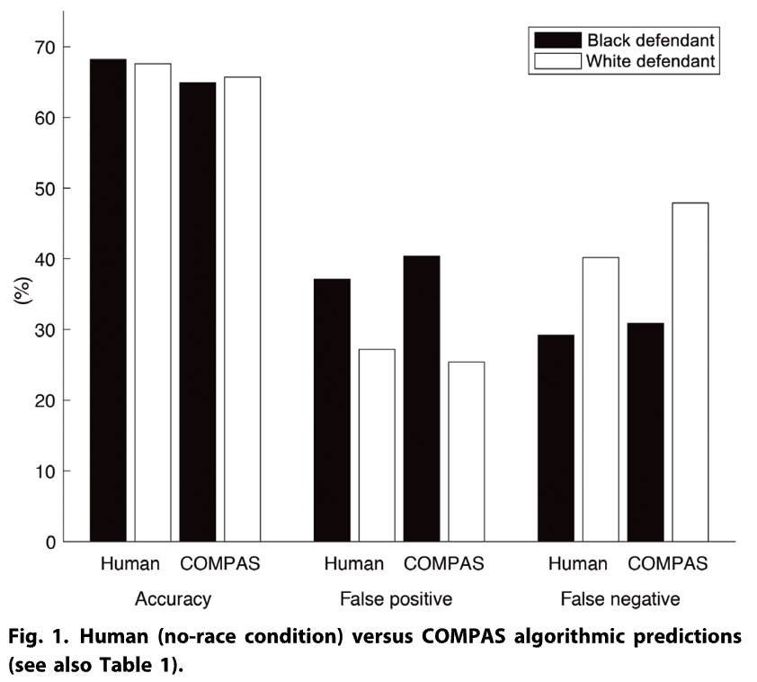
</div>
]


---
# Klassifikationsprobleme und ML-Applikationen

.pull-left-wide2[
## Klassifizierungsprobleme in freier Wildbahn

Klassifizierungsprobleme sind weit verbreitet (wahrscheinlich häufiger als Regressionsprobleme). **Beispiele:**

1. Eine Frau kommt mit einer Reihe von Symptomen in die Notaufnahme. Welche Krankheit hat sie?
2. Ein Online-Banking-Dienst muss in der Lage sein, anhand der IP-Adresse des Benutzers, seiner bisherigen Transaktionen usw. festzustellen, ob eine Transaktion betrügerisch ist oder nicht.
3. Eine Biologin möchte anhand der DNA-Sequenzdaten einer Reihe von Patienten mit und ohne eine bestimmte Krankheit herausfinden, welche DNA-Mutationen schädlich (krankheitsverursachend) sind und welche nicht.
4. Ein Moderator einer Social-Media-Plattform muss entscheiden, ob ein von einem Nutzer erstellter Beitrag als unangemessen gekennzeichnet werden soll oder nicht.
]

.pull-right-small2[
## Automatisierte Entscheidungsfindung

Entscheidungsfindungsprobleme sind oft Klassifizierungsprobleme!

Wenn automatisierte Systeme zur Entscheidungsfindung eingesetzt werden, beruhen sie häufig auf Klassifizierungsmodellen. Ob sie als rechtmäßig angesehen werden oder nicht, hängt oft entscheidend von der Leistung dieser Modelle ab.
]

---
# ML-Performanz-Benchmarking: Beispiel

<div align="center">
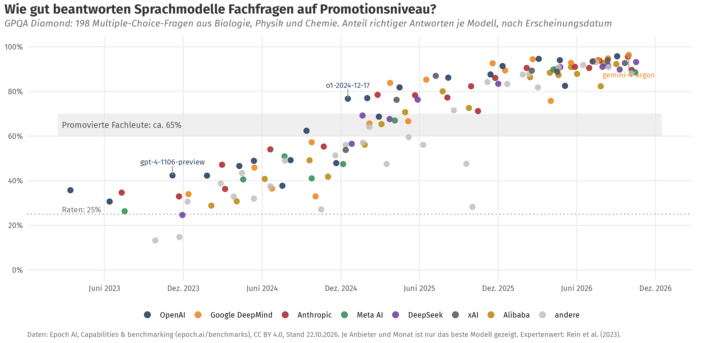
</div>

.font80[`Quelle` Eigene Darstellung nach [Epoch AI, Capabilities & benchmarking](https://epoch.ai/benchmarks) (CC BY 4.0), Stand 22.10.2026. GPQA Diamond: [Rein et al. (2023)](https://arxiv.org/abs/2311.12022).]

---
# ML-Performanz-Benchmarking: Beispiel

<div align="center">
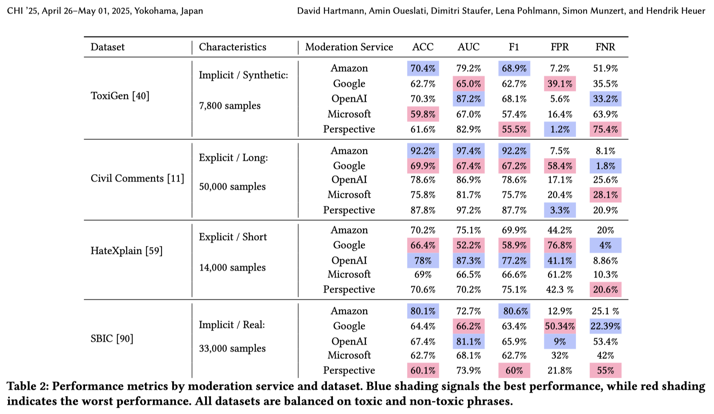
</div>

.font80[`Quelle` [Hartmann, Oueslati, Staufer, Pohlmann, Munzert und Heuer (2025): Lost in Moderation. Proceedings of the 2025 CHI Conference](https://dl.acm.org/doi/pdf/10.1145/3706598.3713998), Tabelle 2.]

---
# Bestimmung der Performanz eines binären Klassifizierers

.pull-left[
## Accuracy ("Korrektklassifizierungsrate")

- Accuracy = $\frac{\text{Anzahl der richtigen Vorhersagen}}{\text{Gesamtzahl der Vorhersagen}} = \frac{TP + TN}{TP + TN + FP + FN}$
- Falschklassifikationsrate: $1 - \text{Accuracy}$

## Nützlichkeit
- Die Accuracy ist eine einfache und intuitive Metrik.
- Sie kann jedoch irreführend sein, insbesondere in unausgewogenen Datensätzen, in denen die Klassen nicht gleichmäßig vertreten sind.
- Beispiel: In einem Datensatz mit 90% der Klasse A und 10% der Klasse B hat ein Modell, das alle Fälle als Klasse A vorhersagt, eine Genauigkeit von 90%, ist aber für die Vorhersage von Fälle der Klasse B nicht nützlich.
]

--

.pull-right[
## Beispiel

<div align="center"><br>
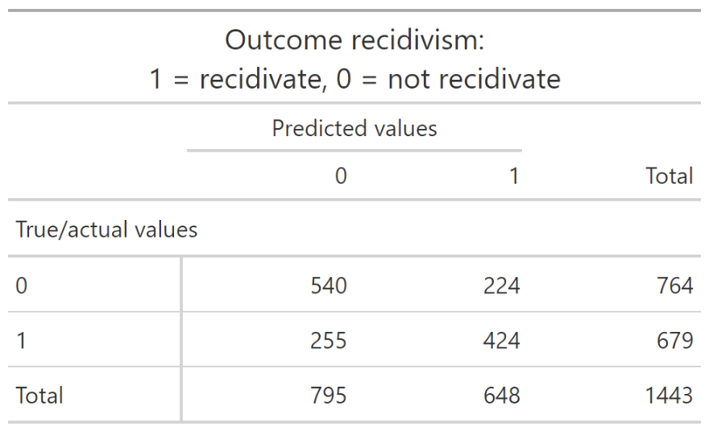
</div>

Wie hoch ist die **Accuracy** unseres Rückfall-Klassifizierers?
]

---
# Bestimmung der Performanz eines binären Klassifizierers

.pull-left[
## Präzision

- Präzision = $\frac{\text{Anzahl der echten positiven Vorhersagen}}{\text{Anzahl der positiven Vorhersagen}} = \frac{TP}{TP + FP}$

## Nützlichkeit
- Die Präzision konzentriert sich auf die Genauigkeit der positiven Vorhersagen und ist nützlich, wenn die Kosten für falsch positive Vorhersagen hoch sind.
]

--

.pull-right[
<div align="center">
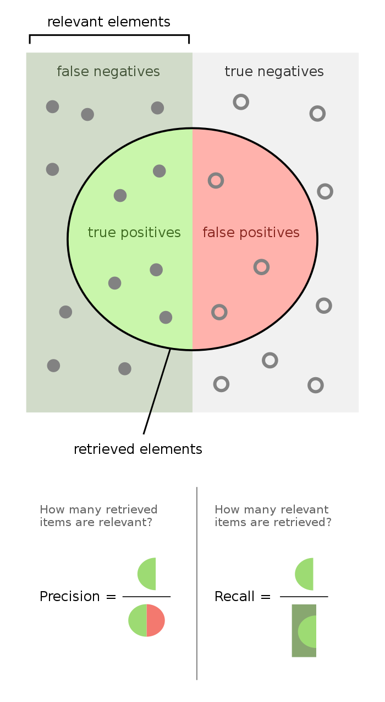
</div>
]

---
# Bestimmung der Performanz eines binären Klassifizierers

.pull-left[
## Präzision

- Präzision = $\frac{\text{Anzahl der echten positiven Vorhersagen}}{\text{Anzahl der positiven Vorhersagen}} = \frac{TP}{TP + FP}$

## Nützlichkeit
- Die Präzision konzentriert sich auf die Genauigkeit der positiven Vorhersagen und ist nützlich, wenn die Kosten für falsch positive Vorhersagen hoch sind.
]

.pull-right[
## Example

<div align="center"><br>

</div>

Wie hoch ist die **Präzision** unseres Rückfall-Klassifizierers?
]

---
# Bestimmung der Performanz eines binären Klassifizierers

.pull-left[
## Recall (Sensitivität)
- Recall = $\frac{\text{Anzahl der wahren positiven Vorhersagen}}{\text{Anzahl der wahren positiven Werte}} = \frac{TP}{TP + FN}$
- „True-Positive-Rate“

## Nützlichkeit
- Der Recall konzentriert sich auf die Erfassung aller positiven Werte und ist wichtig, wenn die Kosten für Falsch-negativ-Vorhersagen hoch sind.
- **Beispiel:** Bei einer medizinischen Diagnose ist der Recall wichtig, um sicherzustellen, dass alle Patienten mit einer Krankheit korrekt identifiziert werden.
- Das ergänzende Maß ist die Spezifität (Rate der echten Negativbefunde; z. B. wie viele gesunde Personen als nicht erkrankt identifiziert werden).
]

--

.pull-right[
<div align="center">

</div>
]

---
# Bestimmung der Performanz eines binären Klassifizierers

.pull-left[
## Recall (Sensitivität)
- Recall = $\frac{\text{Anzahl der wahren positiven Vorhersagen}}{\text{Anzahl der wahren positiven Werte}} = \frac{TP}{TP + FN}$
- „True-Positive-Rate“

## Nützlichkeit
- Der Recall konzentriert sich auf die Erfassung aller positiven Werte und ist wichtig, wenn die Kosten für Falsch-negativ-Vorhersagen hoch sind.
- **Beispiel:** Bei einer medizinischen Diagnose ist der Recall wichtig, um sicherzustellen, dass alle Patienten mit einer Krankheit korrekt identifiziert werden.
- Das ergänzende Maß ist die Spezifität (Rate der echten Negativbefunde; z. B. wie viele gesunde Personen als nicht erkrankt identifiziert werden).
]

.pull-right[
## Beispiel

<div align="center"><br>

</div>

Wie hoch ist der **Recall** unseres Rückfall-Klassifizierers?
]

---
# Bestimmung der Performanz eines binären Klassifizierers

.pull-left[

## F1-Score
- F1 score = $2 \times \frac{\text{Precision} \times \text{Recall}}{\text{Precision} + \text{Recall}} = \frac{2TP}{2TP + FP + FN}$
- Der F1-Score ist das harmonische Mittel aus Präzision und Recall.


## Nützlichkeit
- Der F1-Score berichtet eine Balance zwischen Präzision und Recall, was insbesondere dann hilfreich ist, wenn ein Ungleichgewicht zwischen den Klassen besteht.
- Der F1-Score reicht von 0 bis 1, wobei 1 für perfekte Präzision und Recall und 0 für eine schlechte Leistung steht.
]

.pull-right[
## Illustration

<div align="center"><br>
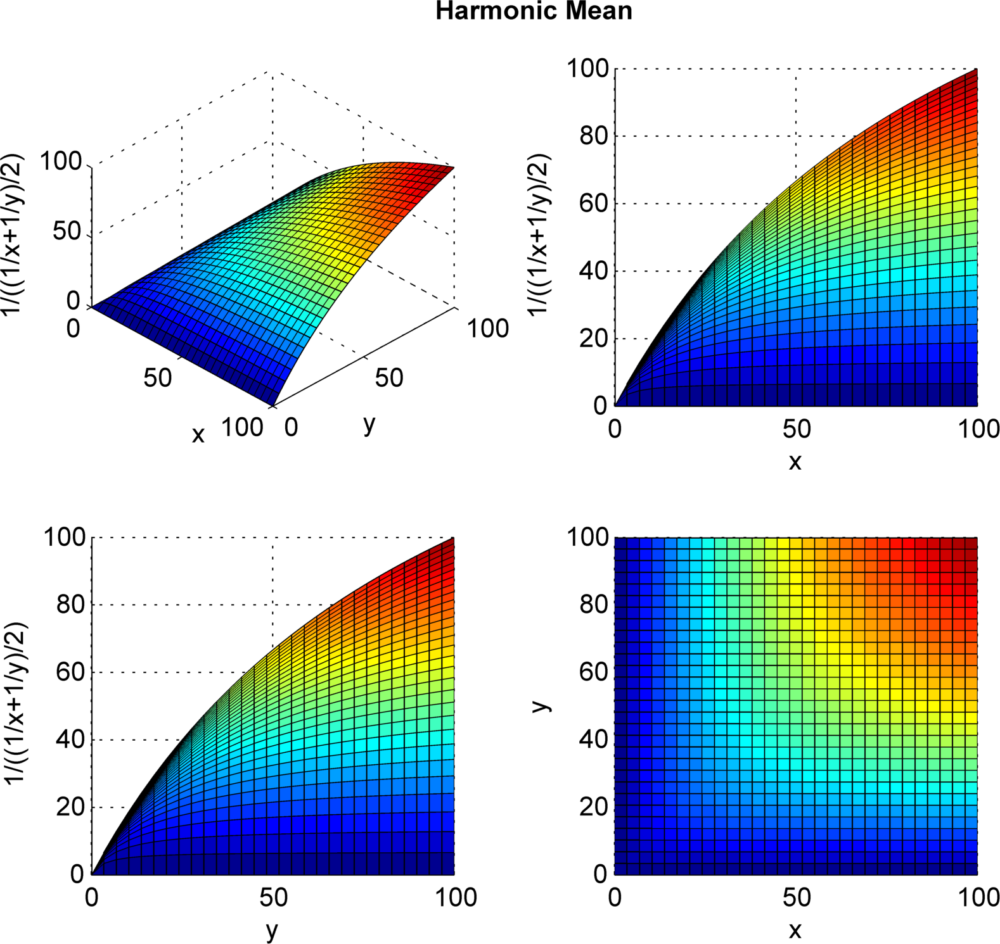
</div>

Abbildung des normalisierten harmonischen Mittels, wobei x die Präzision, y den Recall und die vertikale Achse den F1-Score in %-Punkten darstellt.

`Quelle` [Andong87](https://commons.wikimedia.org/w/index.php?curid=24020909) 
]

---
# Bestimmung der Performanz eines binären Klassifizierers

.pull-left[
## F1-Score
- F1 score = $2 \times \frac{\text{Precision} \times \text{Recall}}{\text{Precision} + \text{Recall}} = \frac{2TP}{2TP + FP + FN}$
- Der F1-Score ist das harmonische Mittel aus Präzision und Recall.


## Nützlichkeit
- Der F1-Score berichtet eine Balance zwischen Präzision und Recall, was insbesondere dann hilfreich ist, wenn ein Ungleichgewicht zwischen den Klassen besteht.
- Der F1-Score reicht von 0 bis 1, wobei 1 für perfekte Präzision und Recall und 0 für eine schlechte Leistung steht.
]

.pull-right[
## Beispiel

<div align="center"><br>

</div>

Wie hoch ist der **F1-Score** unseres Rückfall-Klassifizierers?
]

---
# Weshalb die Wahl der Metrik den Unterschied machen kann

## Szenario

- **Outcome:** Rückfälligkeit, wenn die Person rückfällig wird (1) oder nicht (0)
- **Falsch positiv (FP):** Das Modell sagt voraus, dass eine Person rückfällig wird, wenn sie es tatsächlich nicht wird. 
- **Falsch Negativ (FN):** Das Modell sagt voraus, dass eine Person nicht rückfällig wird, obwohl sie es tatsächlich wird.


## Kosten

- Was sind die nachgelagerten Kosten von FP und FN?
- FP könnte dazu führen, dass einer Person Maßnahmen auferlegt werden, die nicht notwendig wären
- FN könnte dazu führen, dass gefährdete Personen ohne angemessene Intervention entlassen werden, was möglicherweise zu erneuten Straftaten führt.
- Auf welcher Ebene fallen die Kosten an - individuell, gesellschaftlich, ...?


## Ethische und wirtschaftliche Überlegungen

- Wie sollten wir die Kosten von FP und FN abwägen?
- Was sollte in unserem Modell Vorrang haben - die Verringerung von FP, FN oder ein Kompromiss zwischen beiden?

---
# Statistiken verwenden: lessons learned

.pull-left[
## Lies, damned lies and statistics

- Politische Debatten drehen sich fast zwangsläufig auch um Statistiken
- Strategischer Anreiz, Beweise zu seinen Gunsten zu beeinflussen
- Statistische Fallstricke: Nicht alles, was logisch klingt, ist statistisch fundiert 
- Ein grundlegendes Verständnis der grundlegenden Konzepte der Statistik ist der Schlüssel zu kritischem Konsum von Daten und Statistiken
- Einige populäre Irrtümer und Fehler treten immer wieder auf - man kann trainieren, sie zu erkennen!
]

.pull-right[
<div align="center">
<br>
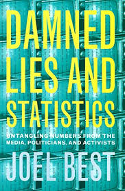
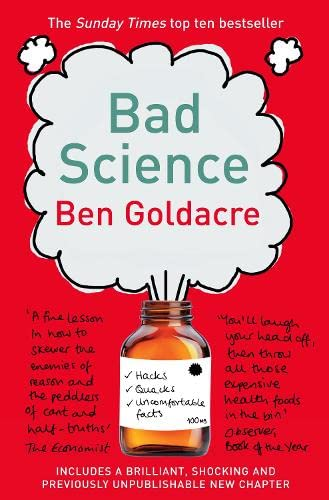

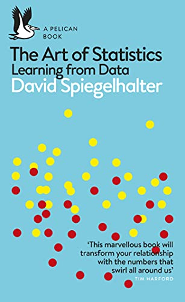

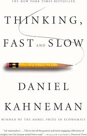
</div>
]

---
# Übung: OptiClassify

.pull-left-wide[

## "OptiClassify: Effiziente Aktenkategorisierung – Präzision, die Sie brauchen!"

Mit OptiClassify bieten wir eine KI-basierte Lösung, die **Verwaltungsakten automatisch in 5 spezifische Kategorien** einteilt. Unsere Technologie erreicht eine **statistisch signifikante Trefferquote (Accuracy) von 95%**, unterstützt durch modernste Machine-Learning-Algorithmen.

Die **Falsch-Negative-Rate liegt bei 5%**, was bedeutet, dass nur wenige Dokumente in die falsche Kategorie eingeordnet werden. Dank der **hohen Signifikanz von p < 0.01** können Sie sich auf die Zuverlässigkeit unserer Lösung verlassen, insbesondere bei großen Datenmengen.

In **Tests mit über 100.000 realen Verwaltungsakten** haben wir bewiesen, dass OptiClassify selbst in komplexen Szenarien konsistent arbeitet und den manuell erzeugten **Kategorisierungsaufwand um 75% reduziert**.

Entdecken Sie die Zukunft der Verwaltung mit OptiClassify – sparen Sie Zeit, Kosten und Ressourcen, indem Sie unsere praxiserprobte Lösung einsetzen!
]

.pull-right-small[
<div align="center">
<br>

</div>
]

---
# Übung: OptiClassify

## Mögliche Fragen

1. Auf Basis welcher Daten wurde das Tool trainiert?

    ✎ Die Qualität und Passung der Trainingsdaten ist entscheidend für die Leistung des Tools im konkreten Kontext.

2. Wie wird die Accuracy von 95% berechnet, und wie verteilt sich diese auf die einzelnen Kategorien?

    ✎ Die Accuracy könnte in einigen Kategorien viel niedriger sein.

3. Wie wirkt sich die False-Negative-Rate von 5% auf kritische Akten aus?

    ✎ Es ist wichtig zu wissen, ob Dokumente, die zwingend in eine bestimmte Kategorie gehören, zuverlässig erkannt werden.

    ✎ Bei einer großen Anzahl von Dokumenten könnten niedrige Fehlerraten zu vielen manuellen Nacharbeiten führen.
    
4. Was soll „Signifikanz von p < 0.01“ hier bedeuten?

    ✎ Signifikanz beantwortet eine andere Frage (ob ein Unterschied zufällig sein könnte), nicht, ob das Tool in Eurem Haus brauchbar ist. Hier ist es ein Marketingwort.

---
class: exercise, center, middle

# Data Detective: AnkER-Zentren

.content-box-white[
<div align="center">

</div>
]
