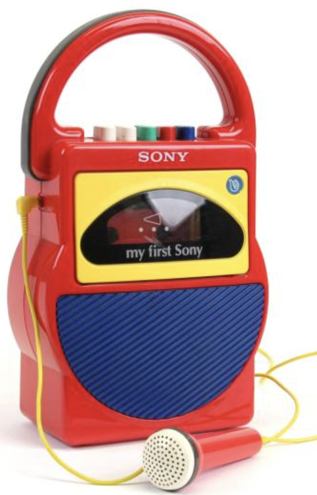

```{css, echo=FALSE} 
@media print { # print out incremental slides; see https://stackoverflow.com/questions/56373198/get-xaringan-incremental-animations-to-print-to-pdf/56374619#56374619
.has-continuation {
display: block !important;
}
}
```

```{r setup, include=FALSE}
# figures formatting setup
options(htmltools.dir.version = FALSE)
library(knitr)
opts_chunk$set(
  prompt = T,
  fig.align="center", #fig.width=6, fig.height=4.5, 
  # out.width="748px", #out.length="520.75px",
  dpi=300, #fig.path='Figs/',
  cache=T, #echo=F, warning=F, message=F
  engine.opts = list(bash = "-l")
)

## Next hook based on this SO answer: https://stackoverflow.com/a/39025054
knit_hooks$set(
  prompt = function(before, options, envir) {
    options(
      prompt = if (options$engine %in% c('sh','bash')) '$ ' else 'R> ',
      continue = if (options$engine %in% c('sh','bash')) '$ ' else '+ '
    )
  })

library(tidyverse)
library(hrbrthemes)
library(fontawesome)
library(RefManageR)

RefManageR::BibOptions(
  check.entries = FALSE,  
  bib.style = "authoryear", 
  cite.style = "authoryear", 
  style = "markdown",
  hyperlink = TRUE, 
  dashed = TRUE)

bib <-  RefManageR::ReadBib("grateful-refs.bib")


```

# Überblick

<br><br><br><br>

1. [Lessons learned, feedback](#lessonslearned)

2. [Abschlussaufgabe](#aufgabe)


<!-- ############################################ -->
---
class: inverse, center, middle
name: lessonslearned

# Lessons learned, feedback

<html><div style='float:left'></div><hr color='#EB811B' size=1px style="width:1000px; margin:auto;"/></html>


---
# Was ich Euch mitgeben wollte

.pull-left[
<br><br><br>
1. **Intuition** für Daten und Datenqualität

2. **Einblick** in das Handwerkszeug eines Data Scientists

3. **"Bullshit detection skills"** für AI-Applikationen, insbesondere bezüglich Dateninput

4. **Inspiration** für die Nutzung von Daten und die Einbindung von Data Scientists in Eurer Behörde
]

.pull-right[
<br>
<div align="center">

</div>
]


---
class: exercise, center, middle

# Abschlussrunde

.content-box-white[
**Was habt Ihr mitgenommen?**

Was sind Daten für Euch? Was ist Data Science für Euch? Was ist die wichtigste Erkenntnis, die Ihr aus den letzten drei Tagen mitnehmt?
]


---
class: exercise, center, middle

# Evaluation

.content-box-white[
**Zeit für die Evaluation!**

Bitte geht auf MyStudies und nehmt dort an der Evaluation teil. Ich bin sind sehr dankbar für Euer Feedback!
]


<!-- ############################################ -->
---
class: inverse, center, middle
name: aufgabe

# Abschlussaufgabe

<html><div style='float:left'></div><hr color='#EB811B' size=1px style="width:1000px; margin:auto;"/></html>


---
# Abschlussaufgabe: zwei Optionen

.pull-left[
## Option 1: Der Daten-Podcast

- Eine Podcast-Aufnahme **zu zweit oder zu dritt**, schwerpunktmäßig zu **zwei Themen, die Kern des Kurses waren**.
- Länge: maximal **20 Minuten** (2 Personen) bzw. **30 Minuten** (3 Personen).
- Einzureichen: **Audiodatei, Transkript und Shownotes**.
- Inhaltliche Bausteine und technische Hinweise auf den nächsten Folien.
]

.pull-right[
## Option 2: Daten-Literacy-Training

- Ein Trainingskonzept **für die eigene Behörde**, ebenfalls zu zweit oder zu dritt.
- Thema aus dem Kurs, das in Eurem Haus einen Unterschied machen würde.
- Einzureichen: **One-Pager** (Konzept) und **Foliendeck** (8 bis 12 Folien).
- Weitere Hinweise auf den nächsten Folien.
]

<br>

️✎ **Für beide Optionen gilt:** 50% der Modulnote. Abgabe bis **23. November 2026** über Moodle, ein Upload pro Team. Details im Syllabus.


---
# Option 1: Der Daten-Podcast

.pull-left-vwide[

Erstellt gemeinsam mit einer oder zwei weiteren Kursteilnehmenden eine Podcast-Aufnahme, die mindestens 2 der 3 folgenden Elemente beinhaltet.

1. **Einblick in einen Daten-Use-Case aus Eurer Behörde**: Stellt einen interessanten Fall aus Eurer Arbeit vor, bei dem Daten eine zentrale Rolle spielen – z.B. ein innovatives Projekt, ein internes Verfahren, etc. Das kann ein Best- oder Worst-Practice-Beispiel sein (oder etwas dazwischen). Geht dabei auch auf Konzepte aus dem Kurs ein, z.B. Datenqualität, Schnittstellen, Weiternutzung, etc.

2. **Daten-Fail der Woche**: Bringt einen aktuellen Nachrichtenartikel, Blogbeitrag oder Social-Media-Post mit, in dem eine problematische oder missverständliche Datennutzung beschrieben wird (kann, muss aber nicht KI-bezogen sein). Diskutiert gemeinsam, was schiefgelaufen ist und was man daraus für den Umgang mit Daten lernen kann. Als Inspiration kann der Podcast *More or Less: Behind the Stats* dienen.

3.  **Blick in die Zukunft**: Diskutiert Eure Vision für den zukünftigen Umgang mit Daten in Eurer Behörde oder Einheit.
]

.pull-right-vsmall[
<br>
<div align="center">

</div>
<br>
<div align="center">

</div>
]


---
# Option 1: Technische Hinweise

.pull-left-vwide[
## Tonaufnahme

- Schafft Euch bitte kein extra Equipment an. Ein Smartphone oder Laptop reicht aus. (Falls Ihr sowieso mit dem Gedanken spielt: Einfache, günstige Geräte wie [dieses hier](https://www.amazon.de/gp/product/B08CVP2HXP/) funktionieren gut und machen auch Videocalls für die Gegenüber potentiell angenehmer.)
- Nutzt eine App wie [Voice Memos](https://apps.apple.com/us/app/voice-memos/id1069512134) (iOS), [Voice Recorder](https://play.google.com/store/apps/details?id=com.media.bestrecorder.audiorecorder) (Android) oder [Audacity](https://www.audacity.de/) (Windows, Mac, Linux). Nehmt am besten redundant auf, also mit zwei Geräten.
- Nutzt die Aufnahmefunktion von [Zoom](https://www.heise.de/tipps-tricks/Zoom-Meeting-aufzeichnen-so-geht-s-4690035.html), [Teams](https://support.microsoft.com/de-de/office/aufzeichnen-einer-besprechung-in-microsoft-teams-34dfbe7f-b07d-4a27-b4c6-de62f1348c24), etc.
- Nutzt Kopfhörer, um Rückkopplungen zu vermeiden.

## KI-Einsatz

- **Selbst einsprechen ist Pflicht.** KI-generierte Audio-Podcasts (NotebookLM, ElevenLabs o.Ä.) sind nicht erlaubt.
- KI-Unterstützung bei der Skript- oder Fragenentwicklung ist in Ordnung. Prüft die Inhalte aber genau: Ihr steht mit Eurer Stimme dafür.
]

.pull-right-vsmall[
<br>
<div align="center">

</div>
]

---
# Option 1: Technische Hinweise

.pull-left-vwide[
## Länge und Gruppen

**Länge der Aufnahme: Maximal 20 Minuten.** Es sind auch Aufnahmen einer dreiköpfigen Gruppe möglich (dann Länge max. 30 Minuten).

**Team-Bildung (für beide Optionen):** Wenn Ihr Euch schon als Team zusammengefunden habt, teilt mir das bitte bis **Montag, 2. November, 18 Uhr** mit, zusammen mit Eurer gewählten Option. Alle anderen Teams stelle ich zusammen.


## Schnitt/Zusammenführung/Format

- Ich erwarte keine aufwändige Postproduktion. Es reicht, wenn Ihr die Aufnahme am Anfang und am Ende kürzt und die beiden Teile zusammenfügt (wenn nicht sowieso durch Aufnahme mit einem Gerät erledigt).
- Als Format der Aufnahme wählt bitte `mp3` oder `m4a`. Dazu ein **Transkript** (automatisch erzeugt reicht, z.B. mit Word, Teams oder Whisper) und **Shownotes** mit den besprochenen Quellen.
]

.pull-right-vsmall[
<br>
<div align="center">

</div>
]


---
# Option 2: Daten-Literacy-Training für die eigene Behörde

.pull-left[
.font90[
## Die Aufgabe

- Wählt **ein Thema aus dem Kurs**, das in Eurem Haus einen Unterschied machen würde: Datenqualität, Schnittstellen, Statistiken richtig lesen, Visualisierung, KI-Werkzeuge im Arbeitsalltag.
- Konzipiert dazu ein **kurzes Training für eine konkrete Zielgruppe** in Eurer Behörde.
- Bearbeitung wie beim Podcast **zu zweit oder zu dritt**.

## Worauf ich achte

- Der Einstieg macht klar, **warum das Thema für die Zielgruppe relevant** ist, am besten an einem Beispiel aus Eurem Haus.
- Mindestens **ein aktivierendes Element**: Übung, Diskussionsfrage, Beispieldatensatz oder Quiz.
- Konzepte aus dem Kurs sind **in die Sprache der Zielgruppe übersetzt**.
]
]

.pull-right[
.font90[
## Abzugeben sind zwei Dinge

**1. Ein One-Pager**, der das Training auf einer Seite beschreibt:

- **Was** Ihr anbietet: Thema, Lernziele, Format und Dauer
- **Für wen** es gedacht ist: Zielgruppe und deren Vorwissen
- **Von wem** es durchgeführt wird, samt dem, was es an Vorbereitung, Technik und Daten braucht

**2. Ein Foliendeck** für eine kurze Session mit **etwa acht bis zwölf Folien**.
]
]


---
# Option 2: Hinweise zur Umsetzung

.pull-left[
## KI-Einsatz

- **Erlaubt**, für Konzept, Text und Folien.
- Das Ergebnis muss aber **aus einem Guss** sein: eine Sprache, eine Logik, ein Format, nicht fünf zusammengeklebte Antworten.
- Und es sollte **auf Eure Zielgruppe passen**.


## Eigene Beispiele

- Bitte **keine Beispiele unverändert aus dem Kurs übernehmen**.
- Nutzt am besten **eigene Beispiele aus Eurem Haus**: ein Datensatz, eine Statistik, ein Dashboard, ein Formular, das Eure Zielgruppe kennt. Inspiriert vom Kurs darf es natürlich sein.
]

.pull-right[

️✎ Bewertet wird nicht die Folienästhetik, sondern ob das Training bei Eurer Zielgruppe ankommen würde.
]


