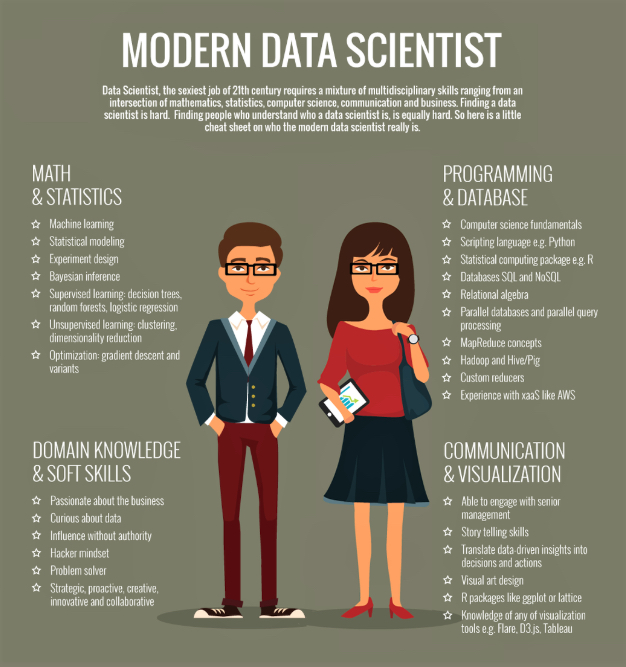
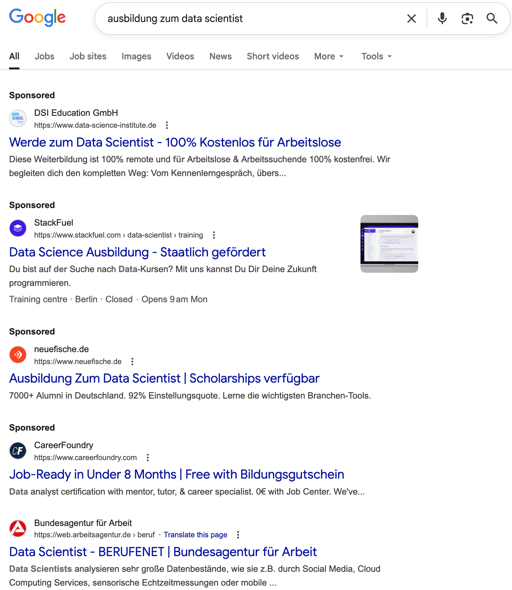
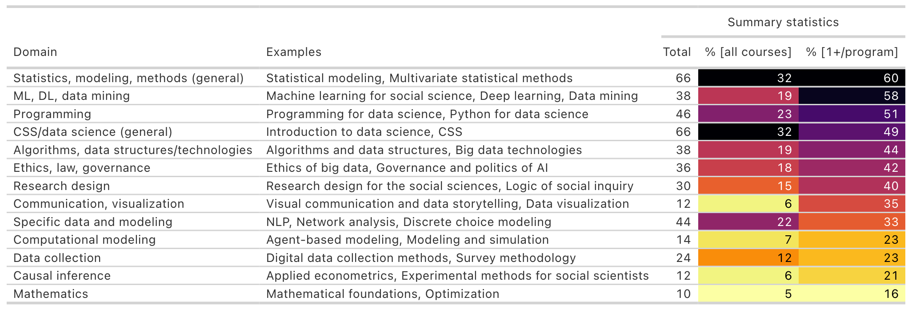
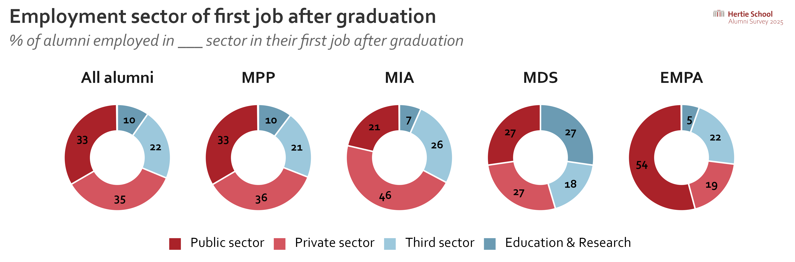
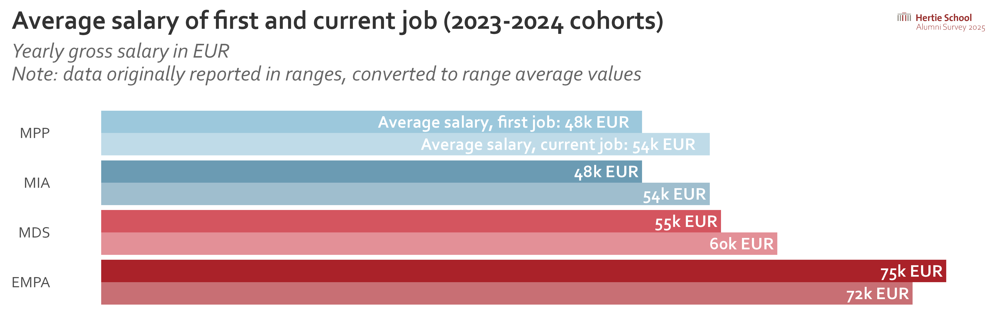
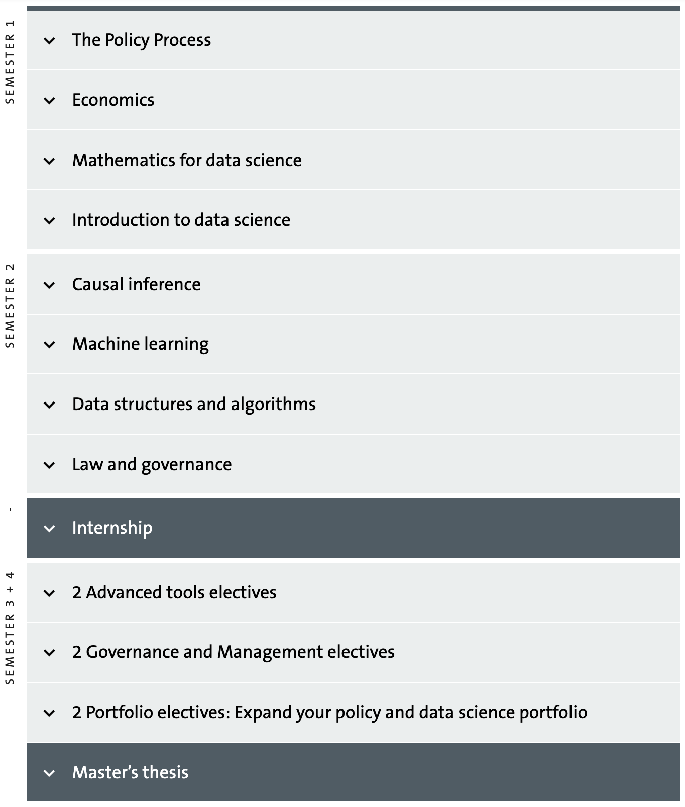
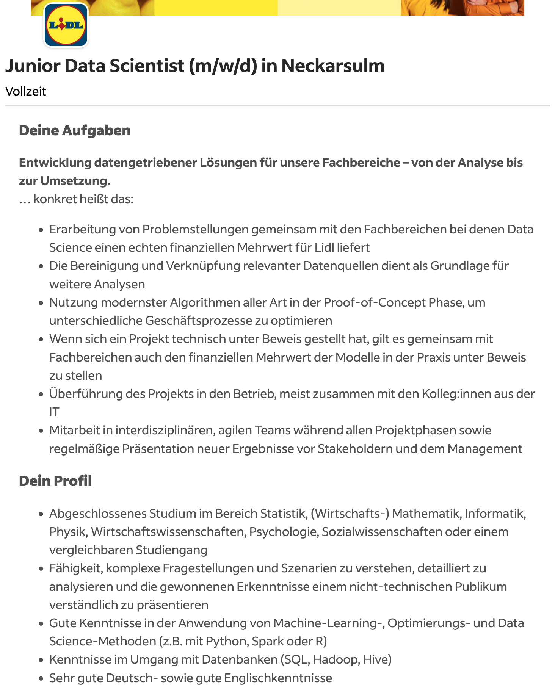
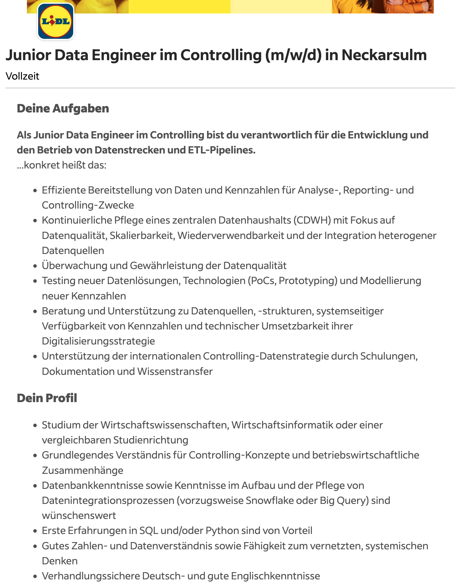
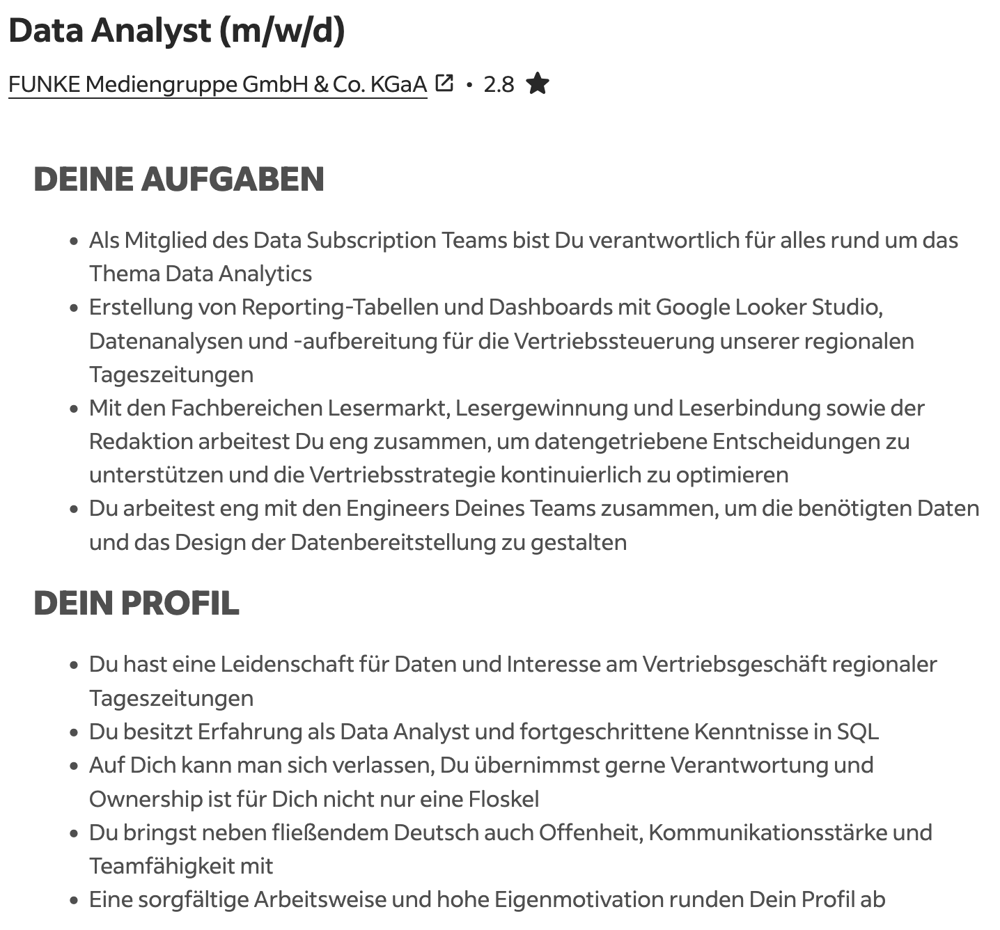

```{css, echo=FALSE} 
@media print { # print out incremental slides; see https://stackoverflow.com/questions/56373198/get-xaringan-incremental-animations-to-print-to-pdf/56374619#56374619
.has-continuation {
display: block !important;
}
}
```

```{r setup, include=FALSE}
# figures formatting setup
options(htmltools.dir.version = FALSE)
library(knitr)
opts_chunk$set(
  prompt = T,
  fig.align="center", #fig.width=6, fig.height=4.5, 
  # out.width="748px", #out.length="520.75px",
  dpi=300, #fig.path='Figs/',
  cache=T, #echo=F, warning=F, message=F
  engine.opts = list(bash = "-l")
)

## Next hook based on this SO answer: https://stackoverflow.com/a/39025054
knit_hooks$set(
  prompt = function(before, options, envir) {
    options(
      prompt = if (options$engine %in% c('sh','bash')) '$ ' else 'R> ',
      continue = if (options$engine %in% c('sh','bash')) '$ ' else '+ '
    )
  })

library(tidyverse)
library(hrbrthemes)
library(fontawesome)
library(RefManageR)

RefManageR::BibOptions(
  check.entries = FALSE,  
  bib.style = "authoryear", 
  cite.style = "authoryear", 
  style = "markdown",
  hyperlink = TRUE, 
  dashed = TRUE)

bib <-  RefManageR::ReadBib("grateful-refs.bib")


```


# Überblick

<br>

1. [Data Science in der Ausbildung](#training)

2. [Data Science als Beruf](#job)

3. [Rekrutierung und Bindung von Data Scientists in Behörden](#recruitment)


---
class: inverse, center, middle
name: training

# Data Science in der Ausbildung
<html><div style='float:left'></div><hr color='#EB811B' size=1px style="width:1000px; margin:auto;"/></html>


---
# Lern- und Berufsfeld Data Science

.pull-left[
## Berufsbilder im Bereich Data Science sind vielfältig

Data Scientist, Data Analyst, Data Engineer, Machine Learning Engineer, AI Researcher, Business Intelligence Analyst, Data Governance Specialist, Data Privacy Specialist, Data Visualization Specialist

## Ausbildung

- Immer mehr strukturierte Data-Science-Programme; Quereinstieg aus technischen Programmen
- Autodidaktische Lernwege zunehmend unrealistisch; Online-Kurse i.d.R. nicht ausreichend
- **Das Einhorn** "Umfassend ausgebildeter Data Scientist" (siehe rechts) **ist eine Illusion**
]

.pull-right-center[
<div align="center">

</div>
.font80[`Credit` Marketing Distillery (2014), „The Modern Data Scientist“]
]


---
# Lern- und Berufsfeld Data Science

.pull-left[
## Berufsbilder im Bereich Data Science sind vielfältig

Data Scientist, Data Analyst, Data Engineer, Machine Learning Engineer, AI Researcher, Business Intelligence Analyst, Data Governance Specialist, Data Privacy Specialist, Data Visualization Specialist

## Ausbildung

- Immer mehr strukturierte Data-Science-Programme; Quereinstieg aus technischen Programmen
- Autodidaktische Lernwege zunehmend unrealistisch; Online-Kurse i.d.R. nicht ausreichend
- **Der Weiterbildungsmarkt verspricht das Einhorn trotzdem** (siehe rechts): "Job-Ready in Under 8 Months", "100% kostenlos für Arbeitslose". Zertifikate ersetzen keine Praxis.
]

.pull-right-center[
<div align="center">

</div>
.font80[`Quelle` Google-Suche „ausbildung zum data scientist“]
]


---
# Schwerpunkte in der Ausbildung: CSS-Master-Programme

<div align="center">

</div>

`Quelle` Eigene Datenerhebung (April 2024), CSS-Master-Programme in Europa und USA


---
# Beispiel: Master of Data Science for Public Policy

.pull-left[
## Hertie School Master of Data Science for Public Policy

- Interdisziplinäres Curriculum: Data Science, Policy, Governance, Leadership
- Hintergründe: Sozialwissenschaften, Informatik, Ingenieurswissenschaften, Mathematik, ...

<div align="center">


</div>
.font80[`Quelle` Hertie School Alumni Survey 2025, Jahrgänge 2023/24]
]

.pull-right[
<div align="center">

</div>
.font80[`Quelle` [Hertie School, MDS-Curriculum](https://www.hertie-school.org/en/mds)]
]


---
class: inverse, center, middle
name: job

# Data Science als Beruf
<html><div style='float:left'></div><hr color='#EB811B' size=1px style="width:1000px; margin:auto;"/></html>


---
# Berufsprofile im Vergleich

<table style="width:100%; table-layout:fixed; border-collapse:collapse; font-size:12px; line-height:1.25;">
  <caption style="caption-side:bottom; font-size:10px; text-align:left; padding-top:6px;">
    Gehälter: Deutschland, brutto/Jahr, Vollzeit, alle Erfahrungsstufen. Ø = Durchschnitt selbstberichteter Gehälter bei <a href="https://www.kununu.com/de/gehalt" target="_blank">kununu</a> (2026, je rund 2.600 bis 2.750 Angaben); Median und Quartile von <a href="https://www.gehalt.de/" target="_blank">gehalt.de</a> (2026). Öffentlicher Dienst (TVöD/TV-L, meist E 13 bis E 14) liegt eher 10 bis 25% darunter. Spalte „Was KI verändert“: eigene Einschätzung; Hintergrund: 84% der Entwickler nutzen oder planen KI-Werkzeuge, 51% täglich (<a href="https://survey.stackoverflow.co/2025/ai" target="_blank">Stack Overflow Developer Survey 2025</a>).
  </caption>
  <thead>
    <tr>
      <th style="border:1px solid #ccc; padding:6px; text-align:left; width:12%;">Rolle</th>
      <th style="border:1px solid #ccc; padding:6px; text-align:left; width:15%;">Typischer Hintergrund</th>
      <th style="border:1px solid #ccc; padding:6px; text-align:left; width:17%;">Kernfähigkeiten</th>
      <th style="border:1px solid #ccc; padding:6px; text-align:left; width:15%;">Typische Tools</th>
      <th style="border:1px solid #ccc; padding:6px; text-align:left; width:24%;">Was KI an der Rolle verändert</th>
      <th style="border:1px solid #ccc; padding:6px; text-align:left;">Gehalt (DE, 2026)</th>
    </tr>
  </thead>
  <tbody>
    <tr>
      <td style="border:1px solid #ccc; padding:6px; vertical-align:top;">Data Analyst</td>
      <td style="border:1px solid #ccc; padding:6px; vertical-align:top;">BWL/VWL, Sozialwissenschaften, Statistik</td>
      <td style="border:1px solid #ccc; padding:6px; vertical-align:top;">Exploration, Reporting, Kennzahlen, Datenerhebung, Ergebnisse erklären</td>
      <td style="border:1px solid #ccc; padding:6px; vertical-align:top;">Excel, SQL, Power BI/Tableau, R/Python (grundlegend)</td>
      <td style="border:1px solid #ccc; padding:6px; vertical-align:top;">Standardauswertungen und Diagramme entstehen per Sprachbefehl. Wert verschiebt sich zu Fragestellung, Prüfung und Einordnung</td>
      <td style="border:1px solid #ccc; padding:6px; vertical-align:top;"><a href="https://www.kununu.com/de/gehalt/data-analyst-4689" target="_blank">58.800 €</a> (Ø; typisch 51.600 bis 61.200 €)</td>
    </tr>
    <tr>
      <td style="border:1px solid #ccc; padding:6px; vertical-align:top;">Data Scientist</td>
      <td style="border:1px solid #ccc; padding:6px; vertical-align:top;">Statistik, Informatik, Mathematik, quantitative Sozial- oder Wirtschaftswissenschaften</td>
      <td style="border:1px solid #ccc; padding:6px; vertical-align:top;">Statistik, ML, Experimentdesign, Validierung, Storytelling</td>
      <td style="border:1px solid #ccc; padding:6px; vertical-align:top;">Python (pandas, scikit-learn), R, SQL, Git</td>
      <td style="border:1px solid #ccc; padding:6px; vertical-align:top;">Modellcode wird generiert; Validierung, Kausalität und Kommunikation bleiben menschliche Arbeit</td>
      <td style="border:1px solid #ccc; padding:6px; vertical-align:top;"><a href="https://www.kununu.com/de/gehalt/data-scientist-973" target="_blank">68.300 €</a> (Ø; typisch 59.200 bis 69.400 €)</td>
    </tr>
    <tr>
      <td style="border:1px solid #ccc; padding:6px; vertical-align:top;">Data Engineer</td>
      <td style="border:1px solid #ccc; padding:6px; vertical-align:top;">Informatik, Informationssysteme</td>
      <td style="border:1px solid #ccc; padding:6px; vertical-align:top;">Datenmodellierung, Pipelines, Schnittstellen, Datenqualität</td>
      <td style="border:1px solid #ccc; padding:6px; vertical-align:top;">SQL, Python, dbt, Airflow, Spark, Cloud</td>
      <td style="border:1px solid #ccc; padding:6px; vertical-align:top;">Pipelines sind schneller gebaut; zentral werden Datenverträge, Qualität und Betrieb</td>
      <td style="border:1px solid #ccc; padding:6px; vertical-align:top;"><a href="https://www.gehalt.de/beruf/data-engineer" target="_blank">72.500 €</a> (Median; Quartile 64.300 bis 81.800 €)</td>
    </tr>
    <tr>
      <td style="border:1px solid #ccc; padding:6px; vertical-align:top;">AI / ML Engineer</td>
      <td style="border:1px solid #ccc; padding:6px; vertical-align:top;">Informatik, Software Engineering mit ML-Kenntnissen</td>
      <td style="border:1px solid #ccc; padding:6px; vertical-align:top;">Modelle und LLM-Anwendungen bauen, evaluieren, absichern, betreiben</td>
      <td style="border:1px solid #ccc; padding:6px; vertical-align:top;">PyTorch, LLM-APIs, RAG-Frameworks, Docker, MLOps-Tools</td>
      <td style="border:1px solid #ccc; padding:6px; vertical-align:top;">Neues Profil: weniger eigene Modelle trainieren, mehr Sprachmodelle anbinden, prüfen (Evaluation, Guardrails) und in Fachverfahren integrieren</td>
      <td style="border:1px solid #ccc; padding:6px; vertical-align:top;"><a href="https://www.gehalt.de/beruf/ki-entwickler-artificial-intelligence-developer" target="_blank">69.800 €</a> (Median; Quartile 62.600 bis 77.900 €)</td>
    </tr>
    <tr>
      <td style="border:1px solid #ccc; padding:6px; vertical-align:top;">Data Steward / Data Governance</td>
      <td style="border:1px solid #ccc; padding:6px; vertical-align:top;">Verwaltung, Wirtschaftsinformatik, Recht/Compliance</td>
      <td style="border:1px solid #ccc; padding:6px; vertical-align:top;">Datenkataloge, Metadaten, Qualitätsregeln, Zweckbindung, Freigaben</td>
      <td style="border:1px solid #ccc; padding:6px; vertical-align:top;">Datenkatalog-Tools, DSGVO-Werkzeuge, SQL (lesen)</td>
      <td style="border:1px solid #ccc; padding:6px; vertical-align:top;">Wird wichtiger: Welche Daten dürfen in welches KI-System? Wer verantwortet Qualität und Herkunft?</td>
      <td style="border:1px solid #ccc; padding:6px; vertical-align:top;"><a href="https://www.gehalt.de/beruf/data-steward" target="_blank">63.300 €</a> (Median; Quartile 55.900 bis 71.700 €)</td>
    </tr>
  </tbody>
</table>


---
# Beispiel Berufsbild Data Scientist (von indeed.com)

<div align="center">

</div>

.font80[`Quelle` [indeed.com](https://de.indeed.com/), Screenshot einer Stellenanzeige (2025)]


---
# Beispiel Berufsbild Data Engineer (von indeed.com)

<div align="center">

</div>

.font80[`Quelle` [indeed.com](https://de.indeed.com/), Screenshot einer Stellenanzeige (2025)]


---
# Beispiel Berufsbild Data Analyst (von indeed.com)

<div align="center">

</div>

.font80[`Quelle` [indeed.com](https://de.indeed.com/), Screenshot einer Stellenanzeige (2025)]


---
class: inverse, center, middle
name: recruitment

# Rekrutierung und Bindung von Data Scientists
<html><div style='float:left'></div><hr color='#EB811B' size=1px style="width:1000px; margin:auto;"/></html>


---
# Rekrutierung von Data Scientists in Behörden

.pull-left[
<br>
## Herausforderungen

- Hohe Konkurrenz durch Privatwirtschaft und Forschung  
- Eingeschränkte Gehaltsbänder (TVöD/TV-L)  
- Langwierige Bewerbungsprozesse, geringe Flexibilität  
- Unklare Rollenbilder und Karrierepfade  
- Technische Infrastruktur und Datenzugänge  
]

.pull-right[
<br>
<div align="center">

</div>
.font80[`Credit` [Carl Steinbeisser, Wikimedia Commons](https://commons.wikimedia.org/wiki/File:Stempelkarussel.JPG), gemeinfrei]
]

---

# Strategien zur Gewinnung von Data Scientists

.pull-left[
## 1. Attraktivität des Umfelds betonen  
- **Sinnstiftung**: Arbeiten für das Gemeinwohl  
- **Interdisziplinarität**: Schnittstelle zwischen Technik, Gesellschaft, Politik  
- Perspektive **Public Data Career**

## 2. Strukturelle Hürden abbauen  
- Schnellere Verfahren, weniger Formalismus  
- Einstiegsprogramme, duale Pfade (z.B. Trainee, Fellowship)  
- Möglichkeiten für Teilzeit, Remote, flexible Tools  
]

.pull-right[
## 3. Employer Branding  
- Sichtbarkeit auf Tech- und Data-Plattformen (z.B. Kaggle, GitHub)  
- Authentische Team-Vorstellungen (Blog, Konferenzen)  
- Kooperationen mit Hochschulen und Weiterbildungsanbietern  

## 4. Passende Profile suchen  
- Kombination aus **Analytik-** und **Verwaltungskompetenz**  
- Offenheit für Quereinsteiger:innen mit Lernbereitschaft  
- Fokus auf **Team-Komplementarität**, nicht nur Einzelstars  
]

---

# Bindung und Weiterentwicklung von Data Scientists

.pull-left[
## 1. Fachliche Entwicklung fördern  
- Zeit und Budget für Fortbildungen, Konferenzen, Communities  
- Interne Austauschformate, z.B. "Data Fridays" oder Brownbag Talks  

## 2. Karrierepfade schaffen  
- Transparente Beförderungskriterien für Data-Rollen  
- Anerkennung von Impact statt Hierarchie  

## 3. Gute Führungskultur  
- Verständnis für datengetriebene Arbeit im Management  
- Vertrauen, Experimentierfreude, Fehlerkultur  
]

.pull-right[
## 4. Moderne Arbeitsbedingungen  
- Aktuelle Hardware, Cloudzugänge, Entwicklungsumgebungen  
- Austausch mit externen Communities  
- Flexible Arbeitszeiten und Remote-Arbeit

<br><br>
## Zukunftsbild
Eine Verwaltung, die **Datenkompetenz als zentrale Fähigkeit** versteht –
nicht nur für Spezialist:innen, sondern als Teil moderner Governance.  
]


---
class: exercise, center, middle

# Übung

.content-box-white[
**Stellenausschreibungs-Kritik [service.bund.de](https://www.service.bund.de/Content/DE/Stellen/Suche/Formular.html)**

<div align="left">Neun Ausschreibungen aus Bundes- und Landesbehörden liegen als PDF im Kursordner <tt>übungsmaterialien/ausschreibungen-service-bund-de/</tt>.</div>

<div align="left">
<ol>
  <li>Teams von jeweils 3 Personen</li>
  <li>Eine Ausschreibung pro Team</li>
  <li>Diskussion: 
    <ul>
      <li>Welche Rolle wird gesucht?</li>
      <li>Welche Anforderungen werden gestellt?</li>
      <li>Welche Tools/Skills werden erwartet?</li>
      <li>Was fehlt? Was ist gut?</li>
      <li>Wie könnte die Anzeige verbessert werden?</li>
    </ul>
  </li>
  <li>15 Minuten, dann gemeinsame Diskussion </li>
</ol>
</div>
]
